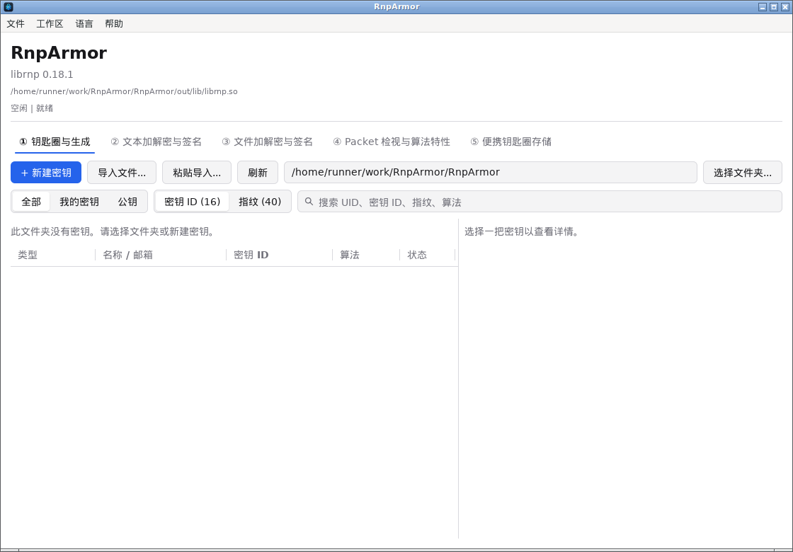
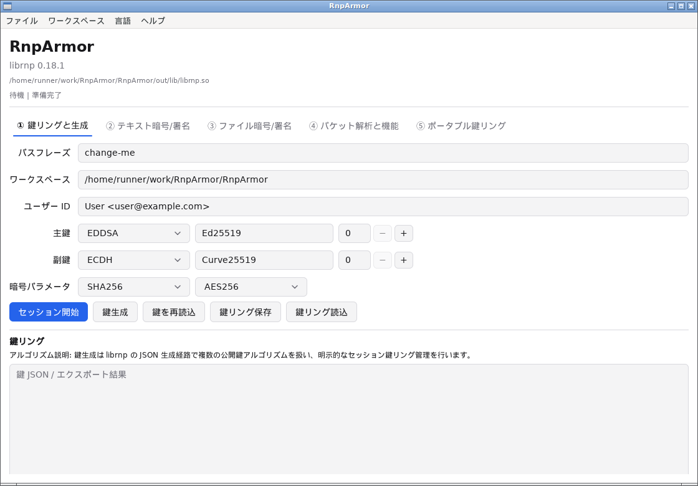

# RnpArmor

English | [简体中文](README.zh-CN.md)

<p></p>

RnpArmor is a MyGo-native OpenPGP GUI powered by `librnp v0.18.1`, delivering Windows 10/11 portable & installer builds (`rnparmor.exe` + `rnp.dll`), macOS Apple Silicon (`arm64`) `.app`/`.dmg` bundles, and Linux (`amd64`) portable builds/tests.

> **User Guide**: See [User Guide (`docs/USER_GUIDE.md`)](docs/USER_GUIDE.md) for installation, checksum verification, step-by-step usage of all 5 workspaces, and troubleshooting.
>
> License: **Apache License, Version 2.0** ([`LICENSE`](LICENSE)). Third-party notices and license texts are included in [`third_party/NOTICES.md`](third_party/NOTICES.md) and distributed bundles (`LICENSE` and `licenses/` on Windows and Linux; `RnpArmor.app/Contents/Resources/LICENSE` and `licenses/` on macOS).

## Screenshots

Linux runtime main-window screenshot (`1120×780`, native `File / Workspace / Language / Help` menu bar, `librnp 0.18.1`), captured via [`.github/workflows/linux-screenshot.yml`](.github/workflows/linux-screenshot.yml) and [`scripts/capture-linux-screenshots.sh`](scripts/capture-linux-screenshots.sh):


<details>
<summary>Simplified Chinese UI screenshot</summary>



</details>

<details>
<summary>Japanese UI screenshot</summary>



</details>

## Highlights

1. **MyGo native GUI with 5 workspaces + native 4-group tri-lingual menu bar + standalone About window**
   - Workspace tabs:
     - Keys & generation (master-detail key manager)
     - Text encrypt/decrypt/sign/verify
     - File encrypt/decrypt/sign/verify
     - Packet inspection & feature matrix
     - Portable keyring storage
   - Built-in zero-dependency UI dictionary at `cmd/rnparmor/i18n.go`.
   - Application icon (`assets/icons/rnparmor-256.png` embedded via `assets/icons/icons.go`) applied at runtime to the main window and child windows (**About**, **New Key**, **Import Key Text**) via `w.SetIcon(...)`, and on macOS via `mygo.App.Dock.SetIcon(...)`.
   - Native top menu bar with 4 tri-lingual groups (`File` / `Workspace` / `Language` / `Help`):
     - `File`: Choose Folder..., Open session, Load keyring, Save keyring, Quit.
     - `Workspace`: 5 radio items synchronized bi-directionally with the workspace tabs.
     - `Language`: radio items (`English`, `中文`, `日本語`) that switch and re-render the menu bar, main window, and open child windows (**About**, **New Key**, **Import Key Text**) live.
     - `Help`: opens the standalone About child window (`About`).
   - Language preset by `--lang en|zh|ja`, `RNPARMOR_LANG`, or system `LANG`.
   - **Standalone menu-less non-modal About child window (`580×520`)**:
     - Single-instance focused, fixed-size, no menu bar (`SetMenu(nil)` on non-macOS), includes a `Close` button.
     - Closing the About window leaves the main window unaffected; closing the main window closes **About**, **New Key**, and **Import Key Text** automatically; switching language updates window titles and content live.
     - Shows Application Version (`appVersion`, e.g., `v0.0.3` or `dev`), Author (`r404r (https://github.com/r404r)`), Repository URL (`https://github.com/r404r/RnpArmor`), RNP upstream (`https://github.com/rnpgp/rnp` + current `librnp` version), Local library path (`rnp.dll` / `librnp.so`), Keyring directory (`portable workspace` + `pubring.gpg`/`secring.gpg` existence), and UI Framework & Runtime (`MyGo` / `purego` / `Botan` versions).

2. **Expanded RNP feature surface in `internal/rnp`**
   - Key iteration/location (with nested `Subkeys` on primary key summaries), key import (`ImportKeys`), public/secret/revocation export (`ExportRevocation`), key-to-JSON, and delete.
   - Public-only & optional-passphrase read-only sessions (`OpenOptionalPass`), plus public-only `pubring.gpg` save/load without creating empty `secring.gpg`.
   - JSON-driven key generation (`rnp_generate_key_json`) with multiple algorithm families and optional expiration.
   - Text operations: encrypt/decrypt, clearsign/detached/inline sign/verify.
   - File operations with option-rich APIs.
   - Packet dump (text/JSON) and feature querying (`rnp_supported_features`, `rnp_supports_feature`).
   - Extended verification metadata (status/hash/signer/timestamps), with explicit separation of:
     - cryptographic math validity
     - identity trust decision (not asserted by default)

3. **Portable-focused safety boundaries**
   - Absolute-path library loading + `SHA256SUMS` verification before loading.
   - Windows `LoadLibraryEx` restricted search semantics.
   - Explicit keyring load/save only; no implicit default keyring; empty initial passphrase (no pre-filled default), masked passphrase fields, concealed secret clipboard copy, and `0600` mode for secret/revocation file exports.
   - Non-clobbering keyring persistence (read-only actions never rewrite disk files) and non-overwrite output semantics for file publishing.

4. **Windows portable build + GUI subsystem + smoke flow hardening**
   - Windows `rnparmor.exe` is built with `-H=windowsgui` (Windows GUI subsystem) so launching it does not pop up a black console window.
   - `cmd/genwinres` generates a temporary AMD64 COFF `.syso` from `assets/icons/rnparmor.ico` during build so `rnparmor.exe` carries an embedded `.rsrc` icon resource, and `packaging/windows/rnparmor.iss` sets `SetupIconFile` for the installer.
   - `scripts/build-windows.ps1` verifies both the `Windows GUI` PE subsystem and `.rsrc` section via `dumpbin /headers`, recording the subsystem in `windows-report.txt`.
   - `rnparmor.exe --smoke-test` supports `--smoke-out <path>` to write smoke output (`status=ok`, `app_version=<value>`, `library=...`, `version=...`, `i18n=ok`) to a file for deterministic CI validation under `-H=windowsgui`.
   - Windows script smoke path runs `--smoke-test --smoke-out` first, then a bounded GUI probe.
   - CI dependency cache (`out/deps`) is configured for Linux and Windows jobs.

5. **Automated multi-platform release workflow**
   - `.github/workflows/release.yml` runs on `push` tag `v*` and `workflow_dispatch`.
   - Builds macOS Apple Silicon (`arm64`), Linux (`amd64`), and Windows (`amd64`) artifacts with platform icons (`RnpArmor.icns` in `RnpArmor.app`, `rnparmor.png` in Linux portable tarball, and `.rsrc` + `SetupIconFile` on Windows).
   - Publishes/updates GitHub Release with:
     - `rnparmor-macos-arm64.dmg` (ad-hoc signed `RnpArmor.app`, minimum macOS 13.0)
     - `rnparmor-linux-amd64.tar.gz`
     - `rnparmor-windows-amd64-setup.exe` (Inno Setup 6 per-user installer)
     - `rnparmor-windows-amd64.zip` (Windows portable bundle)
     - `windows-report.txt`
     - `rnparmor-${TAG}-SHA256SUMS.txt`

## Current Architecture (at a glance)

- `assets/icons/`
  - `rnparmor.png`, `rnparmor-256.png`, `rnparmor.ico`, `RnpArmor.icns`: transparent multi-platform application icon assets.
  - `icons.go`, `icons_test.go`: embeds `rnparmor-256.png` (`icons.AppIconPNG`) for runtime window and Dock icons.
- `cmd/rnparmor/`
  - `main.go`: MyGo app entry, runtime window/Dock icon setup, native 4-group menu bar (including `File → Choose Folder...`), startup keyring auto-load, empty initial passphrase + `OpenOptionalPass`, 5-workspace navigation (with shared recipient/signer pickers and masked symmetric password across Text Studio & File Workbench plus native file pickers on File & Packet pages), `580×520` non-modal About child window, masked unlock input in Portable Keyring, async session operations, `--smoke-out`, and build-time `appVersion` display/output.
  - `keys_ui.go`: Phase 1 master-detail Key Manager workspace (`+ New Key`, `Import File...`, `Import Text...`, `Refresh`, read-only Workspace + native `Choose Folder...`), segmented ownership filters (`All` / `My Keys` / `Public`), `Key ID (16)` ↔ `Fingerprint (40)` switch, live search, sortable primary-key table, detail inspector (grouped fingerprint + copy, badges, nested subkeys, public/secret/revocation exports with confirmation & concealed secret copy, `Delete Key...` confirmation, collapsible `Raw Key JSON`), and `+ New Key` / `Import Key Text` child windows.
  - `studio_ui.go`: Phase 2 shared primary-key recipient picker (`+ Add` with case-/space-insensitive deduplication, `Clear`, and manual CSV editing), secret-only primary signer dropdown (`Use selected key (default)` + manual fingerprint override), and native file `Browse...` / `Save As...` dialog helpers for File Workbench and Packet & Features.
  - `i18n.go`: tri-lingual catalog (EN/ZH/JA), language resolution, translation validation.
  - `main_test.go`: unit tests for smoke output generation/writing, menu template structure, state synchronization, key-manager filter/search/sort/ID-mode/`New Key` validation, `TestStudioKeyPickersAndFileDialogPaths` (recipient/signer pickers, dialog fallback paths, and filters), decrypt/verify input resolution, recipient fallback rules, and real `librnp` end-to-end GUI action regression tests (`TestUIStateActionsEndToEnd`, including revocation export & public-only keyring flows).
- `cmd/genwinres/`
  - `main.go`: zero-dependency pure Go AMD64 COFF `.syso` resource generator embedding `rnparmor.ico` into `rnparmor.exe` at build time.
- `internal/loadlib/`
  - `open.go`: absolute-path `librnp` resolution and `SHA256SUMS` verification before loading, including fallback from `Contents/MacOS/SHA256SUMS` to `Contents/Resources/SHA256SUMS` for macOS `.app` bundles.
- `internal/rnp/`
  - `api.go`: purego FFI bindings to librnp APIs.
  - `session.go`: session lifecycle (`Open`, `OpenOptionalPass`), passphrase callback controls, API models (including `KeySummary.Subkeys`).
  - `ops.go`: key management (including nested subkeys, public-only `SaveTo`/`LoadFrom`, revocation export) + text/file crypto/sign/verify + packet/features.
  - `session_test.go`: compatibility tests + expanded integration scenarios (including subkeys and public-only keyring loading/saving).
- `scripts/build-windows.ps1`
  - builds pinned deps, embeds temporary `.syso` icon via `cmd/genwinres`, builds `-H=windowsgui` portable output and Inno Setup 6 installer (`rnparmor-windows-amd64-setup.exe`), verifies PE subsystem, `.rsrc` section, and DLL imports, and runs tests + `--smoke-out` + GUI probe.
- `scripts/build-macos.sh`
  - builds pinned static deps (`Botan 3.10.0` + `json-c 0.19`), `librnp.dylib`, and `RnpArmor.app` (with `Contents/Resources/RnpArmor.icns` and `CFBundleIconFile` in `Info.plist`), runs ad-hoc `codesign --verify --deep --strict`, `go test`, and `--smoke-test`, and packages `rnparmor-macos-arm64.dmg`.
- `scripts/capture-linux-screenshots.sh`
  - launches `rnparmor` under headless X11 (`Xvfb` + `openbox`) for `--lang en|zh|ja`, captures focused window PNGs via `scrot`, and verifies dimensions and non-blank pixel variance.
- `packaging/windows/rnparmor.iss`
  - Inno Setup 6 script for the Windows per-user installer (`rnparmor-windows-amd64-setup.exe`) with `SetupIconFile`.
- `docs/`
  - `USER_GUIDE.md` / `USER_GUIDE.zh-CN.md`: bilingual end-user installation, workspace, and troubleshooting guides.
  - `screenshots/`: Linux tri-lingual runtime screenshots (`rnparmor-linux-{en,zh,ja}.png`).
- `.github/workflows/smoke.yml`
  - `linux`, `windows-portable`, and `macos-arm64` jobs with dependency caches + per-branch concurrency cancel.
- `.github/workflows/release.yml`
  - tag-driven/manual multi-platform packaging and release publication.
- `.github/workflows/linux-screenshot.yml`
  - captures tri-lingual Linux runtime screenshots via `scripts/capture-linux-screenshots.sh` (including on `assets/icons/**` changes), uploads `rnparmor-linux-screenshots` artifacts, and can commit updated PNGs to `docs/screenshots/` on non-`main` branches.

## GUI Workspaces

### 1) Keys & generation

- Master-detail Key Manager workspace with top toolbar (`+ New Key`, `Import File...`, `Import Text...`, `Refresh`, and read-only Workspace + native `Choose Folder...`).
- Segmented filtering (`All` / `My Keys` / `Public`), `Key ID (16)` ↔ `Fingerprint (40)` column switch, live search across UID/Key ID/fingerprint/algorithm, and sortable primary-key table (keeping subkeys nested inside each primary key summary).
- Detail inspector with grouped 4-character fingerprint + `Copy Fingerprint`, status & capability badges, nested `Subkeys`, `Copy Public Key` / `Export Public (.asc)...`, secret-only `Export Secret (.asc)...` (with confirmation prompt & `0600` file mode) / concealed `Copy Secret` / `Revocation Cert...` (`.rev.asc`), confirmation-gated `Delete Key...`, and collapsible `Raw Key JSON`.
- Standalone `+ New Key` window requiring `Name`/`Email`, masked `Passphrase` + `Confirm Passphrase`, `Expiration` (`Never` / `1 Year` / `2 Years` / `5 Years`), and collapsible `Advanced algorithms`; read-only / public-only keyrings (`pubring.gpg` without `secring.gpg`) open with an empty passphrase.
- Read-only actions never rewrite disk keyrings, empty-session explicit saves fail safely, and deleting the last key cleans up empty files.

### 2) Text studio

- Keyring primary-key recipient dropdown with `+ Add` / `Clear` (case- and whitespace-insensitive deduplication) alongside manual comma-separated fingerprint editing; falls back to the selected key when both recipients and password are empty.
- Masked symmetric `Password` input (`Password` mode).
- Secret-only primary signer dropdown (`Use selected key (default)` first) paired with a manual fingerprint override field.
- Encrypt text (recipient and/or password modes, optional sign-on-encrypt).
- Decrypt text (supports pasting external armored PGP ciphertext directly into Plain text, or staged output).
- Sign text in three modes:
  - cleartext
  - detached
  - inline
- Verify text with signature metadata output (supports pasted external cleartext/inline blocks, detached signatures, or staged output).

### 3) File workbench

- Native file dialogs alongside path fields: `Source` (`Browse...`, defaults to `All files`), `Destination` (`Save As...`, defaults to `All files`), and `Signature path` (`Browse...` + `Save As...`, defaults to `OpenPGP` filter).
- Self-contained embedded controls shared with Text Studio (`Recipients (comma fp)`, masked symmetric `Password`, `Signer fingerprint`, and `Encrypt+Sign` toggle) so file tasks do not require switching tabs.
- Encrypt/decrypt files.
- Sign/verify files (detached and inline flows).
- Keeps non-overwrite publish behavior aligned with internal file safety utilities.

### 4) Packet & features

- `Browse...` native Open dialog (defaults to `OpenPGP` filter) on `Packet input file`; dump OpenPGP packets in text or JSON.
- Query supported algorithms/features globally or by `type:name`.

### 5) Portable keyring storage

- Read-only `Workspace` path with native `Choose Folder...` picker and explicit `Open+Load` / `Save` / `Reload keys` controls (supporting public-only `pubring.gpg` as well as full `pubring.gpg` + `secring.gpg`).
- Masked unlock `Passphrase` (empty at startup, used only in memory for active secret-key operations).

### 6) Native 4-group menu bar & standalone About child window

- Top menu bar groups: `File` (`Choose Folder...` / open session / load & save keyring / quit), `Workspace` (5 radio items synced with workspace tabs), `Language` (`English` / `中文` / `日本語` radio items), and `Help` (`About`).
- `Help → About` opens a `580×520` non-modal, fixed-size, menu-less standalone child window (single-instance focused, with a `Close` button).
- Closing the About window leaves the main window running; closing the main window closes the About window automatically; live language switches update both windows immediately.
- Displays read-only details (app version, author, repository, RNP upstream, local library path, portable keyring directory + `pubring.gpg`/`secring.gpg` existence, runtime stack) and explicitly notes that the system default keyring is not read.

## Verification Model

Verification output intentionally distinguishes:

- **Math validity** (signature cryptographically matches content/key)
- **Identity trust** (who that signer is, and whether trusted in policy)

RnpArmor reports the first; it does **not** automatically elevate to the second.

## CLI

```bash
# Probe librnp and validate i18n catalog; no GUI loop
rnparmor --smoke-test

# Write smoke output to a file (used by CI on Windows -H=windowsgui builds)
rnparmor --smoke-test --smoke-out out/smoke-out.txt

# Force UI language
rnparmor --lang en
rnparmor --lang zh
rnparmor --lang ja
```

Expected smoke output includes:

```text
status=ok
app_version=dev
library=...
version=...
i18n=ok
```

Language preset fallback order:

1. `--lang`
2. `RNPARMOR_LANG`
3. `LANG`
4. default `en`

## Build & Test

### Linux

```bash
bash scripts/build-librnp.sh
export RNPARMOR_LIBRNP="$PWD/out/lib/librnp.so"
go test ./...
CGO_ENABLED=1 go test -race -gcflags=all=-d=checkptr=0 ./...
CGO_ENABLED=0 go build -o rnparmor ./cmd/rnparmor
```

### macOS (Apple Silicon / arm64)

```bash
# one-shot: runs deps -> rnp -> package (default --stage all)
bash scripts/build-macos.sh

# staged mode (for local iteration or CI caching)
bash scripts/build-macos.sh --stage deps
bash scripts/build-macos.sh --stage rnp
bash scripts/build-macos.sh --stage package

# inject app version into Info.plist and binary metadata
bash scripts/build-macos.sh --stage package --version v0.0.1
```

`scripts/build-macos.sh` targets `MACOSX_DEPLOYMENT_TARGET=13.0` (`LSMinimumSystemVersion=13.0`) on Apple Silicon (`arm64`):

- `deps`: builds static `Botan 3.10.0` (using the same 57-module list in `scripts/windows/botan3-modules.txt`, stamped with `.modules-sha256`) and static `json-c 0.19` into `out/deps`.
- `rnp`: builds `librnp.dylib` (`@loader_path/librnp.dylib`) linked statically against Botan and `json-c`, and dynamically against macOS system `/usr/lib/libz` and `/usr/lib/libbz2` plus `-framework Security` (verified via `otool -L` to avoid external Homebrew paths).
- `package`: builds `CGO_ENABLED=0 GOOS=darwin GOARCH=arm64` `rnparmor`, assembles `out/dist/RnpArmor.app` (`Contents/MacOS/rnparmor`, `Contents/MacOS/librnp.dylib`, `Contents/Resources/RnpArmor.icns`, `Contents/Resources/LICENSE`, `Contents/Resources/SHA256SUMS`, `Contents/Resources/licenses/`, with `CFBundleIconFile` in `Info.plist`), verifies icon presence before applying ad-hoc signatures and `codesign --verify --deep --strict`, executes `go test` and `--smoke-test`, and packages `out/rnparmor-macos-arm64.dmg` via `hdiutil create`.

> macOS Gatekeeper note: `RnpArmor.app` is ad-hoc signed and **not Apple-notarized**. Opening it for the first time from Finder may trigger a Gatekeeper warning (use Control-click → Open or System Settings → Privacy & Security if prompted).

### Windows (portable & installer)

```powershell
# one-shot (compatible): runs deps -> rnp -> package (default -Stage all)
pwsh -File .\scripts\build-windows.ps1

# coarse staged mode
pwsh -File .\scripts\build-windows.ps1 -Stage deps
pwsh -File .\scripts\build-windows.ps1 -Stage rnp
pwsh -File .\scripts\build-windows.ps1 -Stage package

# granular dependency stages (used by CI for timing observability and cache reuse)
pwsh -File .\scripts\build-windows.ps1 -Stage fetch-deps
pwsh -File .\scripts\build-windows.ps1 -Stage botan
pwsh -File .\scripts\build-windows.ps1 -Stage small-deps

# inject app version into rnparmor.exe metadata shown by --smoke-test/About
pwsh -File .\scripts\build-windows.ps1 -Version v0.0.1

# stage + version together
pwsh -File .\scripts\build-windows.ps1 -Stage package -Version v0.0.1
```

Windows dependency builds pin and bundle:

- `Botan 3.10.0`: built as a minimized static library from the 57-module list in `scripts/windows/botan3-modules.txt` (one module per line, comments allowed), matching `rnpgp/rnp v0.18.1` OpenPGP requirements while skipping unnecessary CLI/tests and non-OpenPGP modules in CI.
- `json-c 0.19`, `zlib 1.4`, and `bzip2 1.0.8`: built as static libraries linked into `rnp.dll`.
- `dirent 1.24` (`tronkko/dirent`, MIT): Windows header compatibility dependency (`dirent.h`) used during the `librnp` build.
- All third-party license texts (`rnp-LICENSE.md`, `sexpp-LICENSE.md`, `botan-license.txt`, `dirent-LICENSE`, `json-c-COPYING`, `zlib-LICENSE`, `bzip2-LICENSE`, `mygo-MIT.txt`, and `purego-Apache-2.0.txt`) are bundled into `licenses/` inside the Windows portable package.

`scripts/build-windows.ps1` supports the following `-Stage` values:

1. `fetch-deps`: download, checksum-verify, and extract `Botan 3.10.0`, `json-c 0.19`, `zlib 1.4`, `bzip2 1.0.8`, and `dirent 1.24` into `out/src` (skipped when `out/deps` hot cache is complete)
2. `botan`: build and install minimized static `Botan 3.10.0` into `out/deps/botan` (stamped with `.modules-sha256`)
3. `small-deps`: build and install static `json-c`, `zlib`, and `bzip2` into `out/deps`, stage `dirent.h`, and cache dependency licenses under `out/deps/licenses`
4. `deps`: execute `fetch-deps -> botan -> small-deps`
5. `rnp`: build `librnp` (`rnp.dll`) using cached dependencies and cache `rnp.dll` at `out/win-build/rnp-dll/rnp.dll`
6. `package`: generate temporary `cmd/rnparmor/rsrc_windows_amd64.syso` from `assets/icons/rnparmor.ico` via `cmd/genwinres`, build `rnparmor.exe` with `-H=windowsgui`, clean up the temporary `.syso`, copy `rnp.dll`, `LICENSE`, and `licenses/`, verify `Windows GUI` PE subsystem, `.rsrc` section (`dumpbin /headers`), and DLL imports (`DEPENDENCIES.txt`), generate `PORTABLE.txt` and `SHA256SUMS`, run `go test` against packaged `rnp.dll`, run `--smoke-test --smoke-out` and the bounded GUI probe, and produce the portable zip, Inno Setup 6 installer (`SetupIconFile=..\..\assets\icons\rnparmor.ico`), and report
7. `all`: execute `deps -> rnp -> package` (default)

The `package` stage creates `out\dist\rnparmor-windows-amd64`, builds the installer via `packaging/windows/rnparmor.iss` + Inno Setup 6 (`ISCC.exe`), and executes:

1. `dumpbin /headers` check confirming `rnparmor.exe` targets the `Windows GUI` subsystem (recorded in `out\windows-report.txt`) and contains the `.rsrc` icon resource section
2. `go test -count=1 -timeout 20m ./internal/loadlib/ ./internal/rnp/ ./cmd/rnparmor/` with `RNPARMOR_LIBRNP` pointing to the packaged `rnp.dll` and `PATH` restricted to `System32`
3. `rnparmor.exe --smoke-test --smoke-out <path>` (verifying `status=ok`, `app_version=<Version>`, and `i18n=ok`)
4. a bounded GUI process probe

Outputs: `out\rnparmor-windows-amd64.zip`, `out\rnparmor-windows-amd64-setup.exe` (default per-user non-admin install with `PrivilegesRequired=lowest`, Start Menu entry, optional desktop shortcut, and standard uninstaller), and `out\windows-report.txt`.

## CI

Workflow: `.github/workflows/smoke.yml`

- `linux` job:
  - dependency cache on `out/deps`
  - pinned `librnp` build + `go test -race` + `CGO_ENABLED=0` build
- `windows-portable` job:
  - dependency cache on `out/deps` with `actions/cache/restore@v4` before `fetch-deps` and `actions/cache/save@v4` after `small-deps`
  - staged Windows flow (`fetch-deps -> botan -> small-deps -> save cache -> rnp -> package`) for per-stage timing observability and dependency cache reuse
  - cache key: `${{ runner.os }}-deps-v4-${{ hashFiles('deps/pins.json', 'scripts/windows/**') }}`
  - uploads `out/rnparmor-windows-amd64.zip`, `out/rnparmor-windows-amd64-setup.exe`, and `out/windows-report.txt`
- `macos-arm64` job (`runs-on: macos-15`):
  - dependency cache on `out/deps` with key `${{ runner.os }}-arm64-deps-v1-${{ hashFiles('deps/pins.json', 'scripts/windows/botan3-modules.txt', 'scripts/build-macos.sh') }}`
  - staged macOS flow (`deps -> save cache -> rnp -> package`)
  - uploads `out/rnparmor-macos-arm64.dmg`

Workflow: `.github/workflows/release.yml`

- triggers:
  - `push` tags matching `v*`
  - `workflow_dispatch` (optional `tag` input)
- jobs:
  - `linux-portable`: build/test/package `rnparmor-linux-amd64.tar.gz` (including `rnparmor.png` from `assets/icons/rnparmor.png`)
  - `windows-portable`: uses the same `deps-v4` cache key and staged sequence (`fetch-deps -> botan -> small-deps -> save cache -> rnp -> package -Version "${{ steps.tag.outputs.value }}"`) to produce `rnparmor-windows-amd64.zip`, `rnparmor-windows-amd64-setup.exe`, and `windows-report.txt`
  - `macos-arm64` (`runs-on: macos-15`): uses the same `arm64-deps-v1` cache key and staged sequence (`deps -> save cache -> rnp -> package --version "${{ steps.tag.outputs.value }}"`) to produce `rnparmor-macos-arm64.dmg`
  - `publish-release`: on all three platform jobs green, creates/updates GitHub Release and uploads `rnparmor-macos-arm64.dmg`, `rnparmor-linux-amd64.tar.gz`, `rnparmor-windows-amd64-setup.exe`, `rnparmor-windows-amd64.zip`, `windows-report.txt`, and `rnparmor-${TAG}-SHA256SUMS.txt`

Workflow: `.github/workflows/linux-screenshot.yml`

- triggers:
  - `workflow_dispatch` (optional `commit_screenshots` boolean, non-`main` branches only)
  - `pull_request` modifying `scripts/capture-linux-screenshots.sh`, `.github/workflows/linux-screenshot.yml`, or `assets/icons/**`
- `linux-screenshot` job (`runs-on: ubuntu-latest`):
  - builds pinned `librnp.so` and `rnparmor`, runs `scripts/capture-linux-screenshots.sh` under `Xvfb` + `openbox`, uploads `rnparmor-linux-screenshots` (`out/screenshots/*.png`), and optionally commits `docs/screenshots/rnparmor-linux-{en,zh,ja}.png` on non-`main` branches

## Security & Operational Boundaries

- Dynamic library loading is constrained and integrity-checked.
- No implicit default keyring read/write path.
- Passphrase callback re-entry is blocked by design; startup starts with an empty passphrase (no pre-filled default), UI passphrase inputs are masked, and secret-key clipboard copies use concealed mode.
- Large input/output caps are enforced in memory paths.
- Portable test guidance remains: do not use real production keys/passphrases in this stage.

## Repository Status Notes

- `v0.0.1`, `v0.0.2`, and `v0.0.3` have been released across macOS (`arm64`), Linux (`amd64`), and Windows (`amd64`); `v0.0.2` added Apache-2.0 licensing ([`LICENSE`](LICENSE)), Linux runtime screenshots, multi-platform application icons, and the bilingual user guides ([`docs/USER_GUIDE.md`](docs/USER_GUIDE.md) / [`docs/USER_GUIDE.zh-CN.md`](docs/USER_GUIDE.zh-CN.md)), and `v0.0.3` shipped the Phase 1 master-detail Key Manager redesign and native folder picker.
- The current branch lands Phase 2 (`cmd/rnparmor/studio_ui.go`) in preparation for `v0.0.4`: shared Text Studio / File Workbench primary-key recipient and secret-only signer dropdown pickers, masked symmetric passphrase input, self-contained File Workbench recipient/signer/`Encrypt+Sign` controls, and native `Browse...` / `Save As...` file dialogs on File Workbench and Packet & Features, backed by `TestStudioKeyPickersAndFileDialogPaths`.
- Desktop manual UX validation—including Windows 10/11 Chinese IME, high-DPI, and Inno Setup installer flow, plus macOS Apple Silicon first-launch Gatekeeper handling—remains environment-dependent and must be confirmed in dedicated manual runs.

## License

- RnpArmor is licensed under the **Apache License, Version 2.0** (`Copyright 2026 r404r`); see [`LICENSE`](LICENSE) for the full text.
- Distributed bundle license locations:
  - Windows (`rnparmor-windows-amd64.zip`, `rnparmor-windows-amd64-setup.exe`) and Linux (`rnparmor-linux-amd64.tar.gz`): `LICENSE` and `licenses/` at the bundle root.
  - macOS (`rnparmor-macos-arm64.dmg` / `RnpArmor.app`): `RnpArmor.app/Contents/Resources/LICENSE` and `RnpArmor.app/Contents/Resources/licenses/`.

## Third-Party and Pins

See:

- `deps/pins.json`
- `third_party/NOTICES.md`
- bundled `LICENSE` and `licenses/`
