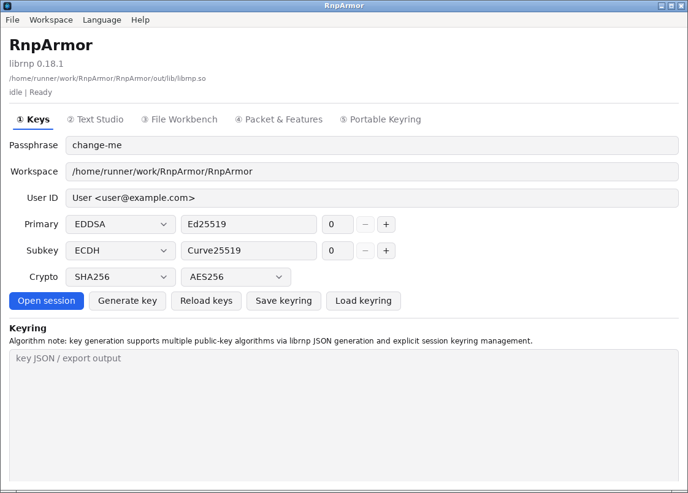
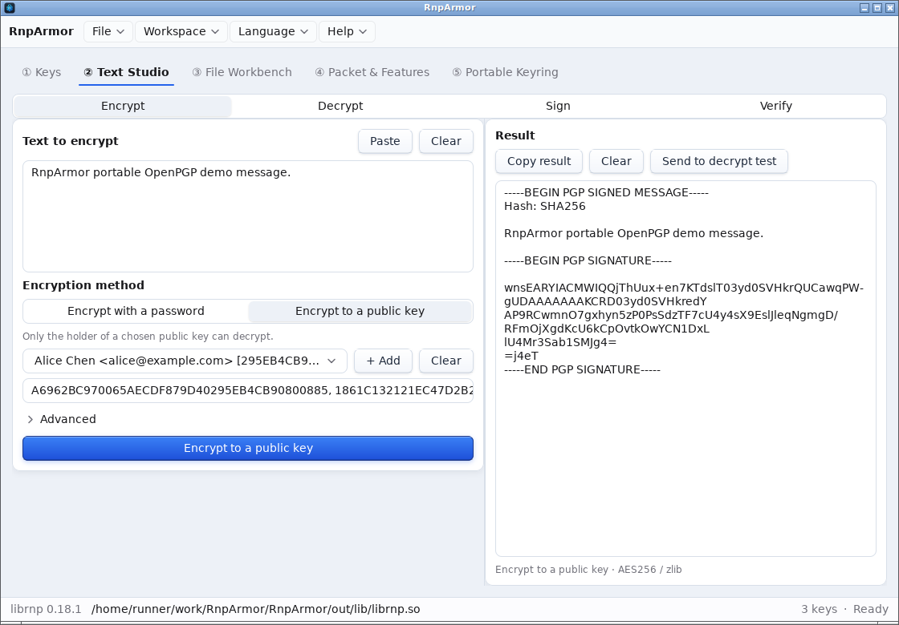
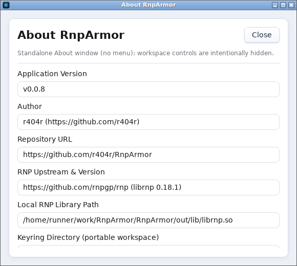

# RnpArmor

English | [简体中文](README.zh-CN.md)

<p></p>

RnpArmor is a MyGo-native OpenPGP GUI powered by `librnp v0.18.1`, delivering Windows 10/11 portable & installer builds (`rnparmor.exe` + `rnp.dll`), macOS Apple Silicon (`arm64`) `.app`/`.dmg` bundles, and Linux (`amd64`) portable builds/tests.

> **User Guide**: See [User Guide (`docs/USER_GUIDE.md`)](docs/USER_GUIDE.md) for installation, checksum verification, step-by-step usage of all 5 workspaces, and troubleshooting.
>
> License: **Apache License, Version 2.0** ([`LICENSE`](LICENSE)). Third-party notices and license texts are included in [`third_party/NOTICES.md`](third_party/NOTICES.md) and distributed bundles (`LICENSE` and `licenses/` on Windows and Linux; `RnpArmor.app/Contents/Resources/LICENSE` and `licenses/` on macOS).

## Screenshots

Linux runtime main-window screenshot (`1120×780`, integrated `File / Workspace / Language / Help` menu bar, light Fluent two-layer cards, pinned bottom status bar showing `librnp 0.18.1` and `3 keys · Ready`), seeded with a 3-key demo keyring (`Alice Chen` with 2 subkeys, `Carol Smith`, and `Bob Tanaka` public-only) via [`.github/workflows/linux-screenshot.yml`](.github/workflows/linux-screenshot.yml), `cmd/seeddemo` (screenshot-CI only, excluded from release builds), and [`scripts/capture-linux-screenshots.sh`](scripts/capture-linux-screenshots.sh):



<details>
<summary>Simplified Chinese UI screenshot</summary>


</details>

<details>
<summary>Japanese UI screenshot</summary>


</details>

<details>
<summary>Additional workspaces &amp; standalone About window screenshots (English)</summary>

**Text Studio** (`② Text Studio`, pre-filled demo plaintext, recipient picker & fingerprint list, `AES256` / `zlib`, signer selector, and 4 text action buttons):



**File Workbench** (`③ File Workbench`, demo source/destination/signature paths, recipient fingerprints, and 4 file action buttons):


**Packet & Features** (`④ Packet & Features`, live JSON packet dump of `demo-signed.asc` alongside `librnp 0.18.1` supported feature matrix):


**Standalone About Child Window** (`Help → About`, `580×520`, menu-less non-modal window showing `v0.0.7`, author, repository URL, `librnp 0.18.1`, and local library path):



</details>

## Highlights

1. **MyGo native GUI with light Fluent frosted-glass shell + 5 workspaces + 4-group menu bar + standalone About window**
   - **Light Fluent theme & two-layer depth (`cmd/rnparmor/style_ui.go`)**:
     - Light-only theme (`rnpLightTheme`) that continues to follow OS high-contrast mode, text scaling, and accent preferences.
     - Cool-gray canvas (`#edf1f7`, or native **Mica** translucency on Windows 11 with automatic cool-gray fallback on Windows 10/Linux) behind pure-white (`#ffffff`) rounded, bordered, shadowed cards (`rnpCard`) across all 5 workspaces and child windows.
     - Tactile raised secondary, primary, and danger buttons (`rnpButton` / `rnpPrimaryButton` / `rnpDangerButton`) with subtle vertical gradients, 1px top highlight and bottom fold lines, hover elevation shadows, and a `1 DIP` downward press shift.
     - `mygo/plugins/glass` frosted-glass material + rounded drop shadows on popover selects, context menus, menu bar panels, and status-bar toasts.
   - Workspace tabs:
     - Keys & generation (master-detail key manager)
     - Text encrypt/decrypt/sign/verify
     - File encrypt/decrypt/sign/verify
     - Packet inspection & feature matrix
     - Portable keyring storage
   - Built-in zero-dependency UI dictionary at `cmd/rnparmor/i18n.go`.
   - Application icon (`assets/icons/rnparmor-256.png` embedded via `assets/icons/icons.go`) applied at runtime to the main window and child windows (**About**, **New Key**, **Import Key Text**) via `w.SetIcon(...)`, and on macOS via `mygo.App.Dock.SetIcon(...)`.
   - Platform-adapted top menu bar with 4 tri-lingual groups (`File` / `Workspace` / `Language` / `Help`):
     - **Windows**: hides the traditional title bar (`TitleBarHidden`, `40 DIP`, `VibrancyMica`) and renders the integrated draggable menu bar inside the top edge while preserving the top-right window caption button area; **Linux**: retains the window-manager title bar and renders the same integrated menu bar inside the window; **macOS**: uses the native macOS system menu bar (`File`, `Workspace`, `Language`, `Help`).
     - `File`: Choose Folder..., Open session, Load keyring, Save keyring, Quit.
     - `Workspace`: 5 radio items synchronized bi-directionally with the workspace tabs.
     - `Language`: radio items (`English`, `中文`, `日本語`) that switch and re-render the menu bar, main window, and open child windows (**About**, **New Key**, **Import Key Text**) live.
     - `Help`: opens the standalone About child window (`About`).
   - Language preset by `--lang en|zh|ja`, `RNPARMOR_LANG`, or system `LANG`.
   - **Pinned bottom status bar & graded notifications**:
     - A single fixed bottom bar (`RoleStatus`) replaces the former stacked header lines to maximize workspace height, showing `librnp <version>`, the single-line library path (hover tooltip with full path, click to copy with **`Library path copied`** toast), loaded primary-key count, and live **`Ready`** / **`busy · <action>`** status.
     - Graded result feedback: routine successes open a 4-second auto-dismissing toast centered just above the bottom bar (hover pauses timer, manual **`×`** close, never covers the bar); signature verification results (`Verify text` / `Verify file`) and main-window errors open a rounded in-app **`AlertDialog`**; errors triggered inside an open child window (**New Key**, **Import Key Text**, **Add Subkey**, **Change Subkey Expiry**, **Revoke Subkey**) remain as inline red errors inside that child window; startup auto-load runs silently and all alerts redact passphrases and private key blocks.
   - **Standalone menu-less non-modal About child window (`580×520`)**:
     - Single-instance focused, fixed-size, no menu bar (`SetMenu(nil)` on non-macOS), includes a `Close` button.
     - Closing the About window leaves the main window unaffected; closing the main window closes **About**, **New Key**, and **Import Key Text** automatically; switching language updates window titles and content live.
     - Shows Application Version (`appVersion`, e.g., `v0.0.4` or `dev`), Author (`r404r (https://github.com/r404r)`), Repository URL (`https://github.com/r404r/RnpArmor`), RNP upstream (`https://github.com/rnpgp/rnp` + current `librnp` version), Local library path (`rnp.dll` / `librnp.so`), Keyring directory (`portable workspace` + `pubring.gpg`/`secring.gpg` existence), and UI Framework & Runtime (`MyGo` / `purego` / `Botan` versions).

2. **Expanded RNP feature surface in `internal/rnp`**
   - Key iteration/location (with nested `Subkeys` and `IsProtected` protection-state tracking), key import (`ImportKeys`), public/secret/revocation export (`ExportRevocation`), full subkey lifecycle (`AddSubkey`, `SetKeyExpiration`, `RevokeKey`, `DeleteSubkey` with primary-key deletion guard and `UsageAllowsAlg` checks), key-to-JSON, and delete.
   - Public-only & optional-passphrase read-only sessions (`OpenOptionalPass`), plus public-only `pubring.gpg` save/load without creating empty `secring.gpg`.
   - Operation-API key generation (`rnp_op_generate_*` via `GenerateKeyWithSpec`) with multiple algorithm families, accurate expiration (`0` = never expires, plus explicit `1`/`2`/`5`-year durations via `rnp_op_generate_set_expiration`), and optional RFC 4880 unprotected secret key generation (`Unprotected: true`).
   - Text operations: encrypt/decrypt, clearsign/detached/inline sign/verify.
   - File operations with option-rich APIs.
   - Packet dump (text/JSON) and feature querying (`rnp_supported_features`, `rnp_supports_feature`).
   - Extended verification metadata (status/hash/signer/timestamps), with explicit separation of:
     - cryptographic math validity
     - identity trust decision (not asserted by default)

3. **Portable-focused safety boundaries**
   - Absolute-path library loading + `SHA256SUMS` verification before loading.
   - Windows `LoadLibraryEx` restricted search semantics.
   - Explicit keyring load/save only; no implicit default keyring; empty initial passphrase (no pre-filled default), masked passphrase fields, concealed secret clipboard copy, and `0600` mode for secret/revocation file exports.
   - Non-clobbering keyring persistence (read-only actions never rewrite disk files) and non-overwrite output semantics for file publishing.

4. **Windows portable build + GUI subsystem + smoke flow hardening**
   - Windows `rnparmor.exe` is built with `-H=windowsgui` (Windows GUI subsystem) so launching it does not pop up a black console window.
   - `cmd/genwinres` generates a temporary AMD64 COFF `.syso` from `assets/icons/rnparmor.ico` during build so `rnparmor.exe` carries an embedded `.rsrc` icon resource, and `packaging/windows/rnparmor.iss` sets `SetupIconFile` for the installer.
   - `scripts/build-windows.ps1` verifies both the `Windows GUI` PE subsystem and `.rsrc` section via `dumpbin /headers`, audits PE imports (`dumpbin /imports`) across `rnparmor.exe` and all bundled DLLs against a Windows system-DLL allowlist, and records the subsystem in `windows-report.txt`.
   - `rnparmor.exe --smoke-test` supports `--smoke-out <path>` to write smoke output (`status=ok`, `app_version=<value>`, `library=...`, `version=...`, `i18n=ok`) to a file for deterministic CI validation under `-H=windowsgui`.
   - Windows script smoke path runs `--smoke-test --smoke-out` first, then a bounded GUI probe (with `PATH` restricted to `System32` so no external DLLs can be picked up).
   - Windows CI (`smoke.yml` / `release.yml`) caches and consumes the pinned prebuilt `r404r/rnp@v0.18.1-win.2` zip (`-Stage prebuilt-rnp`), while Linux/macOS CI (and the Windows source-build fallback stages) cache `out/deps`.

5. **Automated multi-platform release workflow**
   - `.github/workflows/release.yml` runs on `push` tag `v*` and `workflow_dispatch`.
   - Builds macOS Apple Silicon (`arm64`), Linux (`amd64`), and Windows (`amd64`) artifacts with platform icons (`RnpArmor.icns` in `RnpArmor.app`, `rnparmor.png` in Linux portable tarball, and `.rsrc` + `SetupIconFile` on Windows).
   - Publishes/updates GitHub Release with:
     - `rnparmor-macos-arm64.dmg` (ad-hoc signed `RnpArmor.app`, minimum macOS 13.0)
     - `rnparmor-linux-amd64.tar.gz`
     - `rnparmor-windows-amd64-setup.exe` (Inno Setup 6 per-user installer)
     - `rnparmor-windows-amd64.zip` (Windows portable bundle)
     - `windows-report.txt`
     - `rnparmor-${TAG}-SHA256SUMS.txt`

## Current Architecture (at a glance)

- `assets/icons/`
  - `rnparmor.png`, `rnparmor-256.png`, `rnparmor.ico`, `RnpArmor.icns`: transparent multi-platform application icon assets.
  - `icons.go`, `icons_test.go`: embeds `rnparmor-256.png` (`icons.AppIconPNG`) for runtime window and Dock icons.
- `cmd/rnparmor/`
  - `main.go`: MyGo app entry, platform window chrome (`mainWindowOptions`: Windows hidden title bar + Mica vs Linux/macOS default title bar), runtime window/Dock icon setup, platform-integrated or system 4-group menu bar (including `File → Choose Folder...`), light Fluent surface setup (`prepareSurface`) with `rnpCard` containers and raised buttons across workspaces and About, pinned bottom status bar & `AlertDialog` host, silent startup keyring auto-load (`runSilent`), empty initial passphrase + `OpenOptionalPass`, 5-workspace navigation (with shared recipient/signer pickers, `passphraseRow` symmetric password inputs with independent `showTextEncPass`/`showFileEncPass` eye toggles across Text Studio & File Workbench, and native file pickers on File & Packet pages), `580×520` non-modal About child window, `+ New Key` visibility/check state (`newKeyShowPass`, `newKeyShowPass2`, `newKeyChecked`), `passphraseRow` unlock input with `showUnlockPass` toggle in Portable Keyring, subkey modal reveal/reset flags (`subShowPass`, `expiryShowPass`, `revokeShowPass` cleared on success in `applyResult`), async session operations, `--smoke-out`, and build-time `appVersion` display/output.
  - `style_ui.go`: light Fluent & localized frosted-glass design layer (`rnpLightTheme` respecting system high-contrast/text-scale/accent preferences, `#edf1f7` canvas / Windows 11 Mica background, `rnpCard` white rounded cards, `rnpButton` / `rnpPrimaryButton` / `rnpDangerButton` gradient+highlight+fold+1-DIP-press controls, `rnpPassEye` SVG show/hide toggle with `passEyeIcon`/`passEyeOffIcon` and `flipPassVisible`, `rnpDisclosure` compact tree expanders, `useIntegratedMenuBar` / `viewIntegratedMenuBar` draggable top menu bar, `ui.PopoverMenus` + `mygo/plugins/glass` `menuGlass` / `glassMenuPanel` popovers, and `toastGlass` frosted notification styling).
  - `feedback_ui.go`: pinned bottom status bar (`viewStatusBar`: translucent light surface showing `librnp` version, single-line click-to-copy library path with full-path hover tooltip, primary-key count excluding subkeys, and `Ready` / `busy · <action>` indicator), `viewToastViewport` centered above the status bar with `toastGlass` frosted cards (`toastLifetime = 4s`, hover-pause & manual `×` close), Scheme A graded feedback router (`noteActionFeedback` / `feedbackRoute`: success toast, `AlertDialog` for verification output & main-window failures, child-window inline error retention while open, silent startup load), and `safeNotice` redaction (masking passphrases as `••••` and hiding `BEGIN PGP PRIVATE` / `BEGIN PGP SECRET` blocks).
  - `keys_ui.go`: Phase 1 master-detail Key Manager workspace (`rnpCard` left/right panes, `+ New Key`, `Import File...`, `Import Text...`, `Refresh`, read-only Workspace + native `Choose Folder...`), segmented ownership filters (`All` / `My Keys` / `Public`), `Key ID (16)` ↔ `Fingerprint (40)` switch, live search (across both primary keys and nested subkeys), sortable collapsible primary-key tree table (`▾` / `▸` with `rnpDisclosure`), detail inspector (grouped fingerprint + `copyFingerprintText` toast, badges including primary `Auth` and `No Passphrase`, nested subkey lifecycle cards with `+ Add Subkey...`, public/secret/revocation exports with confirmation & concealed secret copy, `Delete Key...` confirmation, collapsible `Raw Key JSON`), redacted async error alerts (`reportAsyncErr`), `validateNewKey`, `resetNewKeyPassUI` (invoked on window open, close, and `OnClosed`), and `rnpCard`-wrapped `Import Key Text` child window.
  - `subkey_ui.go`: left-pane hierarchical collapsible subkey tree builder (`  └ Subkey` rows synced with ID display mode, selection, and highlighting) and `rnpCard`-styled full subkey lifecycle dialogs (`Add Subkey` `560×680`, `Change Subkey Expiry` `480×420`, `Revoke Subkey` `500×460` + native confirmation, confirmation-gated `Delete...`, `No Passphrase` subkey badges, fingerprint copy toast, `passphraseRow` + `rnpPassEye` reveal toggles across all three subkey modals with automatic reset on open, close, `OnClosed`, and submit via `resetAddSubPassUI`/`resetExpiryPassUI`/`resetRevokePassUI`, and optional passphrase handling when the primary secret key is unprotected—still encrypting newly added subkeys when a passphrase is provided).
  - `keygen_ui.go`: scrollable `560×640` `rnpCard`-wrapped `+ New Key` dialog featuring 5 algorithm presets (`Modern (Ed25519 + Curve25519)` recommended default, `RSA 4096 + RSA 4096`, `RSA 3072 + RSA 3072`, `NIST P-256`, and `Custom` auto-expanding advanced options), preset drift detection, algorithm-linked curve/bit-length selectors, `passphraseRow` inputs paired with `rnpPassEye` reveal toggles (auto-resetting to hidden on open/close/submit), live mismatch highlighting & auto-clear (`passMismatchVisible` / `syncNewKeyPassError`), inline red alert box blocking mismatched submission via `submitNewKey`, live protected/unprotected secret-key notices (allowing both passphrase fields blank to create RFC 4880 unprotected keys while preserving existing session passphrases via `takeNewKeyPassphrase`), and tri-lingual dynamic field descriptions & tooltips.
  - `studio_ui.go`: Phase 2 shared primary-key recipient picker (`+ Add` with case-/space-insensitive deduplication, `Clear`, and manual CSV editing), secret-only primary signer dropdown (`Use selected key (default)` + manual fingerprint override), and native file `Browse...` / `Save As...` dialog helpers for File Workbench and Packet & Features styled with Fluent raised buttons.
  - `i18n.go`: tri-lingual catalog (EN/ZH/JA) with unified key-hierarchy terminology (`Primary Key` / `Subkey` in English, plus aligned Simplified Chinese and Japanese terms), status-bar/toast/alert strings, keygen preset, passphrase show/hide tooltips (`tip.show_passphrase` / `tip.hide_passphrase`), unprotected-key (`No Passphrase` badge/notices), and subkey lifecycle descriptions/tooltips, language resolution, and translation validation.
  - `main_test.go`: unit tests for smoke output generation/writing, menu template structure, `TestFluentGlassChrome` (Windows Mica/hidden title bar vs Linux/macOS default title bar, integrated menu bar rules, light theme high-contrast/text-scale preferences, secondary/primary/danger button faces, and `menuGlass` / `toastGlass` styling), `TestPassphraseEyeEverywhere` (default hidden state across all 6 workspace/subkey toggles, `flipPassVisible` nil guard, independent toggling, close/`reset*PassUI`/`applyResult` reset vs error retention, tri-lingual eye tooltips, and `.Password(` single-site regression guard inside `keygen_ui.go` `passphraseRow`), state synchronization, `TestKeyManagerFilterSearchSortAndForms` (filter/search/sort/ID mode, protected & empty-passphrase validation, passphrase eye-toggle/reset, live mismatch field highlighting, submit-time block without mutating session passphrase, and mismatch auto-clear), `TestKeygenPresetsSyncAndTips`, `TestSubkeyTableExpiryUsageAndCatalog`, `TestStudioKeyPickersAndFileDialogPaths`, `TestI18nComplete`, `TestStatusBarAndFeedback`, decrypt/verify input resolution, recipient fallback rules, and real `librnp` end-to-end GUI action regression tests (`TestUIStateActionsEndToEnd` and `TestUIStateEmptyPassphraseLifecycle`).
- `cmd/genwinres/`
  - `main.go`: zero-dependency pure Go AMD64 COFF `.syso` resource generator embedding `rnparmor.ico` into `rnparmor.exe` at build time.
- `cmd/seeddemo/`
  - `main.go`, `main_test.go`: screenshot-CI-only helper binary (`--dir`) seeding the disposable 3-key demo keyring (`Alice Chen` protected with an extra signing subkey, `Carol Smith` unprotected, `Bob Tanaka` public-only) plus `demo-note.txt`, `demo-signed.asc`, and `demo-encrypted.pgp`; excluded from release builds.
- `internal/loadlib/`
  - `open.go`: absolute-path `librnp` resolution and `SHA256SUMS` verification before loading, including fallback from `Contents/MacOS/SHA256SUMS` to `Contents/Resources/SHA256SUMS` for macOS `.app` bundles.
- `internal/rnp/`
  - `api.go`: purego FFI bindings to librnp APIs (including `rnp_key_is_protected` and `rnp_op_generate_*` key/subkey generation operations).
  - `session.go`: session lifecycle (`Open`, `OpenOptionalPass`), passphrase callback controls, API models (`KeySummary.Subkeys`, `KeySummary.IsSub`, `KeySummary.IsProtected`, `KeySummary.CanAuth`, `KeyGenRequest.Unprotected`, `SubkeyGenRequest.Unprotected`).
  - `ops.go`: key management (`GenerateKeyWithSpec` switched to `librnp`'s `rnp_op_generate_*` API so `ExpirationSec` sets primary and encryption subkey expiration directly—`0` = never expires—instead of `rnp_generate_key_json` ignoring `"expiration"` on `librnp 0.18.1` and defaulting to 2 years; plus nested subkeys, `AddSubkey`, `SetKeyExpiration`, `RevokeKey`, `DeleteSubkey` with primary-key guard & `UsageAllowsAlg`, RFC 4880 unprotected secret key & subkey support, public-only `SaveTo`/`LoadFrom`, revocation export) + text/file crypto/sign/verify + packet/features.
  - `session_test.go`: compatibility tests + expanded integration scenarios (`TestSubkeyLifecycle`, `TestEmptyPassphraseKeyLifecycle`, `TestGenerateKeyExpiration` verifying `Never` / explicit durations on primary keys & subkeys, and public-only keyring loading/saving).
- `scripts/build-windows.ps1`
  - defaults CI to `-Stage prebuilt-rnp` (downloading & SHA-256-verifying the pinned `r404r/rnp@v0.18.1-win.2` portable zip from `deps/pins.json` and staging `rnp.dll` plus required sibling runtime DLLs and licenses into `out/lib` / `out/prebuilt-rnp`) while keeping source-build stages (`fetch-deps`/`botan`/`small-deps`/`deps`/`rnp`/`all`) as an optional fallback; embeds temporary `.syso` icon via `cmd/genwinres`, builds `-H=windowsgui` portable output and Inno Setup 6 installer (`rnparmor-windows-amd64-setup.exe`), writes `SHA256SUMS` covering all packaged files, verifies PE subsystem, `.rsrc` section, and recursive DLL imports across `rnparmor.exe` and all sibling DLLs, and runs tests + `--smoke-out` + GUI probe.
- `scripts/build-macos.sh`
  - builds pinned static deps (`Botan 3.10.0` + `json-c 0.19`), `librnp.dylib`, and `RnpArmor.app` (with `Contents/Resources/RnpArmor.icns` and `CFBundleIconFile` in `Info.plist`), runs ad-hoc `codesign --verify --deep --strict`, `go test`, and `--smoke-test`, and packages `rnparmor-macos-arm64.dmg`.
- `scripts/capture-linux-screenshots.sh`
  - seeds the demo keyring via `--seeder`, launches `rnparmor` under headless X11 (`Xvfb` + `openbox`) across `--lang en|zh|ja` and `RNPARMOR_DEMO_SCENE`, captures all 11 focused PNGs via `scrot`, and verifies dimensions and non-blank pixel variance.
- `packaging/windows/rnparmor.iss`
  - Inno Setup 6 script explicitly packaging `rnparmor.exe`, `*.dll`, `SHA256SUMS`, `LICENSE`, `PORTABLE.txt`, `DEPENDENCIES.txt`, and `licenses\*` for the Windows per-user installer (`rnparmor-windows-amd64-setup.exe`) with `SetupIconFile`.
- `docs/`
  - `USER_GUIDE.md` / `USER_GUIDE.zh-CN.md`: bilingual end-user installation, workspace, and troubleshooting guides.
  - `screenshots/`: 11 Linux runtime demo-keyring screenshots (`rnparmor-linux-{en,zh,ja}.png`, plus `rnparmor-linux-{text,file,packet,about}-{en,zh}.png`).
- `.github/workflows/smoke.yml`
  - `linux`, `windows-portable` (prebuilt `rnp_windows_portable` zip + cache), and `macos-arm64` jobs with per-branch concurrency cancel.
- `.github/workflows/release.yml`
  - tag-driven/manual multi-platform packaging and release publication.
- `.github/workflows/linux-screenshot.yml`
  - builds `librnp.so`, `rnparmor`, and `seeddemo`, runs `scripts/capture-linux-screenshots.sh` under `Xvfb` + `openbox` (including on `cmd/rnparmor/**`, `cmd/seeddemo/**`, `scripts/capture-linux-screenshots.sh`, `.github/workflows/linux-screenshot.yml`, or `assets/icons/**` PR changes), uploads `rnparmor-linux-screenshots` artifacts, and can commit all 11 updated PNGs to `docs/screenshots/` on non-`main` branches.

## GUI Workspaces

### 1) Keys & generation

- Master-detail Key Manager workspace with top toolbar (`+ New Key`, `Import File...`, `Import Text...`, `Refresh`, and read-only Workspace + native `Choose Folder...`).
- Segmented filtering (`All` / `My Keys` / `Public`), `Key ID (16)` ↔ `Fingerprint (40)` column switch, live search across UID/Key ID/fingerprint/algorithm (matching primary keys and nested subkeys), and a sortable hierarchical collapsible key tree (`▾` / `▸`, expanded by default, rendering indented `  └ Subkey` rows with usage/ID/algorithm/status and highlighting the corresponding subkey card on selection).
- Detail inspector with grouped 4-character fingerprint + `Copy Fingerprint`, status, ownership, **`No Passphrase`**, and capability badges (including primary `Auth`), `Subkeys` section with full secret-key subkey lifecycle management (`+ Add Subkey...` `560×680` with usage-enforced algorithm filtering, `Change Expiry...` `480×420`, `Revoke...` `500×460` + native confirmation, and warning-gated `Delete...` that protects the primary key; all three passphrase prompts use `passphraseRow` + `rnpPassEye` auto-resetting on open/close/submit), `Copy Public Key` / `Export Public (.asc)...`, secret-only `Export Secret (.asc)...` (with confirmation prompt & `0600` file mode) / concealed `Copy Secret` / `Revocation Cert...` (`.rev.asc`), confirmation-gated `Delete Key...`, and collapsible `Raw Key JSON`. Unprotected primary keys allow leaving the passphrase blank across subkey add/expiry/revoke/delete and subsequent encrypt/decrypt/sign/verify actions (while entering a passphrase in `+ Add Subkey...` still encrypts that new subkey individually).
- Standalone `+ New Key` window (`560×640`) with `Name`/`Email`, optional masked `Passphrase` + `Confirm Passphrase` (each paired with a `rnpPassEye` show/hide eye button with tri-lingual `Show passphrase`/`Hide passphrase` tooltip that auto-resets to hidden on open, close, and submit), live red field error & submit-time inline red alert blocking mismatches via `submitNewKey` (including single-side empty confirmation, auto-clearing via `syncNewKeyPassError` when matched), `Expiration` (`Never` / `1 Year` / `2 Years` / `5 Years` backed by `rnp_op_generate_*` so `Never` truly sets `0` expiration on both primary and encryption subkeys instead of falling back to 2 years on `librnp 0.18.1`), 5 algorithm presets (`Modern (Ed25519 + Curve25519)` recommended default, `RSA 4096 + RSA 4096`, `RSA 3072 + RSA 3072`, `NIST P-256`, `Custom`), collapsible `Advanced algorithms` with algorithm-linked curve/bit selectors and tri-lingual field descriptions & tooltips. Leaving both passphrase fields blank displays an explicit unencrypted-storage notice and creates an OpenPGP RFC 4880 unprotected secret key; read-only / public-only keyrings (`pubring.gpg` without `secring.gpg`) also open with an empty passphrase.
- Read-only actions never rewrite disk keyrings, empty-session explicit saves fail safely, and deleting the last key cleans up empty files.

### 2) Text studio

- Keyring primary-key recipient dropdown with `+ Add` / `Clear` (case- and whitespace-insensitive deduplication) alongside manual comma-separated fingerprint editing; falls back to the selected key when both recipients and password are empty.
- Masked symmetric `Password` input via `passphraseRow` (`Password` mode + independent `rnpPassEye` show/hide toggle with tri-lingual tooltip and accessibility label).
- Secret-only primary signer dropdown (`Use selected key (default)` first) paired with a manual fingerprint override field.
- Encrypt text (recipient and/or password modes, optional sign-on-encrypt).
- Decrypt text (supports pasting external armored PGP ciphertext directly into Plain text, or staged output).
- Sign text in three modes:
  - cleartext
  - detached
  - inline
- Verify text with signature metadata output (supports pasted external cleartext/inline blocks, detached signatures, or staged output).

### 3) File workbench

- Native file dialogs alongside path fields: `Source` (`Browse...`, defaults to `All files`), `Destination` (`Save As...`, defaults to `All files`), and `Signature path` (`Browse...` + `Save As...`, defaults to `OpenPGP` filter).
- Self-contained embedded controls shared with Text Studio (`Recipients (comma fp)`, symmetric `Password` paired with an independent `rnpPassEye` show/hide toggle, `Signer fingerprint`, and `Encrypt+Sign` toggle) so file tasks do not require switching tabs.
- Encrypt/decrypt files.
- Sign/verify files (detached and inline flows).
- Keeps non-overwrite publish behavior aligned with internal file safety utilities.

### 4) Packet & features

- `Browse...` native Open dialog (defaults to `OpenPGP` filter) on `Packet input file`; dump OpenPGP packets in text or JSON.
- Query supported algorithms/features globally or by `type:name`.

### 5) Portable keyring storage

- Read-only `Workspace` path with native `Choose Folder...` picker and explicit `Open+Load` / `Save` / `Reload keys` controls (supporting public-only `pubring.gpg` as well as full `pubring.gpg` + `secring.gpg`).
- Masked unlock `Passphrase` via `passphraseRow` + independent `rnpPassEye` show/hide toggle (empty at startup, used only in memory for active secret-key operations).

### 6) Platform-adapted 4-group menu bar, frosted overlays & standalone About child window

- Window chrome & 4-group menu bar (`File`, `Workspace`, `Language`, `Help`):
  - **Windows**: hides the traditional title bar (`40 DIP`, native Mica on Windows 11 with cool-gray fallback on Windows 10) and renders an integrated in-window menu bar reserving the top-right window caption area and supporting drag-to-move on the title and empty spacer strip.
  - **Linux**: keeps the window manager's title bar and window controls while rendering the same integrated menu bar inside the window.
  - **macOS**: uses the native macOS system menu bar and shows the app title above the tabs.
- All workspaces and child windows render inside pure-white `#ffffff` rounded cards (`rnpCard`) over the light `#edf1f7` canvas / Mica surface, using raised gradient buttons (`1 DIP` press shift) and `mygo/plugins/glass` frosted-glass popover selects, context menus, menu panels, and toasts.
- `Help → About` opens a `580×520` non-modal, fixed-size, menu-less standalone child window (single-instance focused, with a `Close` button).
- Closing the About window leaves the main window running; closing the main window closes the About window automatically; live language switches update both windows immediately.
- Displays read-only details (app version, author, repository, RNP upstream, local library path, portable keyring directory + `pubring.gpg`/`secring.gpg` existence, runtime stack) and explicitly notes that the system default keyring is not read.

### 7) Pinned bottom status bar & graded notifications

- The former stacked version/path/status lines in the header are consolidated into a fixed bottom status bar (`RoleStatus`), freeing vertical space inside every workspace.
- Status bar displays: `librnp <version>`, the single-line elided `librnp` / `rnp.dll` path (hover for full path tooltip; click to copy with **`Library path copied`** toast), loaded primary-key count (`<N> keys` / `1 key`), and live state (**`Ready`** or **`busy · <action>`**).
- Action feedback follows graded routing:
  - Routine successes (generate, import, export, copy public/secret/fingerprint/library path, delete, encrypt/decrypt/sign, packet dump, feature query, keyring open/save/reload, subkey add/expiry/revoke/delete) show a 4-second auto-dismissing toast just above the status bar (hover pauses countdown, **`×`** closes manually, status bar stays uncovered).
  - Signature verification (`Verify text` / `Verify file`) and main-window failures show a rounded in-app **`AlertDialog`** with an **`OK`** button.
  - Child-window failures (**New Key**, **Import Key Text**, **Add Subkey**, **Change Subkey Expiry**, **Revoke Subkey**) remain as inline red errors inside the open child window; startup auto-load runs silently and notices redact passphrases/private keys.

## Verification Model

Verification output intentionally distinguishes:

- **Math validity** (signature cryptographically matches content/key)
- **Identity trust** (who that signer is, and whether trusted in policy)

RnpArmor reports the first; it does **not** automatically elevate to the second.

## CLI

```bash
# Probe librnp and validate i18n catalog; no GUI loop
rnparmor --smoke-test

# Write smoke output to a file (used by CI on Windows -H=windowsgui builds)
rnparmor --smoke-test --smoke-out out/smoke-out.txt

# Force UI language
rnparmor --lang en
rnparmor --lang zh
rnparmor --lang ja
```

Expected smoke output includes:

```text
status=ok
app_version=dev
library=...
version=...
i18n=ok
```

Language preset fallback order:

1. `--lang`
2. `RNPARMOR_LANG`
3. `LANG`
4. default `en`

## Build & Test

### Linux

```bash
bash scripts/build-librnp.sh
export RNPARMOR_LIBRNP="$PWD/out/lib/librnp.so"
go test ./...
CGO_ENABLED=1 go test -race -gcflags=all=-d=checkptr=0 ./...
CGO_ENABLED=0 go build -o rnparmor ./cmd/rnparmor
```

### macOS (Apple Silicon / arm64)

```bash
# one-shot: runs deps -> rnp -> package (default --stage all)
bash scripts/build-macos.sh

# staged mode (for local iteration or CI caching)
bash scripts/build-macos.sh --stage deps
bash scripts/build-macos.sh --stage rnp
bash scripts/build-macos.sh --stage package

# inject app version into Info.plist and binary metadata
bash scripts/build-macos.sh --stage package --version v0.0.1
```

`scripts/build-macos.sh` targets `MACOSX_DEPLOYMENT_TARGET=13.0` (`LSMinimumSystemVersion=13.0`) on Apple Silicon (`arm64`):

- `deps`: builds static `Botan 3.10.0` (using the same 57-module list in `scripts/windows/botan3-modules.txt`, stamped with `.modules-sha256`) and static `json-c 0.19` into `out/deps`.
- `rnp`: builds `librnp.dylib` (`@loader_path/librnp.dylib`) linked statically against Botan and `json-c`, and dynamically against macOS system `/usr/lib/libz` and `/usr/lib/libbz2` plus `-framework Security` (verified via `otool -L` to avoid external Homebrew paths).
- `package`: builds `CGO_ENABLED=0 GOOS=darwin GOARCH=arm64` `rnparmor`, assembles `out/dist/RnpArmor.app` (`Contents/MacOS/rnparmor`, `Contents/MacOS/librnp.dylib`, `Contents/Resources/RnpArmor.icns`, `Contents/Resources/LICENSE`, `Contents/Resources/SHA256SUMS`, `Contents/Resources/licenses/`, with `CFBundleIconFile` in `Info.plist`), verifies icon presence before applying ad-hoc signatures and `codesign --verify --deep --strict`, executes `go test` and `--smoke-test`, and packages `out/rnparmor-macos-arm64.dmg` via `hdiutil create`.

> macOS Gatekeeper note: `RnpArmor.app` is ad-hoc signed and **not Apple-notarized**. Opening it for the first time from Finder may trigger a Gatekeeper warning (use Control-click → Open or System Settings → Privacy & Security if prompted).

### Windows (portable & installer)

```powershell
# default CI fast path: stage pinned prebuilt rnp.dll & runtime DLLs, then package
pwsh -File .\scripts\build-windows.ps1 -Stage prebuilt-rnp
pwsh -File .\scripts\build-windows.ps1 -Stage package

# optional source-build fallback: runs deps -> rnp -> package (default -Stage all)
pwsh -File .\scripts\build-windows.ps1

# coarse source fallback stages
pwsh -File .\scripts\build-windows.ps1 -Stage deps
pwsh -File .\scripts\build-windows.ps1 -Stage rnp
pwsh -File .\scripts\build-windows.ps1 -Stage package

# granular source fallback stages (require Python 3 and Ninja)
pwsh -File .\scripts\build-windows.ps1 -Stage fetch-deps
pwsh -File .\scripts\build-windows.ps1 -Stage botan
pwsh -File .\scripts\build-windows.ps1 -Stage small-deps

# inject app version into rnparmor.exe metadata shown by --smoke-test/About
pwsh -File .\scripts\build-windows.ps1 -Version v0.0.1

# stage + version together
pwsh -File .\scripts\build-windows.ps1 -Stage package -Version v0.0.1
```

Windows dependency staging supports two modes:

- **Default CI prebuilt path (`-Stage prebuilt-rnp`, pinned in `deps/pins.json` as `rnp_windows_portable`)**:
  - Downloads and SHA-256-verifies `r404r/rnp@v0.18.1-win.2` (`rnp-windows-x64-portable.zip`, commit `5ede42bfd49c4992550d3c642d5d1b2286c1da9a`, SHA-256 `5886bf2bcd17ca2f0ed1e959c9e08a21865fc9c4a8bbf42d4dc691a53414361b`, `4,328,958` bytes).
  - Stages `rnp.dll` together with the 6 required sibling runtime DLLs (`botan-3.dll`, `bz2.dll`, `libz.dll`, `MSVCP140.dll`, `VCRUNTIME140.dll`, `VCRUNTIME140_1.dll`) into `out/lib`—excluding `rnp.exe`, `rnpkeys.exe`, `README.txt`, and unused `getopt.dll` (included only if `rnp.dll`'s import table references it)—and bundles all corresponding third-party licenses (`RNP-LICENSE.md`, `RNP-LICENSE-OCB.md`, `sexpp-LICENSE.md`, `vcpkg-botan.txt`, `vcpkg-bzip2.txt`, `vcpkg-zlib.txt`, `vcpkg-dirent.txt`, `vcpkg-getopt-win32.txt`, `nlohmann-json-MIT.txt`, `msvc-runtime-license.txt`, `mygo-MIT.txt`, `purego-Apache-2.0.txt`) into `licenses/` inside both the portable zip and Inno Setup installer.
  - Because the VC143 CRT DLLs sit directly alongside `rnp.dll` and recursive PE import auditing checks `rnparmor.exe` plus every shipped DLL, clean Windows machines do not need a separate MSVC Redistributable install, and `SHA256SUMS` covers `rnp.dll` and all sibling DLLs in the bundle.
- **Optional source-build fallback (`-Stage fetch-deps` / `botan` / `small-deps` / `deps` / `rnp` / `all`)**:
  - Preserved in `scripts/build-windows.ps1` (requires Python 3 and `ninja.exe`). Builds minimized static `Botan 3.10.0` (from the 57-module list in `scripts/windows/botan3-modules.txt`), static `json-c 0.19`, `zlib 1.4`, and `bzip2 1.0.8` plus `dirent 1.24` (`dirent.h`), compiles `rnp.dll` from source, clears any `out/prebuilt-rnp` marker so prebuilt and source DLL sets never mix, and bundles the static-build license texts into `licenses/`.

`scripts/build-windows.ps1` supports the following `-Stage` values:

1. `prebuilt-rnp`: download, SHA-256-verify, and extract pinned `r404r/rnp@v0.18.1-win.2` (`rnp_windows_portable`), validate `dumpbin /imports rnp.dll`, publish `rnp.dll` + required sibling runtime DLLs into `out/lib`, and stage prebuilt license texts into `out/prebuilt-rnp/licenses`
2. `fetch-deps`: *(source fallback)* download, checksum-verify, and extract `Botan 3.10.0`, `json-c 0.19`, `zlib 1.4`, `bzip2 1.0.8`, and `dirent 1.24` into `out/src` (skipped when `out/deps` hot cache is complete)
3. `botan`: *(source fallback)* build and install minimized static `Botan 3.10.0` into `out/deps/botan` (stamped with `.modules-sha256`)
4. `small-deps`: *(source fallback)* build and install static `json-c`, `zlib`, and `bzip2` into `out/deps`, stage `dirent.h`, and cache dependency licenses under `out/deps/licenses`
5. `deps`: *(source fallback)* execute `fetch-deps -> botan -> small-deps`
6. `rnp`: *(source fallback)* clear `out/prebuilt-rnp`, build static-linked `rnp.dll` into `out/win-build/rnp-dll/rnp.dll`, and publish it to `out/lib`
7. `package`: generate temporary `cmd/rnparmor/rsrc_windows_amd64.syso` from `assets/icons/rnparmor.ico` via `cmd/genwinres`, build `rnparmor.exe` with `-H=windowsgui`, clean up the temporary `.syso`, copy `*.dll` from `out/lib`, `LICENSE`, and `licenses/`, verify `Windows GUI` PE subsystem, `.rsrc` section (`dumpbin /headers`), and recursive PE imports across `rnparmor.exe` + all bundled DLLs (`DEPENDENCIES.txt`), generate `PORTABLE.txt` and `SHA256SUMS` (covering all packaged files including `rnp.dll` and sibling DLLs), run `go test` against packaged `rnp.dll` with `PATH` restricted to `System32`, run `--smoke-test --smoke-out` and the bounded GUI probe, and produce the portable zip, Inno Setup 6 installer (`SetupIconFile=..\..\assets\icons\rnparmor.ico`), and report
8. `all`: *(source fallback default)* execute `deps -> rnp -> package`

The `package` stage creates `out\dist\rnparmor-windows-amd64`, builds the installer via `packaging/windows/rnparmor.iss` (explicitly packaging `rnparmor.exe`, `*.dll`, `SHA256SUMS`, `LICENSE`, `PORTABLE.txt`, `DEPENDENCIES.txt`, and `licenses\*`) + Inno Setup 6 (`ISCC.exe`), and executes:

1. `dumpbin /headers` check confirming `rnparmor.exe` targets the `Windows GUI` subsystem (recorded in `out\windows-report.txt`) and contains the `.rsrc` icon resource section
2. `go test -count=1 -timeout 20m ./internal/loadlib/ ./internal/rnp/ ./cmd/rnparmor/` with `RNPARMOR_LIBRNP` pointing to the packaged `rnp.dll` and `PATH` restricted to `System32`
3. `rnparmor.exe --smoke-test --smoke-out <path>` (verifying `status=ok`, `app_version=<Version>`, and `i18n=ok`)
4. a bounded GUI process probe

Outputs: `out\rnparmor-windows-amd64.zip`, `out\rnparmor-windows-amd64-setup.exe` (default per-user non-admin install with `PrivilegesRequired=lowest`, Start Menu entry, optional desktop shortcut, and standard uninstaller), and `out\windows-report.txt`.

## CI

Workflow: `.github/workflows/smoke.yml`

- `linux` job:
  - dependency cache on `out/deps`
  - pinned `librnp` build + `go test -race` + `CGO_ENABLED=0` build
- `windows-portable` job:
  - caches `out/cache/rnp-windows-x64-portable.zip` via `actions/cache@v4` with key `${{ runner.os }}-rnp-windows-portable-v1-${{ hashFiles('deps/pins.json') }}`
  - defaults CI to `-Stage prebuilt-rnp` (`r404r/rnp@v0.18.1-win.2`, SHA-256-verified) followed by `-Stage package` (keeping source-build stages in `scripts/build-windows.ps1` as optional fallback)
  - uploads `out/rnparmor-windows-amd64.zip`, `out/rnparmor-windows-amd64-setup.exe`, and `out/windows-report.txt`
- `macos-arm64` job (`runs-on: macos-15`):
  - dependency cache on `out/deps` with key `${{ runner.os }}-arm64-deps-v1-${{ hashFiles('deps/pins.json', 'scripts/windows/botan3-modules.txt', 'scripts/build-macos.sh') }}`
  - staged macOS flow (`deps -> save cache -> rnp -> package`)
  - uploads `out/rnparmor-macos-arm64.dmg`

Workflow: `.github/workflows/release.yml`

- triggers:
  - `push` tags matching `v*`
  - `workflow_dispatch` (optional `tag` input)
- jobs:
  - `linux-portable`: build/test/package `rnparmor-linux-amd64.tar.gz` (including `rnparmor.png` from `assets/icons/rnparmor.png`)
  - `windows-portable`: caches `out/cache/rnp-windows-x64-portable.zip` (`${{ runner.os }}-rnp-windows-portable-v1-${{ hashFiles('deps/pins.json') }}`) and runs `-Stage prebuilt-rnp` followed by `-Stage package -Version "${{ steps.tag.outputs.value }}"` (source stages remain in `scripts/build-windows.ps1` as fallback) to produce `rnparmor-windows-amd64.zip`, `rnparmor-windows-amd64-setup.exe`, and `windows-report.txt`
  - `macos-arm64` (`runs-on: macos-15`): uses the same `arm64-deps-v1` cache key and staged sequence (`deps -> save cache -> rnp -> package --version "${{ steps.tag.outputs.value }}"`) to produce `rnparmor-macos-arm64.dmg`
  - `publish-release`: on all three platform jobs green, creates/updates GitHub Release and uploads `rnparmor-macos-arm64.dmg`, `rnparmor-linux-amd64.tar.gz`, `rnparmor-windows-amd64-setup.exe`, `rnparmor-windows-amd64.zip`, `windows-report.txt`, and `rnparmor-${TAG}-SHA256SUMS.txt`

Workflow: `.github/workflows/linux-screenshot.yml`

- triggers:
  - `workflow_dispatch` (optional `commit_screenshots` boolean, non-`main` branches only)
  - `pull_request` modifying `scripts/capture-linux-screenshots.sh`, `.github/workflows/linux-screenshot.yml`, `assets/icons/**`, `cmd/rnparmor/**`, or `cmd/seeddemo/**`
- `linux-screenshot` job (`runs-on: ubuntu-latest`):
  - builds pinned `librnp.so`, `rnparmor`, and `seeddemo`, runs `scripts/capture-linux-screenshots.sh` under `Xvfb` + `openbox`, uploads `rnparmor-linux-screenshots` (`out/screenshots/*.png`), and optionally commits the 11 `docs/screenshots/rnparmor-linux-*.png` images on non-`main` branches

## Security & Operational Boundaries

- Dynamic library loading is constrained and integrity-checked.
- No implicit default keyring read/write path.
- Passphrase callback re-entry is blocked by design; startup starts with an empty passphrase (no pre-filled default), all 8 UI passphrase/password inputs (`+ New Key` Passphrase & Confirm Passphrase, Text Studio Password, File Workbench Password, Portable Keyring Passphrase, and Add Subkey / Change Expiry / Revoke Subkey dialogs) default to masked mode with a `rnpPassEye` reveal toggle (auto-resetting on modal open, close, and submit), secret-key clipboard copies use concealed mode, and error/alert notices redact in-memory passphrases (`••••`) and `BEGIN PGP PRIVATE` / `BEGIN PGP SECRET` blocks (`The details were hidden because they may contain key material.`). When both passphrase fields in `+ New Key` are intentionally left empty to generate a `No Passphrase` key, secret key packets are stored unencrypted on disk (with `0600` permissions on Unix); reserve unprotected secret keys for isolated local/automated testing or scenarios where plaintext-at-rest risk is acceptable, and use a strong passphrase for everyday primary keys.
- Large input/output caps are enforced in memory paths.
- Portable test guidance remains: do not use real production keys/passphrases in this stage.

## Repository Status Notes

- `v0.0.1`–`v0.0.8` have been released across macOS (`arm64`), Linux (`amd64`), and Windows (`amd64`): `v0.0.2` added Apache-2.0 licensing ([`LICENSE`](LICENSE)), Linux runtime screenshots, multi-platform application icons, and the bilingual user guides ([`docs/USER_GUIDE.md`](docs/USER_GUIDE.md) / [`docs/USER_GUIDE.zh-CN.md`](docs/USER_GUIDE.zh-CN.md)); `v0.0.3` fixed the GUI action deadlock and keyring persistence edge cases; `v0.0.4` shipped Phase 1 (master-detail Key Manager, 16/40-char ID switch, masked New Key dialog, public-only empty-passphrase startup, native folder picker) and Phase 2 (`cmd/rnparmor/studio_ui.go` recipient/signer pickers, masked symmetric passphrase, native file `Browse...` / `Save As...` dialogs), plus release upload hardening; `v0.0.5` delivered PR #14 (`+ New Key` algorithm presets, curve/size linking, tri-lingual tips, `Primary Key / Subkey` terminology, `TestKeygenPresetsSyncAndTips`) and PR #15 (`cmd/rnparmor/subkey_ui.go`, left-pane hierarchical collapsible subkey tree, full subkey lifecycle `AddSubkey`/`SetKeyExpiration`/`RevokeKey`/`DeleteSubkey`, `TestSubkeyLifecycle`, `TestSubkeyTableExpiryUsageAndCatalog`, and expanded `TestUIStateActionsEndToEnd`); `v0.0.6` delivered PR #16 (RFC 4880 empty-passphrase unprotected key generation, `No Passphrase` badges, optional passphrases across subkey lifecycle and crypto flows, `TestEmptyPassphraseKeyLifecycle`, and `TestUIStateEmptyPassphraseLifecycle`); `v0.0.7` delivered PR #17 (`cmd/rnparmor/feedback_ui.go`, pinned bottom status bar, click-to-copy library path toast, Scheme A graded result notifications, `TestI18nComplete`, `TestStatusBarAndFeedback`) and PR #18 (`cmd/rnparmor/style_ui.go` light Fluent theme honoring system high-contrast/text-scale/accent preferences, `#edf1f7`/Windows 11 Mica canvas + white `rnpCard` panels, raised gradient/1-DIP-press buttons, Windows/Linux integrated menu bar vs macOS system menu bar, `mygo/plugins/glass` frosted popovers/menus/toasts, `TestFluentGlassChrome`); `v0.0.8` shipped PR #19 (`cmd/seeddemo`, 11 refreshed Linux runtime demo screenshots embedded across the bilingual docs) and PR #20 (`rnpPassEye` show/hide toggles in `+ New Key`, live/submit mismatch blocking, `GenerateKeyWithSpec` migration to `librnp` `rnp_op_generate_*` for real `Never` & duration expiration, `TestGenerateKeyExpiration`, and expanded `TestKeyManagerFilterSearchSortAndForms`).
- Merged/upcoming for `v0.0.9`: PR #21 extended `passphraseRow` / `rnpPassEye` (with tri-lingual tooltips and accessibility labels) across all remaining 6 password inputs—Text Studio symmetric password (`showTextEncPass`), File Workbench symmetric password (`showFileEncPass`), Portable Keyring unlock passphrase (`showUnlockPass`), and the Add Subkey (`subShowPass`), Change Subkey Expiry (`expiryShowPass`), and Revoke Subkey (`revokeShowPass`) modals with automatic hidden reset on modal open/close/submit—completing all 8 password inputs app-wide alongside the `TestPassphraseEyeEverywhere` regression guard; PR #22 (`feat/windows-prebuilt-rnp`) switches Windows CI (`smoke.yml` / `release.yml` `windows-portable`) by default to `-Stage prebuilt-rnp` reusing pinned `r404r/rnp@v0.18.1-win.2` (`rnp-windows-x64-portable.zip`, SHA-256-verified in `deps/pins.json`), packaging `rnp.dll` + 6 sibling runtime DLLs (`botan-3.dll`, `bz2.dll`, `libz.dll`, `MSVCP140.dll`, `VCRUNTIME140.dll`, `VCRUNTIME140_1.dll`) and prebuilt third-party licenses into both the portable zip and Inno Setup installer (`packaging/windows/rnparmor.iss`) with full-bundle `SHA256SUMS` and recursive PE import auditing while preserving the source-build stages in `scripts/build-windows.ps1` as optional fallback.
- Desktop manual UX validation—including Windows 10/11 Chinese IME, high-DPI, and Inno Setup installer flow, plus macOS Apple Silicon first-launch Gatekeeper handling—remains environment-dependent and must be confirmed in dedicated manual runs.

## License

- RnpArmor is licensed under the **Apache License, Version 2.0** (`Copyright 2026 r404r`); see [`LICENSE`](LICENSE) for the full text.
- Distributed bundle license locations:
  - Windows (`rnparmor-windows-amd64.zip`, `rnparmor-windows-amd64-setup.exe`) and Linux (`rnparmor-linux-amd64.tar.gz`): `LICENSE` and `licenses/` at the bundle root.
  - macOS (`rnparmor-macos-arm64.dmg` / `RnpArmor.app`): `RnpArmor.app/Contents/Resources/LICENSE` and `RnpArmor.app/Contents/Resources/licenses/`.

## Third-Party and Pins

See:

- `deps/pins.json`
- `third_party/NOTICES.md`
- bundled `LICENSE` and `licenses/`
