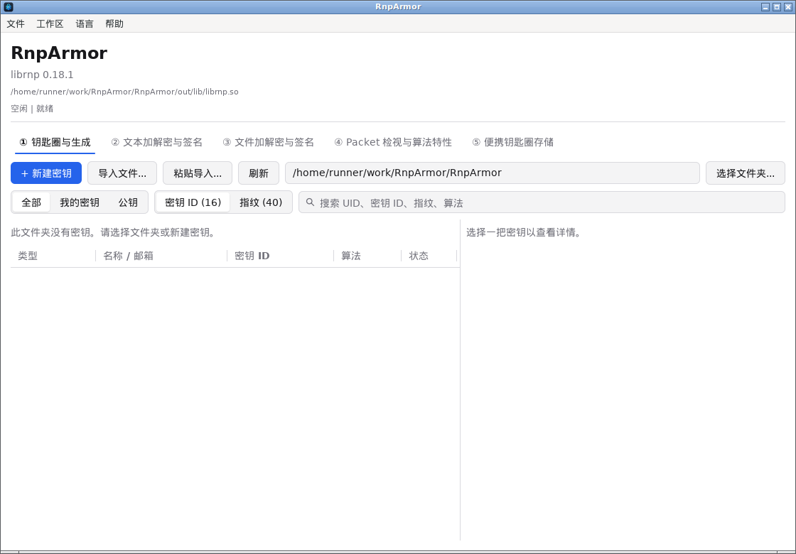
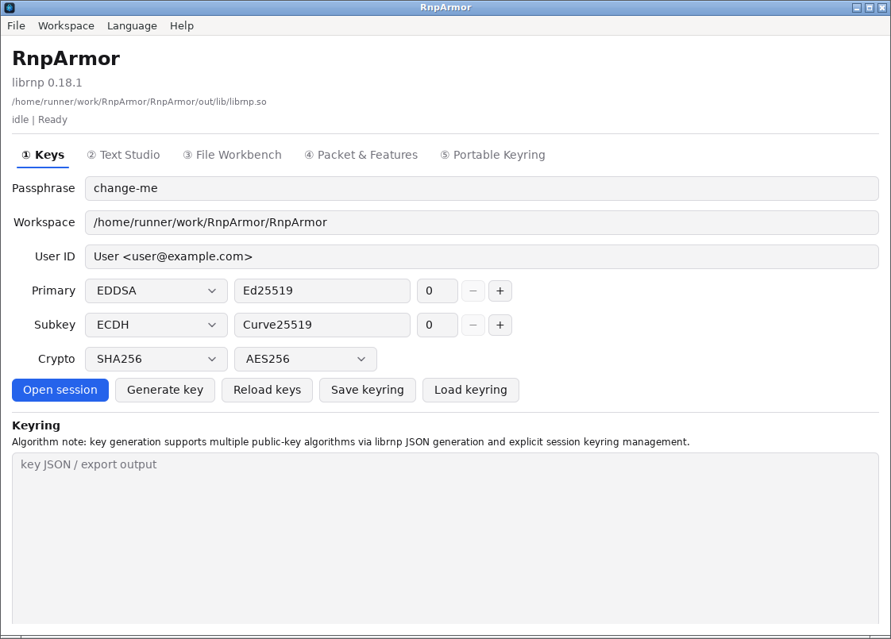
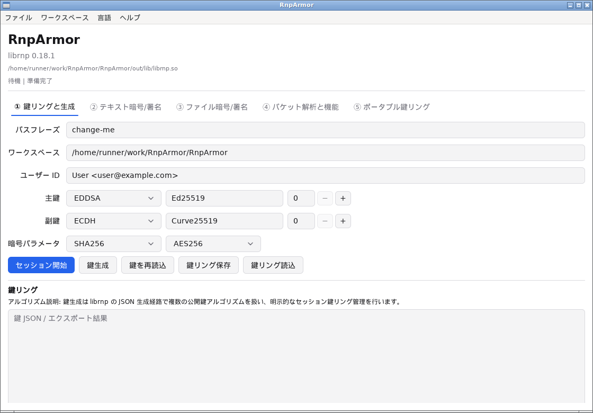
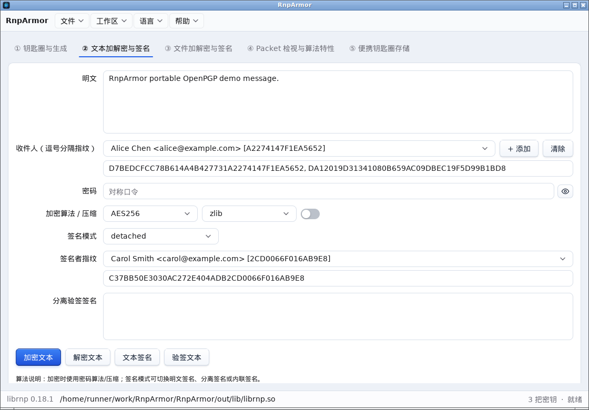
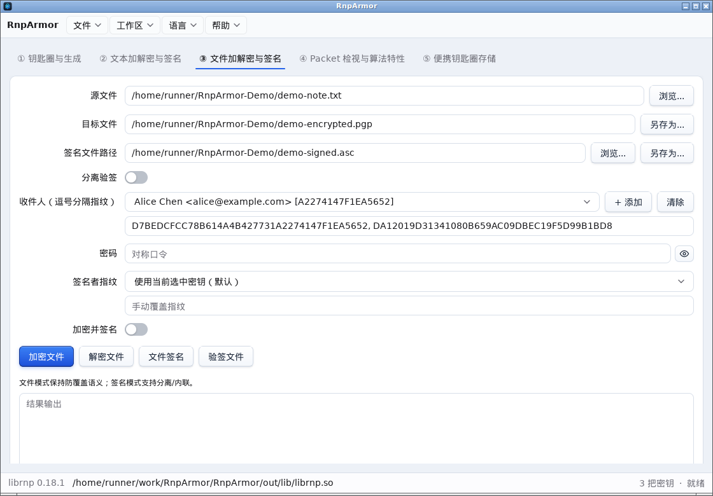
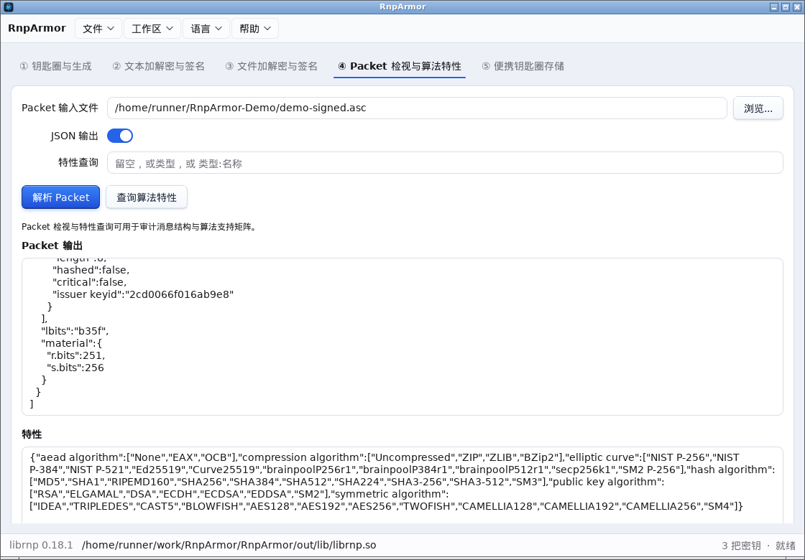
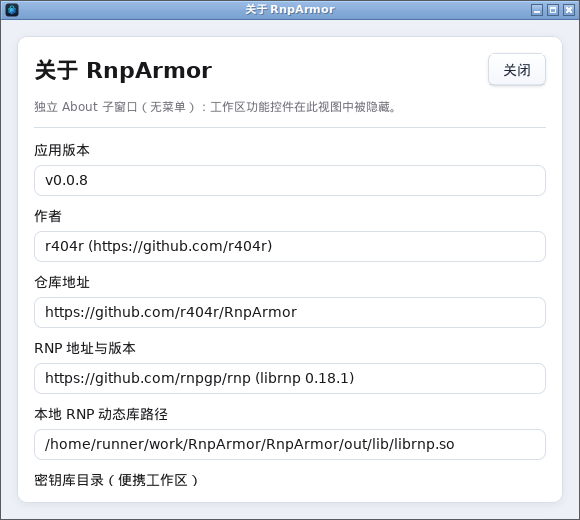

# RnpArmor

[English](README.md) | 简体中文

<p></p>

RnpArmor 是基于 MyGo 原生窗口与 `librnp v0.18.1` 的 OpenPGP 图形工具，提供 Windows 10/11 便携版与安装版（`rnparmor.exe` + `rnp.dll`）、macOS Apple Silicon（`arm64`）`.app`/`.dmg` 应用包以及 Linux（`amd64`）便携构建与测试链路。

> **用户指南**：安装部署、校验方法、五大工作区图文步骤与故障排查请见 [用户指南（`docs/USER_GUIDE.zh-CN.md`）](docs/USER_GUIDE.zh-CN.md)。
>
> 许可证：**Apache License, Version 2.0**（[`LICENSE`](LICENSE)）。第三方声明与许可文本见 [`third_party/NOTICES.md`](third_party/NOTICES.md) 及各平台分发包（Windows 与 Linux 位于 `LICENSE` 与 `licenses/`，macOS 位于 `RnpArmor.app/Contents/Resources/LICENSE` 与 `licenses/`）。

## 界面截图

Linux 运行时主窗口实机截图（`1120×780`，融合式 `文件 / 工作区 / 语言 / 帮助` 菜单栏、浅色 Fluent 双层卡片与底部固定状态栏 `librnp 0.18.1`、`3 把密钥 · 就绪`），通过 [`.github/workflows/linux-screenshot.yml`](.github/workflows/linux-screenshot.yml)、`cmd/seeddemo`（仅截图 CI 使用，不打入发布产物，写入 `Alice Chen` 含 2 把子密钥、`Carol Smith` 与仅公钥 `Bob Tanaka` 3 把演示密钥）及 [`scripts/capture-linux-screenshots.sh`](scripts/capture-linux-screenshots.sh) 自动采集：



<details>
<summary>英文界面截图</summary>



</details>

<details>
<summary>日文界面截图</summary>



</details>

<details>
<summary>更多工作区与独立 About 子窗口截图（简体中文）</summary>

**文本工作区**（`② 文本加解密与签名`，展示预填演示明文、收件人选择与指纹列表、`AES256` / `zlib`、签名者选择及 4 个文本操作按钮）：



**文件工作区**（`③ 文件加解密与签名`，展示演示源文件路径、目标加密文件路径、签名路径、收件人指纹及 4 个文件操作按钮）：



**Packet 与特性**（`④ Packet 检视与算法特性`，展示演示签名文件 `demo-signed.asc` 的真实 JSON Packet 解析结果与 `librnp 0.18.1` 算法支持矩阵）：



**独立无菜单非模态 About 子窗口**（`帮助 → 关于`，`580×520`，展示 `v0.0.7` 版本、作者、仓库地址、`librnp 0.18.1` 及本地动态库路径）：



</details>

## 功能总览

1. **浅色 Fluent 与磨砂玻璃视觉壳 + MyGo 五大工作区 GUI + 4 组菜单栏 + 独立 About 子窗口**
   - **浅色 Fluent 主题与双层景深（`cmd/rnparmor/style_ui.go`）**：
     - 专注浅色外观（`rnpLightTheme`），同时遵循系统高对比度、字号缩放与强调色偏好。
     - 双层景深布局：浅冷灰画布（`#edf1f7`，Windows 11 下开启原生 **Mica** 透底材质，Windows 10 与 Linux 自动降级为浅冷灰）托起各工作区与子窗口的纯白（`#ffffff`）圆角阴影卡片（`rnpCard`）。
     - 克制立体质感按钮（`rnpButton` / `rnpPrimaryButton` / `rnpDangerButton`）：主/次/危险按钮采用细腻垂直渐变、顶部高光与底部折边、悬停微浮阴影以及按下微沉 `1 DIP` 反馈。
     - 应用内下拉选择框、右键菜单、菜单面板与 Toast 轻提示统一接入 `mygo/plugins/glass` 磨砂玻璃与圆角投影效果。
   - 工作区：
     - 钥匙圈与生成（主从双栏密钥管理视图）
     - 文本加解密与签名验签
     - 文件加解密与签名验签
     - Packet 检视与算法特性
     - 便携钥匙圈存储
   - 三语词典位于 `cmd/rnparmor/i18n.go`，零外部依赖。
   - 应用图标（通过 `assets/icons/icons.go` 内嵌透明 `256×256` PNG `assets/icons/rnparmor-256.png`，即 `icons.AppIconPNG`）在运行时通过 `w.SetIcon(...)` 设置到主窗口及子窗口（**关于**、**新建密钥**、**粘贴导入密钥**），并在 macOS 上通过 `mygo.App.Dock.SetIcon(...)` 设置 Dock 图标。
   - 适配三平台的 4 组三语菜单栏（文件 / 工作区 / 语言 / 帮助）：
     - **Windows**：隐藏传统标题栏（`TitleBarHidden`，`40 DIP` 顶栏配 Mica 材质）并在窗口内顶部启用自绘融合式菜单栏（留出右上角系统窗口控制按钮安全区，标题与空白区域可直接拖动窗口）；**Linux**：保留窗口管理器标题栏并内嵌同款现代菜单栏；**macOS**：保持顶部原生系统菜单栏。
     - 文件：选择文件夹...、打开会话、加载钥匙圈、保存钥匙圈、退出。
     - 工作区：5 个单选菜单项，与工作区 Tab 双向联动。
     - 语言：三语单选项（`English`、`中文`、`日本語`），切换后实时刷新菜单栏、主窗口与已打开的子窗口（**关于**、**新建密钥**、**粘贴导入密钥**）。
     - 帮助：打开独立 About 子窗口（关于）。
   - 语言可由 `--lang en|zh|ja`、`RNPARMOR_LANG`、`LANG` 预设。
   - **底部固定状态栏与分级通知反馈**：
     - 主窗口最下方固定显示单行状态栏（精简移除原顶部堆叠的版本/路径/状态文字，释放工作区高度），展示 `librnp <版本>`、单行自动省略的 `librnp` / `rnp.dll` 库路径（悬停查看完整路径，点击一键复制并弹出**`已复制库路径`**轻提示）、当前主密钥数量，以及 **`就绪`** / **`忙碌 · <操作>`** 状态；
     - 采用分级结果反馈（方案 A）：常规操作成功在状态栏正上方弹出 4 秒自动收起的轻提示（悬停可暂停计时、可手动点击 **`×`** 关闭且不遮挡状态栏）；文本/文件验签结果与主窗口失败弹出应用内圆角 **`AlertDialog`**（点击 **`确定`** 关闭）；打开中的子窗口内联报错保留在子窗口本地；启动自动加载保持静默，且所有提示自动脱敏口令与私钥内容。
   - **独立无菜单非模态 About 子窗口（`580×520`）**：
     - 单实例聚焦、固定尺寸、无菜单栏（非 macOS 平台调用 `SetMenu(nil)`）、带关闭按钮。
     - 关闭 About 窗口不影响主窗口；主窗口关闭时联动关闭 **关于**、**新建密钥** 与 **粘贴导入密钥** 子窗口；语言切换时窗口标题与内容同步刷新。
     - 展示应用版本（`appVersion`，如 `v0.0.4` 或 `dev`）、作者（`r404r (https://github.com/r404r)`）、仓库地址（`https://github.com/r404r/RnpArmor`）、RNP 上游地址与 `librnp` 版本、本地动态库路径（`rnp.dll` / `librnp.so`）、密钥库目录（便携工作区路径及 `pubring.gpg`/`secring.gpg` 存在状态）与 GUI 框架/运行时栈（MyGo / purego / Botan 版本）。

2. **`internal/rnp` 能力扩展**
   - 补齐密钥迭代/定位（主密钥摘要内嵌子密钥 `Subkeys` 与受保护状态 `IsProtected`）、密钥导入（`ImportKeys`）、公私钥/吊销证书导出（`ExportRevocation`）、完整子密钥生命周期管理（`AddSubkey`、`SetKeyExpiration`、`RevokeKey`、`DeleteSubkey`，含用途算法合法性校验 `UsageAllowsAlg` 与拒绝误删主密钥保护）、删除、JSON 导出。
   - 支持无口令仅公钥/只读会话（`OpenOptionalPass`），以及仅 `pubring.gpg`（无 `secring.gpg`）的独立加载与保存。
   - 基于 `rnp_op_generate_*` 操作接口（`GenerateKeyWithSpec`）的多算法密钥生成、精确有效期设置（`0` 为永不过期，支持 `1`/`2`/`5` 年并写入 `rnp_op_generate_set_expiration`），以及可选 OpenPGP RFC 4880 无口令保护私钥生成（`Unprotected: true`）。
   - 文本能力：加密/解密、clearsign/detached/inline 签名与验签。
   - 文件能力：带选项的加解密与签名验签。
   - Packet 文本/JSON 检视与算法特性查询。
   - 验签结果扩展：状态、哈希、签名者、时间戳等。

3. **安全边界（portable 优先）**
   - 加载动态库前校验 `SHA256SUMS`。
   - Windows 端使用 `LoadLibraryEx` 约束搜索路径。
   - 仅支持显式路径钥匙圈读写，不依赖默认钥匙圈；启动默认空口令（不预填明文默认口令）、口令输入掩码化、私钥复制采用隐秘剪贴板标记，导出私钥与吊销证书使用 `0600` 权限。
   - 只读操作不改写磁盘钥匙圈，文件发布遵循防覆盖语义。

4. **Windows portable 构建、GUI 子系统与 smoke 流程加固**
   - Windows 构建使用 `-H=windowsgui`（Windows GUI 子系统），双击启动不弹出黑色控制台窗口。
   - `cmd/genwinres` 在构建期基于 `assets/icons/rnparmor.ico` 生成临时 AMD64 COFF `.syso` 资源文件，使 `rnparmor.exe` 内嵌 `.rsrc` 图标资源；`packaging/windows/rnparmor.iss` 配置 `SetupIconFile` 为安装程序设置图标。
   - `scripts/build-windows.ps1` 通过 `dumpbin /headers` 同时校验 `Windows GUI` PE 子系统与 `.rsrc` 资源节，并将子系统信息记录于 `windows-report.txt`。
   - `rnparmor.exe --smoke-test` 支持 `--smoke-out <path>` 将冒烟结果写入文件，便于 `-H=windowsgui` 产物在 CI 中进行确定性校验。
   - Windows 脚本先执行 `--smoke-test --smoke-out`，再做有超时保护的 GUI 进程探针。
   - Linux/Windows CI 作业均配置 `out/deps` 缓存。

5. **自动多平台打包发布工作流**
   - `.github/workflows/release.yml` 在 `v*` Tag 推送或手动触发时执行。
   - 同时构建 macOS Apple Silicon（`arm64`）、Linux（`amd64`）与 Windows（`amd64`）产物并附带各平台图标（macOS `RnpArmor.app` 内置 `RnpArmor.icns`、Linux 便携包附带 `rnparmor.png`、Windows 含 `.rsrc` 与 `SetupIconFile`）。
   - 三平台通过后创建/更新 GitHub Release，并上传：
     - `rnparmor-macos-arm64.dmg`（内含 ad-hoc 签名的 `RnpArmor.app`，最低 macOS 13.0）
     - `rnparmor-linux-amd64.tar.gz`
     - `rnparmor-windows-amd64-setup.exe`（Inno Setup 6 当前用户免管理员安装程序）
     - `rnparmor-windows-amd64.zip`（Windows 便携包）
     - `windows-report.txt`
     - `rnparmor-${TAG}-SHA256SUMS.txt`

## 架构与目录

- `assets/icons/`
  - `rnparmor.png`、`rnparmor-256.png`、`rnparmor.ico`、`RnpArmor.icns`：多平台透明应用图标资产。
  - `icons.go`、`icons_test.go`：内嵌 `rnparmor-256.png`（`icons.AppIconPNG`）供运行时窗口与 Dock 图标使用。
- `cmd/rnparmor/`
  - `main.go`：MyGo 主程序、分平台窗口外观策略（`mainWindowOptions`：Windows 隐藏标题栏并启用 Mica，Linux/macOS 保留默认标题栏）、运行时窗口/Dock 图标设置、自绘融合式或系统 4 组菜单栏（含 `文件 → 选择文件夹...`）、浅色 Fluent 画布/卡片与按钮适配（`prepareSurface` / `rnpCard` / `rnpButton`）、主窗口底部固定状态栏与 `AlertDialog` 宿主、启动静默自动加载钥匙圈（`runSilent`）、默认空口令与 `OpenOptionalPass`、5 工作区切换（在文本与文件工作区集成共享收件人/签名者下拉选择器、通过 `passphraseRow` 提供带独立显隐状态 `showTextEncPass`/`showFileEncPass` 的对称口令输入框，并在文件与 Packet 页嵌入原生文件选择按钮）、`580×520` 非模态 About 子窗口、`+ 新建密钥` 口令明文开关与提交校验状态（`newKeyShowPass`、`newKeyShowPass2`、`newKeyChecked`）、便携页 `passphraseRow` 解锁口令与 `showUnlockPass` 显隐开关、子密钥弹窗显隐状态（`subShowPass`、`expiryShowPass`、`revokeShowPass`，并在 `applyResult` 提交成功关闭时调用对应 `reset*PassUI`）、异步会话操作、`--smoke-out` 及构建注入 `appVersion` 展示/输出。
  - `style_ui.go`：浅色 Fluent 与局部磨砂玻璃视觉实现层（遵循系统高对比度/字号/强调色偏好的 `rnpLightTheme`、`#edf1f7` 画布与 Windows 11 原生 Mica 透底兼容、`rnpCard` 纯白圆角阴影卡片、带垂直渐变/高光/折边/1 DIP 按压下沉的 `rnpButton` / `rnpPrimaryButton` / `rnpDangerButton`、带 `passEyeIcon`/`passEyeOffIcon` SVG 图标与 `flipPassVisible` 的口令显隐切换按钮 `rnpPassEye`、表格紧凑展开按钮 `rnpDisclosure`、`useIntegratedMenuBar` / `viewIntegratedMenuBar` 可拖动融合菜单栏、`ui.PopoverMenus` + `mygo/plugins/glass` `menuGlass` / `glassMenuPanel` 下拉与右键磨砂浮层，以及 `toastGlass` 磨砂轻提示样式）。
  - `feedback_ui.go`：主窗口底部固定状态栏（`viewStatusBar`：半透明浅色底栏展示 `librnp` 版本、单行省略可悬停看全路径并点击复制的动态库路径、主密钥数量计数与 `就绪` / `忙碌 · <操作>` 状态）、位于状态栏正上方的 `toastGlass` 磨砂玻璃轻提示视口（`viewToastViewport`，`toastLifetime = 4s`、悬停暂停、手动 `×` 关闭）、方案 A 分级路由（`noteActionFeedback` / `feedbackRoute`：成功 Toast、验签结果与主窗口错误 `AlertDialog`、未关闭子窗口内联报错保留、启动静默加载）与 `safeNotice` 脱敏（口令替换 `••••` 并隐藏 `BEGIN PGP PRIVATE` / `BEGIN PGP SECRET` 区块）。
  - `keys_ui.go`：Phase 1 `rnpCard` 双栏钥匙圈管理工作区（`+ 新建密钥`、`导入文件...`、`粘贴导入...`、`刷新`、只读工作目录 + 原生`选择文件夹...`）、所有权分段过滤（`全部` / `我的密钥` / `公钥`）、`密钥 ID (16)` ↔ `指纹 (40)` 切换、实时搜索（覆盖主密钥与子密钥）、可排序可折叠主密钥树形表（`▾` / `▸` 采用 `rnpDisclosure`）、右侧详情检视栏（4 字符分组指纹复制并触发 `copyFingerprintText` 轻提示、徽章含主密钥`认证`与`无口令保护`、内嵌子密钥操作卡片与 `+ 添加子密钥...`、带确认提示/隐秘剪贴板/`0600` 落盘的公钥/私钥/吊销证书导出、原生二次确认 `删除密钥...`、可折叠 `原始密钥 JSON`）、脱敏异步错误弹窗（`reportAsyncErr`）、`validateNewKey`、`resetNewKeyPassUI`（在新建密钥弹窗打开、关闭及 `OnClosed` 回调时复位口令显示开关与校验报错），以及 `rnpCard` 样式的`粘贴导入密钥`独立子窗口。
  - `subkey_ui.go`：左侧树形可折叠子密钥行构建与选中高亮联动（默认展开的 `  └ 子密钥` 缩进行，联动 16/40 位 ID 展示）以及基于 `rnpCard` 的完整子密钥生命周期弹窗（`添加子密钥` `560×680` 按用途约束算法与曲线/位宽联动、`修改子密钥有效期` `480×420`、`吊销子密钥` `500×460` + 二次确认、警告确认`删除...`、子密钥`无口令保护`徽章、子密钥指纹复制轻提示、3 个子密钥弹窗的 `passphraseRow` + `rnpPassEye` 显隐开关与打开/关闭/`OnClosed`/提交自动复位函数 `resetAddSubPassUI`/`resetExpiryPassUI`/`resetRevokePassUI`，以及对无口令主密钥免填会话口令的支持——主动填写口令时仍可单独加密新子密钥）。
  - `keygen_ui.go`：采用 `rnpCard` 布局的可滚动 `560×640` `+ 新建密钥` 弹窗，提供 5 档算法预设（`现代推荐（Ed25519 + Curve25519）` 默认推荐、`RSA 4096 + RSA 4096`、`RSA 3072 + RSA 3072`、`NIST P-256（合规）` 与自动展开高级区的`自定义`）、预设偏离自动切回自定义逻辑、随所选主密钥/加密子密钥算法联动的有效曲线或位数选择器、`passphraseRow` 附带 `rnpPassEye` 口令显隐开关（打开/关闭/提交后自动复位隐藏）、口令不一致实时字段高亮与自动清除（`passMismatchVisible` / `syncNewKeyPassError`）、`submitNewKey` 拦截提交并显示红色内联错误框（覆盖单侧留空）、实时加密/未加密保存提示（双口令均留空时生成 RFC 4880 无口令私钥并通过 `takeNewKeyPassphrase` 保留现有会话口令），以及三语动态说明与悬停 Tooltip 提示。
  - `studio_ui.go`：Phase 2 共享主密钥收件人下拉选择器（`+ 添加` 忽略大小写与空格去重、`清除` 及手动编辑列表）、含私钥主密钥签名者下拉框（`使用当前选中密钥（默认）` + 手动指纹覆盖）以及文件工作区与 Packet 页的 Fluent 按钮与原生 `浏览...` / `另存为...` 文件对话窗封装。
  - `i18n.go`：EN/ZH/JA 三语词典（中文统一使用「主密钥 / 子密钥」，英文 `Primary Key / Subkey`，日文 `主鍵 / 副鍵`）、状态栏/轻提示/弹窗词条、新建密钥预设、口令显隐悬停提示（`tip.show_passphrase` / `tip.hide_passphrase`）、无口令保护徽章/未加密提示与子密钥管理说明/悬停提示、语言解析与完整性校验。
  - `main_test.go`：冒烟输出与文件写入、菜单模板结构、`TestFluentGlassChrome`（Windows 隐藏标题栏+Mica vs Linux/macOS 默认标题栏、融合菜单栏开关、浅色画布与高对比度/字号偏好、主/次/危险按钮外观及 `menuGlass` / `toastGlass` 校验）、`TestPassphraseEyeEverywhere`（验证全部 6 处工作区/子密钥显隐开关默认隐藏、`flipPassVisible` 空指针保护、彼此独立切换、关闭/`reset*PassUI`/`applyResult` 成功路径复位与失败报错保留、三语眼睛提示校验及 `.Password(` 仅存于 `keygen_ui.go` `passphraseRow` 的回归守卫）、状态联动、`TestKeyManagerFilterSearchSortAndForms`（钥匙圈筛选/搜索/排序/ID 切换、设口令与空口令校验、眼睛显隐切换与关闭复位、口令不一致实时字段提示/提交拦截不改动会话口令及修改一致后自动清除）、`TestKeygenPresetsSyncAndTips`、`TestSubkeyTableExpiryUsageAndCatalog`、`TestStudioKeyPickersAndFileDialogPaths`、`TestI18nComplete`、`TestStatusBarAndFeedback`、文本解密/验签输入解析、收件人留空回退规则单元测试，以及基于真实 `librnp` 的端到端 GUI 动作回归单测（`TestUIStateActionsEndToEnd` 与 `TestUIStateEmptyPassphraseLifecycle`）。
- `cmd/genwinres/`
  - `main.go`：零第三方依赖的纯 Go AMD64 COFF `.syso` 资源生成器，构建时将 `rnparmor.ico` 临时嵌入 `rnparmor.exe`。
- `cmd/seeddemo/`
  - `main.go`、`main_test.go`：仅用于截图 CI 的临时演示数据初始化工具（`--dir`），写入 3 把演示主密钥（`Alice Chen` 含口令及额外签名子密钥、`Carol Smith` 无口令保护、`Bob Tanaka` 仅公钥）及 `demo-note.txt`、`demo-signed.asc`、`demo-encrypted.pgp` 演示文件，不进入发布包。
- `internal/loadlib/`
  - `open.go`：绝对路径解析 `librnp` 并于加载前校验 `SHA256SUMS`，针对 macOS `.app` 包结构支持从 `Contents/MacOS/SHA256SUMS` 回退至 `Contents/Resources/SHA256SUMS`。
- `internal/rnp/`
  - `api.go`：purego 对 librnp 的 FFI 绑定（含 `rnp_key_is_protected` 及 `rnp_op_generate_*` 密钥/子密钥生成操作接口）。
  - `session.go`：会话生命周期（`Open`、`OpenOptionalPass`）、口令回调控制、数据模型（含 `KeySummary.Subkeys`、`IsSub`、`IsProtected`、`CanAuth`、`KeyGenRequest.Unprotected`、`SubkeyGenRequest.Unprotected`）。
  - `ops.go`：密钥管理（`GenerateKeyWithSpec` 改用 `librnp` `rnp_op_generate_*` 操作接口直接写入 `ExpirationSec`，避免 `librnp 0.18.1` 中 `rnp_generate_key_json` 忽略 `"expiration"` 并默认回落 2 年，从而让 `0` 永不过期与 `1`/`2`/`5` 年同时作用于主密钥与加密子密钥；并包含主密钥内嵌子密钥摘要、`UsageAllowsAlg`、`AddSubkey`、`SetKeyExpiration`、`RevokeKey`、带防误删主密钥保护的 `DeleteSubkey`、RFC 4880 无口令保护私钥与子密钥生成、仅公钥 `SaveTo`/`LoadFrom`、吊销证书导出）、文本/文件加解密签名验签、Packet/特性接口。
  - `session_test.go`：兼容测试 + 扩展测试（含 `TestSubkeyLifecycle`、`TestEmptyPassphraseKeyLifecycle`、`TestGenerateKeyExpiration` 实测 `Never`/指定年限对主密钥与子密钥的生效校验及仅公钥钥匙圈测试）。
- `scripts/build-windows.ps1`：Windows 构建脚本，调用 `cmd/genwinres` 嵌入临时 `.syso` 图标、编译 `-H=windowsgui` 便携包与 Inno Setup 6 安装包（`rnparmor-windows-amd64-setup.exe`）、校验 PE 子系统、`.rsrc` 资源节与 DLL 导入表，并运行测试、`--smoke-out` 冒烟与打包。
- `scripts/build-macos.sh`：macOS Apple Silicon（`arm64`）构建脚本，编译静态依赖（`Botan 3.10.0` + `json-c 0.19`）与 `librnp.dylib`，组装 `RnpArmor.app`（写入 `Contents/Resources/RnpArmor.icns` 与 `Info.plist` 的 `CFBundleIconFile`），执行 ad-hoc `codesign --verify --deep --strict`、`go test`、`--smoke-test`，最终打包 `rnparmor-macos-arm64.dmg`。
- `scripts/capture-linux-screenshots.sh`：通过 `--seeder` 初始化演示钥匙圈后，在无头 X11（`Xvfb` + `openbox`）下结合 `--lang en|zh|ja` 与 `RNPARMOR_DEMO_SCENE` 依次截取并校验全部 11 张聚焦窗口 PNG（分辨率与非空白像素方差）。
- `packaging/windows/rnparmor.iss`：Windows 安装程序（`rnparmor-windows-amd64-setup.exe`）的 Inno Setup 6 脚本（含 `SetupIconFile`）。
- `docs/`
  - `USER_GUIDE.md` / `USER_GUIDE.zh-CN.md`：中英文双语终端用户安装、工作区操作与排查指南。
  - `screenshots/`：Linux 演示钥匙圈 11 张实机截图（主窗口 `rnparmor-linux-{en,zh,ja}.png` 及文本/文件/Packet/About `rnparmor-linux-{text,file,packet,about}-{en,zh}.png`）。
- `.github/workflows/smoke.yml`：`linux`、`windows-portable` 与 `macos-arm64` 三平台 CI（含缓存与同分支并发自动取消）。
- `.github/workflows/release.yml`：Tag/手动触发的多平台自动打包发布。
- `.github/workflows/linux-screenshot.yml`：编译 `librnp.so`、`rnparmor` 与 `seeddemo` 并调用 `scripts/capture-linux-screenshots.sh` 采集 11 张 Linux 实机截图（含 `cmd/rnparmor/**`、`cmd/seeddemo/**`、`scripts/capture-linux-screenshots.sh`、`.github/workflows/linux-screenshot.yml` 或 `assets/icons/**` PR 变更触发），上传 `rnparmor-linux-screenshots` artifact，并可在非 `main` 分支将更新后的 11 张 PNG 提交至 `docs/screenshots/`。

## 五大工作区说明

### 1）钥匙圈与生成

- 主从双栏密钥管理视图，顶部工具栏集成 `+ 新建密钥`、`导入文件...`、`粘贴导入...`、`刷新` 与只读工作目录 + 原生`选择文件夹...` 选择器。
- 支持 `全部` / `我的密钥` / `公钥` 分段过滤、`密钥 ID (16)` ↔ `指纹 (40)` 切换、按 UID / Key ID / 指纹 / 算法实时搜索（同时匹配主密钥与子密钥），以及可排序的树形可折叠主密钥列表（带 `▾` / `▸` 折叠按钮，默认展开显示缩进的 `  └ 子密钥` 行与用途/ID/算法/状态，点击子密钥行同步选中主密钥详情并高亮对应子密钥卡片）。
- 右侧详情栏展示 4 字符分组完整指纹与一键复制、所有权/状态/`无口令保护`/能力徽章（含主密钥`认证`徽章）、`子密钥`卡片列表与含私钥主密钥下的完整子密钥生命周期操作（`+ 添加子密钥...` `560×680` 按用途校验允许算法、`续期 / 改有效期...` `480×420`、`吊销...` `500×460` + 二次确认，以及带保护提示且拒绝误删主密钥的`删除...`；三个子密钥弹窗口令框均统一采用 `passphraseRow` / `rnpPassEye` 显隐开关并在打开、关闭及提交后自动复位隐藏）、`复制公钥` / `导出公钥 (.asc)...`、私钥专属的确认弹窗`导出私钥 (.asc)...` / 隐秘剪贴板`复制私钥` / `吊销证书...`（`.rev.asc`）、原生二次确认`删除密钥...` 及可折叠`原始密钥 JSON`。对`无口令保护`主密钥执行添加子密钥、续期、吊销、删除及后续加解密、签名验签时均允许留空口令（若在`+ 添加子密钥...`中主动填写口令，新建子密钥仍会单独加密保护）。
- 独立 `+ 新建密钥` 弹窗（`560×640`）支持名称/邮箱、可选掩码`口令` + `确认口令`（两侧均配有 `rnpPassEye` 眼睛图标显隐开关及三语 `显示口令`/`隐藏口令` 悬停提示，打开、关闭及提交后自动复位隐藏）、口令不一致时即时触发红色字段高亮并在点击提交后弹出红色内联错误框通过 `submitNewKey` 拦截生成（含单侧留空，修正一致后由 `syncNewKeyPassError` 自动清除）、有效期（`永不` / `1 年` / `2 年` / `5 年` 底层改由 `rnp_op_generate_*` 操作接口写入，确保 `永不` 即 `0` 秒真正永不过期而不再受 `librnp 0.18.1` 默认 2 年回落影响），提供 5 档算法预设（`现代推荐（Ed25519 + Curve25519）` 默认推荐、`RSA 4096 + RSA 4096`、`RSA 3072 + RSA 3072`、`NIST P-256（合规）` 与`自定义`）以及可折叠高级算法选项（按主密钥/加密子密钥算法联动有效曲线与位数，并提供三语动态说明与悬停提示）。两项口令均留空时，下方明确提示将以未加密形式保存并生成 OpenPGP RFC 4880 无口令保护私钥；启动默认空口令状态下即可浏览与导入仅公钥钥匙圈（仅 `pubring.gpg`）。
- 只读操作不改写磁盘钥匙圈，空会话显式保存受保护报错，删除最后一把密钥会清理空文件。

### 2）文本工作区

- 已加载主密钥收件人下拉选择 + `+ 添加` / `清除`（忽略大小写与空格去重），同时支持手动粘贴与编辑逗号分隔指纹；收件人与密码均留空时回退到当前已选择密钥。
- 对称加密**密码**通过 `passphraseRow` 输入，默认掩码遮蔽并配有独立 `rnpPassEye` 显隐开关（含三语悬停提示与无障碍标签）。
- 含私钥主密钥签名者下拉框（首项`使用当前选中密钥（默认）`）配合手动指纹覆盖框。
- 文本加密（收件人模式 / 密码模式 / 可选加密同时签名）。
- 文本解密（支持直接向明文框粘贴外部 PGP 密文或解密暂存输出）。
- 三种签名模式：
  - 明文签名（clearsign）
  - 分离签名（detached）
  - 内联签名（inline）
- 验签结果展示签名元数据（支持外部明文/内联签名粘贴、分离签名或暂存输出）。

### 3）文件工作区

- 原生文件选择器：`源文件`（`浏览...`，默认优先所有文件）、`目标文件`（`另存为...`，默认优先所有文件）与`签名文件路径`（同时提供`浏览...` 与 `另存为...`，默认优先 OpenPGP 扩展名）。
- 直接在文件工作区内嵌与文本工作区共享的`收件人`、带独立 `rnpPassEye` 显隐开关的掩码`密码`、`签名者指纹`与`加密并签名`控件，无需切换标签页即可独立配置。
- 文件加密/解密。
- 分离与内联签名验签。
- 延续防覆盖发布语义与绝对路径限制。

### 4）Packet 与特性

- `Packet 输入文件`支持原生`浏览...` 文件打开对话窗（默认优先 OpenPGP 扩展名），支持 OpenPGP Packet 文本或 JSON 解析。
- 全局或 `type:name` 的特性查询。

### 5）便携钥匙圈存储

- 只读**工作目录**展示 + 原生**选择文件夹...** 选择器，支持显式`打开并加载`、`保存`与`刷新密钥`（兼容仅 `pubring.gpg` 与完整 `pubring.gpg` + `secring.gpg`）。
- 通过 `passphraseRow` 提供的掩码**口令**输入框与独立 `rnpPassEye` 显隐开关（启动默认为空，仅在会话私钥解锁等操作期间以内存形式使用）。

### 6）分平台 4 组菜单栏、磨砂浮层与独立 About 子窗口

- 窗口外观与 4 组菜单栏（文件 / 工作区 / 语言 / 帮助）：
  - **Windows**：隐藏传统标题栏（`40 DIP` 顶栏，Windows 11 开启原生 Mica 透底，Windows 10 自动降级浅冷灰画布），在窗口顶部自绘融合式菜单栏并留出右上角系统窗口按钮区，应用标题与菜单空白区支持直接拖动窗口。
  - **Linux**：保留窗口管理器原生标题栏与控制按钮，同时在窗口顶部内嵌同款融合式菜单栏。
  - **macOS**：保持顶部原生系统菜单栏，并在选项卡上方显示应用标题。
- 各工作区与独立子窗口内容均置于浅冷灰/Mica 背景上的纯白 `#ffffff` 圆角卡片（`rnpCard`）中，搭配渐变高光按压微沉按钮以及基于 `mygo/plugins/glass` 的磨砂下拉框、右键菜单与轻提示。
- 点击「帮助 → 关于」打开 `580×520` 固定尺寸、非模态的独立无菜单子窗口（单实例聚焦、无菜单栏、带关闭按钮）。
- 关闭 About 子窗口不影响主窗口；主窗口关闭时联动关闭 About 子窗口；切换语言时其标题与内容同步更新。
- 仅展示只读信息（应用版本、作者、仓库、RNP 上游、本地动态库路径、便携密钥库目录及 `pubring.gpg`/`secring.gpg` 存在状态、运行时栈），并明确提示不读取系统默认钥匙圈。

### 7）底部固定状态栏与分级通知反馈

- 原顶部堆叠的版本、库路径与状态文字已精简移除，改为主窗口最底部固定状态栏（`RoleStatus`），释放主工作区纵向空间。
- 底部状态栏集中展示：`librnp <版本>`、单行省略的 `librnp` / `rnp.dll` 库路径（悬停查看完整路径，点击一键复制并触发**`已复制库路径`**轻提示）、当前主密钥数量（`<N> 把密钥`）及实时状态（**`就绪`** 或 **`忙碌 · <操作>`**）。
- 操作结果按重要程度分级展示：
  - 常规操作成功（生成、导入、导出、复制公钥/私钥/指纹/库路径、删除、加解密、签名、解析数据包、查询特性、钥匙圈加载/保存、子密钥管理等）在状态栏正上方弹出 4 秒自动收起的轻提示（悬停可暂停计时、可手动点 **`×`** 关闭且不遮挡状态栏）。
  - 文本/文件验签结果与主窗口操作失败弹出圆角应用内 **`AlertDialog`**（点击 **`确定`** 关闭）。
  - 打开状态的**新建密钥**、**粘贴导入密钥**、**添加子密钥**、**修改子密钥有效期**、**吊销子密钥**等子窗口内发生的错误保留在子窗口内联红字提示；启动自动加载保持静默，且所有提示均经过脱敏处理。

## 验签语义

界面刻意区分两类信号：

- **数学有效**：签名与内容/密钥在密码学上匹配。
- **身份可信**：签名者是否被策略信任。

RnpArmor 默认只报告前者，不会自动推断后者。

## 命令行

```bash
# 探测 librnp + 校验三语词典，不进入 GUI 循环
rnparmor --smoke-test

# 将冒烟输出写入指定文件（用于 Windows -H=windowsgui 构建的 CI 确定性校验）
rnparmor --smoke-test --smoke-out out/smoke-out.txt

# 强制界面语言
rnparmor --lang en
rnparmor --lang zh
rnparmor --lang ja
```

预期 smoke 输出含：

```text
status=ok
app_version=dev
library=...
version=...
i18n=ok
```

语言预设优先级：

1. `--lang`
2. `RNPARMOR_LANG`
3. `LANG`
4. 默认 `en`

## 构建与测试

### Linux

```bash
bash scripts/build-librnp.sh
export RNPARMOR_LIBRNP="$PWD/out/lib/librnp.so"
go test ./...
CGO_ENABLED=1 go test -race -gcflags=all=-d=checkptr=0 ./...
CGO_ENABLED=0 go build -o rnparmor ./cmd/rnparmor
```

### macOS（Apple Silicon / arm64）

```bash
# 一键执行：按序执行 deps -> rnp -> package（默认 --stage all）
bash scripts/build-macos.sh

# 分阶段模式（便于本地迭代与 CI 缓存）
bash scripts/build-macos.sh --stage deps
bash scripts/build-macos.sh --stage rnp
bash scripts/build-macos.sh --stage package

# 注入版本号到 Info.plist 与二进制元数据
bash scripts/build-macos.sh --stage package --version v0.0.1
```

`scripts/build-macos.sh` 面向 Apple Silicon（`arm64`），最低系统要求 `MACOSX_DEPLOYMENT_TARGET=13.0`（`LSMinimumSystemVersion=13.0`）：

- `deps`：按 `scripts/windows/botan3-modules.txt` 的 57 个模块清单编译静态 `Botan 3.10.0`（写入 `.modules-sha256` 校验印记）与静态 `json-c 0.19` 到 `out/deps`。
- `rnp`：构建 `librnp.dylib`（install name 为 `@loader_path/librnp.dylib`），静态链接 Botan 与 `json-c`，动态链接 macOS 系统自带 `/usr/lib/libz` 与 `/usr/lib/libbz2` 以及 `-framework Security`（通过 `otool -L` 校验无外部 Homebrew 等非系统路径依赖）。
- `package`：构建 `CGO_ENABLED=0 GOOS=darwin GOARCH=arm64` 的 `rnparmor`，组装 `out/dist/RnpArmor.app`（`Contents/MacOS/rnparmor`、`Contents/MacOS/librnp.dylib`、`Contents/Resources/RnpArmor.icns`、`Contents/Resources/LICENSE`、`Contents/Resources/SHA256SUMS` 与 `Contents/Resources/licenses/`，并在 `Info.plist` 写入 `CFBundleIconFile`），在严格签名校验前检查图标完备性，执行 ad-hoc 签名与 `codesign --verify --deep --strict`，运行 `go test` 与 `--smoke-test`，最终通过 `hdiutil create` 生成 `out/rnparmor-macos-arm64.dmg`。

> macOS Gatekeeper 提示：`RnpArmor.app` 仅作 ad-hoc 签名且**未经过 Apple 公证**。首次在访达中打开可能触发 Gatekeeper 安全提示（如遇提示，可通过右键 → 打开或在「系统设置 → 隐私与安全性」中放行）。

### Windows（portable 与安装版）

```powershell
# 一键（兼容旧习惯）：按序执行 deps -> rnp -> package（默认 -Stage all）
pwsh -File .\scripts\build-windows.ps1

# 粗粒度分阶段模式
pwsh -File .\scripts\build-windows.ps1 -Stage deps
pwsh -File .\scripts\build-windows.ps1 -Stage rnp
pwsh -File .\scripts\build-windows.ps1 -Stage package

# 细粒度依赖阶段（CI 用于分段观测耗时与缓存复用）
pwsh -File .\scripts\build-windows.ps1 -Stage fetch-deps
pwsh -File .\scripts\build-windows.ps1 -Stage botan
pwsh -File .\scripts\build-windows.ps1 -Stage small-deps

# 注入应用版本（用于 --smoke-test / About 显示）
pwsh -File .\scripts\build-windows.ps1 -Version v0.0.1

# 分阶段 + 版本注入
pwsh -File .\scripts\build-windows.ps1 -Stage package -Version v0.0.1
```

Windows 依赖构建钉扎并打包以下组件：

- `Botan 3.10.0`：按 `scripts/windows/botan3-modules.txt` 中的精简静态模块清单（共 57 个模块，每行一个模块，支持注释）编译静态库，对齐 `rnpgp/rnp v0.18.1` 的 OpenPGP 能力需求，避免在 CI 中编译不必要的 CLI/测试与非 OpenPGP 模块。
- `json-c 0.19`、`zlib 1.4`、`bzip2 1.0.8`：编译为静态库并链接进 `rnp.dll`。
- `dirent 1.24`（`tronkko/dirent`，MIT 许可）：Windows 构建 `librnp` 所需的头文件兼容依赖（`dirent.h`）。
- 上述及 Go/RNP 第三方许可证文本（`rnp-LICENSE.md`、`sexpp-LICENSE.md`、`botan-license.txt`、`dirent-LICENSE`、`json-c-COPYING`、`zlib-LICENSE`、`bzip2-LICENSE`、`mygo-MIT.txt`、`purego-Apache-2.0.txt`）均随 Windows portable 包打入 `licenses/` 目录。

`scripts/build-windows.ps1` 支持以下 `-Stage` 阶段参数：

1. `fetch-deps`：下载、校验并解压 `Botan 3.10.0`、`json-c 0.19`、`zlib 1.4`、`bzip2 1.0.8` 与 `dirent 1.24` 源码到 `out/src`（若 `out/deps` 热缓存已完整则自动跳过）
2. `botan`：编译并安装精简静态 `Botan 3.10.0` 到 `out/deps/botan`（写入 `.modules-sha256` 校验印记）
3. `small-deps`：编译并安装静态 `json-c`、`zlib`、`bzip2` 到 `out/deps`，准备 `dirent.h` 并将依赖许可证缓存至 `out/deps/licenses`
4. `deps`：依次执行 `fetch-deps -> botan -> small-deps`
5. `rnp`：基于缓存依赖编译 `librnp`（`rnp.dll`），并缓存至 `out/win-build/rnp-dll/rnp.dll`
6. `package`：调用 `cmd/genwinres` 基于 `assets/icons/rnparmor.ico` 生成临时 `cmd/rnparmor/rsrc_windows_amd64.syso`，使用 `-H=windowsgui` 构建 `rnparmor.exe` 并清理临时 `.syso`，复制 `rnp.dll`、`LICENSE` 与 `licenses/`，校验 `Windows GUI` PE 子系统、`.rsrc` 资源节（`dumpbin /headers`）与 DLL 导入表（`DEPENDENCIES.txt`），生成 `PORTABLE.txt` 与 `SHA256SUMS`，对打包后的 `rnp.dll` 执行 `go test`，运行 `--smoke-test --smoke-out` 与 GUI 探针，并产出便携 zip、Inno Setup 6 安装包（`SetupIconFile=..\..\assets\icons\rnparmor.ico`）与报告
7. `all`：依次执行 `deps -> rnp -> package`（默认）

`package` 阶段会生成 `out\dist\rnparmor-windows-amd64`，使用 `packaging/windows/rnparmor.iss` 与 Inno Setup 6（`ISCC.exe`）打包安装程序，并执行：

1. `dumpbin /headers` 校验，确认 `rnparmor.exe` 为 `Windows GUI` 子系统（记录至 `out\windows-report.txt`）且包含 `.rsrc` 图标资源节
2. 将 `RNPARMOR_LIBRNP` 指向打包目录内的 `rnp.dll`、并将 `PATH` 收窄到 `System32` 后运行 `go test -count=1 -timeout 20m ./internal/loadlib/ ./internal/rnp/ ./cmd/rnparmor/`
3. 执行 `rnparmor.exe --smoke-test --smoke-out <path>`（核对 `status=ok`、`app_version=<Version>` 与 `i18n=ok`）
4. 执行带超时保护的 GUI 进程探针

输出产物：`out\rnparmor-windows-amd64.zip`、`out\rnparmor-windows-amd64-setup.exe`（默认当前用户免管理员安装 `PrivilegesRequired=lowest`，支持开始菜单快捷方式、可选桌面快捷方式与标准卸载）与 `out\windows-report.txt`。

## CI

工作流文件：`.github/workflows/smoke.yml`

- `linux` 作业：
  - `out/deps` 缓存
  - pinned `librnp` 构建 + `go test -race` + `CGO_ENABLED=0` 构建
- `windows-portable` 作业：
  - 使用 `actions/cache/restore@v4` 恢复 `out/deps`，并在 `small-deps` 之后执行 `actions/cache/save@v4` 保存缓存
  - CI 拆分为 `fetch-deps -> botan -> small-deps -> save cache -> rnp -> package`，以提升各阶段耗时观测性与依赖缓存复用率
  - 缓存键：`${{ runner.os }}-deps-v4-${{ hashFiles('deps/pins.json', 'scripts/windows/**') }}`
  - 上传 `out/rnparmor-windows-amd64.zip`、`out/rnparmor-windows-amd64-setup.exe` 与 `out/windows-report.txt`
- `macos-arm64` 作业（`runs-on: macos-15`）：
  - 使用 `out/deps` 缓存，缓存键 `${{ runner.os }}-arm64-deps-v1-${{ hashFiles('deps/pins.json', 'scripts/windows/botan3-modules.txt', 'scripts/build-macos.sh') }}`
  - 分阶段流程：`deps -> save cache -> rnp -> package`
  - 上传 `out/rnparmor-macos-arm64.dmg`

发布文件：`.github/workflows/release.yml`

- 触发条件：
  - 推送 `v*` Tag
  - 手动触发（可选 `tag` 输入）
- 作业：
  - `linux-portable`：构建/测试/打包 `rnparmor-linux-amd64.tar.gz`（随包附带 `assets/icons/rnparmor.png` 即 `rnparmor.png`）
  - `windows-portable`：沿用相同的 `deps-v4` 缓存键与分段流水线（`fetch-deps -> botan -> small-deps -> save cache -> rnp -> package -Version "${{ steps.tag.outputs.value }}"`），产出 `rnparmor-windows-amd64.zip`、`rnparmor-windows-amd64-setup.exe` 与 `windows-report.txt`
  - `macos-arm64`（`runs-on: macos-15`）：沿用相同的 `arm64-deps-v1` 缓存键与分段流水线（`deps -> save cache -> rnp -> package --version "${{ steps.tag.outputs.value }}"`），产出 `rnparmor-macos-arm64.dmg`
  - `publish-release`：三平台均通过后创建/更新 GitHub Release，上传 `rnparmor-macos-arm64.dmg`、`rnparmor-linux-amd64.tar.gz`、`rnparmor-windows-amd64-setup.exe`、`rnparmor-windows-amd64.zip`、`windows-report.txt` 与统一校验文件 `rnparmor-${TAG}-SHA256SUMS.txt`

截图工作流：`.github/workflows/linux-screenshot.yml`

- 触发条件：
  - `workflow_dispatch`（可选 `commit_screenshots` 布尔输入，仅限非 `main` 分支）
  - 修改 `scripts/capture-linux-screenshots.sh`、`.github/workflows/linux-screenshot.yml`、`assets/icons/**`、`cmd/rnparmor/**` 或 `cmd/seeddemo/**` 的 `pull_request`
- `linux-screenshot` 作业（`runs-on: ubuntu-latest`）：
  - 构建 pinned `librnp.so`、`rnparmor` 与 `seeddemo`，在 `Xvfb` + `openbox` 下运行 `scripts/capture-linux-screenshots.sh`，上传 `rnparmor-linux-screenshots`（`out/screenshots/*.png`），并按条件在非 `main` 分支提交全部 11 张 `docs/screenshots/rnparmor-linux-*.png` 截图

## 安全边界与注意事项

- 动态库加载路径受控并做完整性校验。
- 不读写默认钥匙圈，必须显式目录。
- 口令回调重入被设计性阻断；启动默认空口令（不再预填明文默认口令），全应用全部 8 处密码输入框（`+ 新建密钥` 口令与确认口令、文本工作区对称密码、文件工作区对称密码、便携钥匙圈解锁口令以及添加子密钥/修改子密钥有效期/吊销子密钥弹窗）均默认做掩码遮蔽并配有 `rnpPassEye` 显隐开关（弹窗打开、关闭及提交后自动复位隐藏），私钥复制采用隐秘剪贴板标记；所有通知与报错均经过 `safeNotice` 自动脱敏，将内存口令替换为 `••••` 并隐去私钥区块明细（`详情已隐藏，因为其中可能包含密钥材料。`）。若刻意在 `+ 新建密钥` 中双项留空口令以生成`无口令保护`私钥，磁盘私钥将按 OpenPGP RFC 4880 未加密保存（虽保留 Unix `0600` 文件权限，但文件泄露即可直接使用），建议仅用于本地隔离、自动化测试或明确可接受磁盘明文风险的场景，日常主力密钥仍建议设置高强度口令。
- 内存路径有输入/输出体积上限。
- 当前阶段仍建议避免在测试环境使用真实生产密钥与口令。

## 仓库状态说明

- `v0.0.1`–`v0.0.8` 多平台版本均已发布（覆盖 macOS `arm64`、Linux `amd64` 与 Windows `amd64`）：`v0.0.2` 合入 Apache-2.0 许可证（[`LICENSE`](LICENSE)）、Linux 实机截图、三端应用图标与双语用户指南（[`docs/USER_GUIDE.md`](docs/USER_GUIDE.md) / [`docs/USER_GUIDE.zh-CN.md`](docs/USER_GUIDE.zh-CN.md)），`v0.0.3` 修复了 GUI 操作重入死锁与钥匙圈持久化边界问题，`v0.0.4` 合并发布 Phase 1（主从双栏 Keys 管理页、16/40 位 ID 切换、掩码双口令新建密钥弹窗、空口令公钥只读打开与原生文件夹选择器）、Phase 2（`cmd/rnparmor/studio_ui.go` 共享收件人/签名者下拉、掩码对称口令与文件/Packet 原生文件对话窗）及 Release 发布重试与取消草稿加固，`v0.0.5` 合入 PR #14（`+ 新建密钥` 5 档算法预设、动态参数联动、统一`主密钥 / 子密钥`术语、三语动态说明与悬停提示及 `TestKeygenPresetsSyncAndTips`）和 PR #15（`cmd/rnparmor/subkey_ui.go`、左侧树形可折叠子密钥列表、完整子密钥生命周期接口 `AddSubkey`/`SetKeyExpiration`/`RevokeKey`/`DeleteSubkey`、`TestSubkeyLifecycle`、`TestSubkeyTableExpiryUsageAndCatalog` 及扩展 `TestUIStateActionsEndToEnd`），`v0.0.6` 合入 PR #16（双空口令 RFC 4880 无口令保护私钥生成、`无口令保护`徽章、无口令主密钥下子密钥与加解密免口令支持、`TestEmptyPassphraseKeyLifecycle` 及 `TestUIStateEmptyPassphraseLifecycle`），`v0.0.7` 发布 PR #17（`cmd/rnparmor/feedback_ui.go`、底部固定状态栏、点击库路径复制轻提示、方案 A 分级通知反馈、`TestI18nComplete`、`TestStatusBarAndFeedback`）与 PR #18（`cmd/rnparmor/style_ui.go` 浅色 Fluent 主题、#edf1f7 / Windows 11 Mica 与纯白 `rnpCard` 双层景深、渐变高光 1 DIP 按压立体按钮、Windows/Linux 融合式菜单栏与 macOS 系统菜单栏、`mygo/plugins/glass` 磨砂下拉/右键/Toast 浮层及 `TestFluentGlassChrome`），`v0.0.8` 发布 PR #19（`cmd/seeddemo` 与 `docs/screenshots/` 11 张 Linux 演示截图刷新并图文同步至双语文档）与 PR #20（`+ 新建密钥` `rnpPassEye` 显隐开关、口令不一致实时高亮与强阻断、`GenerateKeyWithSpec` 改用 `rnp_op_generate_*` 修复永不过期与年限生效、`TestGenerateKeyExpiration` 及扩展 `TestKeyManagerFilterSearchSortAndForms`）。
- 待随后续版本推出的分支 `feat/passphrase-eye-everywhere` 变更（`v0.0.9` 尚未发布）：将 `passphraseRow` / `rnpPassEye`（含三语悬停提示与无障碍标签）推广至其余全部 6 处密码输入框——文本工作区对称密码（`showTextEncPass`）、文件工作区对称密码（`showFileEncPass`）、便携钥匙圈解锁口令（`showUnlockPass`）以及添加子密钥（`subShowPass`）、修改子密钥有效期（`expiryShowPass`）、吊销子密钥（`revokeShowPass`）弹窗并在子窗口打开/关闭/提交后自动复位隐藏，完成全应用全部 8 处密码输入框覆盖，并配套 `TestPassphraseEyeEverywhere` 回归守卫。
- 桌面端人工交互体验（Windows 10/11 中文输入法、高 DPI 与安装程序流程，以及 macOS Apple Silicon 首次启动未公证 Gatekeeper 提示）仍依赖真实桌面环境，需在专门手工测试中确认。

## 许可证

- RnpArmor 本身采用 **Apache License, Version 2.0**（`Copyright 2026 r404r`），全文见 [`LICENSE`](LICENSE)。
- 各平台分发包内许可证路径：
  - Windows（`rnparmor-windows-amd64.zip`、`rnparmor-windows-amd64-setup.exe`）与 Linux（`rnparmor-linux-amd64.tar.gz`）：包根目录下的 `LICENSE` 与 `licenses/`。
  - macOS（`rnparmor-macos-arm64.dmg` / `RnpArmor.app`）：`RnpArmor.app/Contents/Resources/LICENSE` 与 `RnpArmor.app/Contents/Resources/licenses/`。

## 第三方依赖与钉扎

详见：

- `deps/pins.json`
- `third_party/NOTICES.md`
- 分发包内 `LICENSE` 与 `licenses/`
