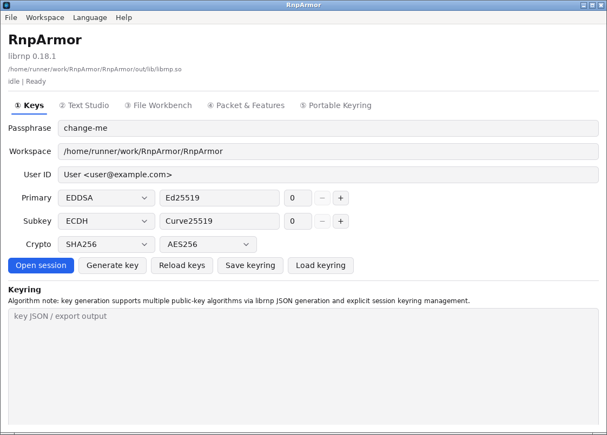

# RnpArmor User Guide

English | [简体中文](USER_GUIDE.zh-CN.md) | [README](../README.md)

<p></p>

## 1. Overview & Quick Start

RnpArmor is a native OpenPGP desktop GUI built with MyGo and `librnp v0.18.1`. It is designed for users who want explicit, portable keyring files (`pubring.gpg` and `secring.gpg`) in a chosen folder rather than modifying the system default GnuPG keyring.

Supported release targets:

- **Windows 10/11 (`amd64`)**: Per-user installer (`rnparmor-windows-amd64-setup.exe`) and portable archive (`rnparmor-windows-amd64.zip`).
- **macOS Apple Silicon (`arm64`, macOS 13.0+)**: Application disk image (`rnparmor-macos-arm64.dmg` containing `RnpArmor.app`).
- **Linux (`amd64`)**: Portable archive (`rnparmor-linux-amd64.tar.gz`).

> **Important Security Note:** On startup, RnpArmor pre-fills the **Passphrase** field with the placeholder `"change-me"` and **User ID** with `"User <user@example.com>"`. Always replace `"change-me"` with a strong passphrase before generating or saving real keys.

## 2. Download, Installation & First Launch

Release packages are published via `.github/workflows/release.yml` (`v0.0.1` is currently published; upcoming `v0.0.2` will include the new multi-platform application icons and this guide).

### Verifying Release Checksums

Each release provides a combined checksum file `rnparmor-<TAG>-SHA256SUMS.txt` alongside the platform archives. Verify your download before extracting or installing:

```bash
# Linux / macOS
sha256sum -c rnparmor-<TAG>-SHA256SUMS.txt --ignore-missing
# or on macOS without GNU sha256sum:
shasum -a 256 rnparmor-macos-arm64.dmg
```

```powershell
# Windows (PowerShell)
Get-FileHash .\rnparmor-windows-amd64-setup.exe -Algorithm SHA256
Get-FileHash .\rnparmor-windows-amd64.zip -Algorithm SHA256
```

In addition, every bundle includes an internal `SHA256SUMS` file. Every time RnpArmor starts, `internal/loadlib` verifies the shared library (`rnp.dll`, `librnp.so`, or `librnp.dylib`) against `SHA256SUMS` before loading it.

### Windows Installer (`rnparmor-windows-amd64-setup.exe`)

1. Download `rnparmor-windows-amd64-setup.exe`.
2. Double-click to run the Inno Setup installer:
   - Defaults to **per-user installation without administrator privileges** (`PrivilegesRequired=lowest`, overridable in the dialog).
   - Creates a **Start Menu** entry (`RnpArmor`), an optional **Desktop shortcut** (unchecked by default), and registers standard Windows uninstallation (`RnpArmor`).
3. Launch **RnpArmor** from the Start Menu or Desktop shortcut.

### Windows Portable (`rnparmor-windows-amd64.zip`)

1. Extract `rnparmor-windows-amd64.zip` into a dedicated folder (keep `rnparmor.exe`, `rnp.dll`, `SHA256SUMS`, `LICENSE`, and `licenses\` together).
2. Double-click `rnparmor.exe`:
   - Built with `-H=windowsgui` (Windows GUI subsystem) and an embedded `.ico` resource, so **no black console window pops up**.
   - Loads `rnp.dll` strictly from the same folder using `LoadLibraryEx` restricted search flags (never searches the current working directory or `PATH`).
3. **Windows SmartScreen note**: Because CI artifacts are not Authenticode-signed yet, Windows Defender SmartScreen may show *"Windows protected your PC"*. Verify the file SHA-256 against `rnparmor-<TAG>-SHA256SUMS.txt`, then click **More info** → **Run anyway** if you trust the download.

### macOS Apple Silicon (`rnparmor-macos-arm64.dmg`)

1. Open `rnparmor-macos-arm64.dmg`.
2. Drag `RnpArmor.app` into the `Applications` alias.
3. **First launch & Gatekeeper note**: `RnpArmor.app` is ad-hoc signed and **not Apple-notarized**. Double-clicking it the first time may trigger a Gatekeeper prompt:
   - Right-click (or **Control-click**) `RnpArmor.app` in Finder → choose **Open** → confirm **Open**, or allow it under **System Settings → Privacy & Security**.
4. Inside `RnpArmor.app`, `Contents/MacOS/rnparmor` verifies `Contents/MacOS/librnp.dylib` against `Contents/Resources/SHA256SUMS` automatically on launch.

### Linux Portable (`rnparmor-linux-amd64.tar.gz`)

1. Extract the archive and enter the extracted directory:

```bash
tar -xzf rnparmor-linux-amd64.tar.gz
cd rnparmor-linux-amd64
./rnparmor
```

The bundle contains `rnparmor`, `librnp.so`, `libbotan-3.so.10`, `libjson-c.so.5`, `SHA256SUMS`, `rnparmor.png`, `LICENSE`, and `licenses/`.

### CLI Flags & Environment Variables

| Option / Variable | Purpose | Details |
| --- | --- | --- |
| `--lang en\|zh\|ja` | Preset UI language | Precedence: `--lang` > `RNPARMOR_LANG` > `LANG` > `en` |
| `RNPARMOR_LANG` | Language environment variable | Supports `en`, `zh`, `ja` (and locale prefixes like `zh_CN.UTF-8`) |
| `--smoke-test` | Headless library & i18n check | Probes `librnp`, checks `SHA256SUMS` and translations, prints status, exits `0` without starting GUI |
| `--smoke-out <path>` | Write smoke output to file | Creates parent dirs if needed; useful on Windows `-H=windowsgui` where stdout has no console |
| `RNPARMOR_LIBRNP` | Override shared library path | Must be an **absolute path**; target directory (or `Contents/Resources` on macOS) must still provide a valid `SHA256SUMS` |

Example `--smoke-test` output:

```text
status=ok
app_version=v0.0.1
library=/path/to/librnp.so
version=0.18.1+git...
i18n=ok
```

## 3. Interface Overview & Menu Bar



The main window (`1120×780`) displays the title, loaded `librnp` version, absolute library path, live status bar (`idle` / `busy` + last action or error), the 5 workspace tabs, and a native 4-group menu bar:

1. **`File`**
   - **Open session**: initializes an in-memory `librnp` session (and loads keys if `pubring.gpg` and `secring.gpg` already exist in `Workspace`).
   - **Load keyring**: loads `pubring.gpg` and `secring.gpg` from the configured `Workspace` directory.
   - **Save keyring**: writes `pubring.gpg` and `secring.gpg` to the `Workspace` directory.
   - **Quit**: closes the application.
2. **`Workspace`**
   - Radio items synchronized bi-directionally with the 5 tabs: **Keys**, **Text Studio**, **File Workbench**, **Packet & Features**, **Portable Keyring**.
3. **`Language`**
   - Live radio switch between **`English`**, **`中文`**, and **`日本語`**. Updates the menu bar, main window title/controls, and the About window immediately without restarting.
4. **`Help`**
   - **About**: opens a standalone, menu-less, non-modal child window (`580×520`, fixed size, single-instance focused) with a **Close** button. Closing About keeps the main window open; closing the main window closes About automatically.
   - Read-only fields shown in About: **Application Version**, **Author**, **Repository URL**, **RNP Upstream & Version**, **Local RNP Library Path**, **Keyring Directory (portable workspace)**, **pubring.gpg exists**, **secring.gpg exists**, **UI Framework & Runtime** (`MyGo v0.10.0 | purego v0.11.1 | Botan 3.10.0`), plus a reminder that the system default keyring is not read.

## 4. Step-by-Step Guide for All 5 Workspaces

> All workspace operations run asynchronously in the background (with a 2-minute timeout). While an operation is running, the status line shows `busy` and ignores duplicate clicks until the call returns.

### Workspace 1: `① Keys`

Use this workspace to manage your session, generate keys, inspect key details, and export/delete keys.

**Fields & Defaults:**

- **Passphrase**: defaults to `"change-me"` — **change this to a strong passphrase before generating keys**.
- **Workspace**: defaults to the current working directory; points to your portable keyring folder.
- **User ID**: defaults to `"User <user@example.com>"`.
- **Primary**: algorithm (`EDDSA`, `RSA`, `ECDSA`, `DSA`; default `EDDSA`), `curve` (default `Ed25519`), bit length (`0`–`8192`; used for `RSA` / `DSA`, e.g., `3072` or `4096`).
- **Subkey**: algorithm (`ECDH`, `RSA`, `ELGAMAL`, or empty `""`; default `ECDH`), `curve` (default `Curve25519`), bit length (`0`–`8192`).
- **Crypto**: key protection hash (`SHA256`, `SHA384`, `SHA512`, `SHA3-256`; default `SHA256`) and symmetric cipher (`AES256`, `AES192`, `AES128`, `Camellia256`; default `AES256`).

**Common Workflow:**

1. Set **Workspace** to an absolute directory path and replace **Passphrase** (`"change-me"`) with your own passphrase.
2. Click **Open session** (optional if generating immediately; if `pubring.gpg` and `secring.gpg` already exist in **Workspace**, keys are loaded automatically).
3. Configure **User ID**, **Primary**, **Subkey**, and **Crypto**, then click **Generate key**.
   - Supported ECC curve names include `Curve25519` (`X25519`), `Ed25519`, `NIST P-256` (`P-256` / `secp256r1`), `NIST P-384` (`P-384` / `secp384r1`), `NIST P-521` (`P-521` / `secp521r1`), and `secp256k1`.
4. Click **Reload keys** at any time to refresh the list under **Keyring**.
5. Click any key button in the **Keyring** list to select it (**Selected** displays its full fingerprint). With a key selected, you can click:
   - **Key JSON**: shows structured key metadata in the **key JSON / export output** box.
   - **Export public** / **Export secret**: exports the ASCII-armored public or secret key block into the output box.
   - **Delete key**: removes the selected key (public, secret, and subkeys) from the session keyring.
6. Click **Save keyring** to write `pubring.gpg` and `secring.gpg` to **Workspace** (or **Load keyring** to reload from disk). Note that successful operations with a non-empty **Workspace** also persist `pubring.gpg` and `secring.gpg` automatically.

### Workspace 2: `② Text Studio`

Use this workspace for ASCII-armored text encryption, decryption, signing, and verification.

**Fields:**

- **Plain text**: defaults to `"hello from RnpArmor"`.
- **Recipients (comma fp)**: comma-separated recipient key fingerprints. If both **Recipients** and **Password** are empty, RnpArmor falls back to the active session encryption subkey (if one was generated in this session).
- **Password**: optional symmetric encryption password (can be combined with recipients or used alone).
- **Cipher / Compression**: cipher (`AES256`, `AES192`, `AES128`, `Camellia256`; default `AES256`), compression (`zlib`, `bzip2`, `zip`, `uncompressed`; default `zlib`), and **Encrypt+Sign** toggle.
- **Sign mode**: `cleartext`, `detached` (default), or `inline` (attached OpenPGP signature).
- **Signer fingerprint**: optional explicit signer fingerprint (if blank, **Encrypt+Sign** uses the **Selected** key when toggled on, and **Sign text** uses the active primary key).
- **Detached verify sig**: paste a detached ASCII-armored signature here when verifying a detached signature.

**Operations:**

- **Encrypt text**: encrypts **Plain text** to **result output** (and stages the armored message internally for immediate testing with **Decrypt text**).
- **Decrypt text**: decrypts the armored message staged from **Encrypt text** / **Sign text** and prints the plaintext to **result output**. *(Note: Workspace 2 does not currently provide a separate editable ciphertext input box; use **File Workbench** to decrypt external `.asc` / `.pgp` files saved on disk.)*
- **Sign text**: signs **Plain text** using the selected **Sign mode** (`cleartext`, `detached`, or `inline`, with `SHA256`) and prints the result to **result output** (for `detached`, also copies the signature into **Detached verify sig**).
- **Verify text**: verifies the staged text/signature (or **Plain text** + **Detached verify sig** after detached signing) and displays:
  - Mathematical validity badge: `[Math: VALID]` or `[Math: INVALID]`
  - Identity trust badge: `[Identity: UNVERIFIED]` or `[Identity: TRUSTED]` *(always `UNVERIFIED` in this release because RnpArmor reports cryptographic validity only and does not assert policy trust)*
  - Metadata lines: `Status`, `KeyID`, `Fingerprint`, `Hash`, `Created`, `Expires`.

### Workspace 3: `③ File Workbench`

Use this workspace to encrypt, decrypt, sign, and verify files on disk safely.

**Important Path & Safety Rules:**

- All paths (**Source**, **Destination**, **Signature path**) must be **absolute paths**.
- **Source** and **Destination** cannot be the same path.
- **Non-overwrite protection**: RnpArmor refuses to overwrite an existing **Destination** or **Signature path** (`refusing to overwrite an existing file`). Choose a new output filename each time.
- **Size limit**: regular files only, non-empty, up to **32 MiB** (`MaxInput`) input and **40 MiB** (`MaxOutput`) in-memory output.

**Operations:**

- **Encrypt file**: set **Source** and **Destination**, plus recipients/password/cipher/compression/Encrypt+Sign options from **Text Studio**, then click **Encrypt file**. Output uses ASCII armor automatically when **Destination** ends with `.asc` (otherwise binary OpenPGP).
- **Decrypt file**: set **Source** (encrypted file) and **Destination** (new output path), then click **Decrypt file**.
- **Sign file**: set **Source** and **Signature path**, choose **Sign mode** (`detached` or `inline` in **Text Studio**; armored with `SHA256`), optionally set **Signer fingerprint**, and click **Sign file**.
- **Verify file**:
  - For detached verification: toggle **Detached** on, set **Source** (original file) and **Signature path** (`.asc`/`.sig` file), and click **Verify file**.
  - For inline signed files: toggle **Detached** off, set **Source** to the signed file, and click **Verify file**.

### Workspace 4: `④ Packet & Features`

Use this workspace to inspect OpenPGP packet structures and audit supported algorithms in `librnp`.

- **Dump packets**:
  1. Enter an absolute path to an OpenPGP file (`.asc`, `.pgp`, `.gpg`, up to 32 MiB) in **Packet input file**.
  2. Toggle **JSON** on for JSON output (default) or off for text output.
  3. Click **Dump packets** to inspect the structure in **Packet output**.
- **Query features**:
  - Leave **Feature query** empty to dump all 6 categories (`symmetric algorithm`, `hash algorithm`, `public key algorithm`, `elliptic curve`, `compression algorithm`, `aead algorithm`).
  - Enter a category name (e.g. `elliptic curve`) or a `type:name` pair (e.g. `public key algorithm:EDDSA`) to check a specific feature, then click **Query features** to view the JSON output under **Features**.

### Workspace 5: `⑤ Portable Keyring`

Use this workspace to load, save, and migrate explicit portable keyrings.

- **Workspace**: absolute path to your portable keyring directory.
- **Passphrase**: passphrase used in memory only for the active session.
- **Open+Load**: loads `pubring.gpg` and `secring.gpg` from **Workspace** into the session.
- **Save**: saves the current session keys as `pubring.gpg` and `secring.gpg` inside **Workspace** (creates the directory with `0700` permissions if needed; `secring.gpg` is written with `0600` permissions on Unix).
- **Reload keys**: refreshes the loaded key summaries.

**Backup & Migration:**

1. Close RnpArmor or ensure no operation is `busy`.
2. Copy both `pubring.gpg` and `secring.gpg` from your **Workspace** folder to an encrypted backup drive or another machine. Keep `secring.gpg` strictly private.
3. On the destination machine, open RnpArmor, enter the target folder's absolute path in **Workspace** and your **Passphrase**, then click **Open+Load**.

## 5. Security, Verification & Troubleshooting

### Security Reminders

- **Change `"change-me"` immediately**: `"change-me"` is only a test default in `cmd/rnparmor/main.go`.
- **No implicit system keyring**: RnpArmor never reads or modifies `~/.gnupg` or any default OS keyring.
- **Math validity vs. identity trust**: `[Math: VALID]` confirms the cryptographic signature matches the key and data; `[Identity: UNVERIFIED]` reminds you that RnpArmor does not evaluate Web-of-Trust or policy trust. Always verify key fingerprints out-of-band.
- **In-flight call cancellation**: An active `librnp` C call cannot be interrupted mid-flight; timeouts discard the result only after the C call finishes.

### Common Issues & Fixes

| Symptom | Cause | Resolution |
| --- | --- | --- |
| `librnp bundle checksum failed` on startup | Missing `SHA256SUMS`, modified library, or mismatched `RNPARMOR_LIBRNP` | Re-extract the original release archive without modifying `rnp.dll`/`librnp.so`/`librnp.dylib` or `SHA256SUMS`; if using `RNPARMOR_LIBRNP`, use an absolute path alongside its valid `SHA256SUMS` |
| `path must be absolute` | Relative path entered in **File Workbench**, **Packet input file**, or **Workspace** | Enter a full absolute path (e.g., `C:\Users\name\docs\file.txt` on Windows or `/home/name/file.txt` on Linux/macOS) |
| `refusing to overwrite an existing file` | Output path in **Destination** or **Signature path** already exists | Choose a new output filename that does not already exist |
| `input exceeds the memory limit` | Input file exceeds 32 MiB (`MaxInput`) | RnpArmor currently buffers files up to 32 MiB in memory |
| Operations fail with `passphrase unavailable` or key-not-found | **Passphrase** is empty, wrong for `secring.gpg`, or session keyring not loaded | Enter the matching passphrase, verify `Workspace` contains `pubring.gpg` and `secring.gpg`, and click **Load keyring** / **Open+Load** |
| Windows SmartScreen / macOS Gatekeeper warning | Unsigned Windows binary or ad-hoc signed (unnotarized) macOS app | Verify release SHA-256 checksums first; on Windows click **More info → Run anyway**; on macOS **Control-click → Open** |
| Need CLI diagnostics without GUI | Diagnosing library loading or translations | Run `rnparmor --smoke-test --smoke-out smoke.txt` and inspect `status=ok`, `library=`, `version=`, and `i18n=ok` |

### Licenses & Notices

- RnpArmor project license: **Apache License, Version 2.0** ([`../LICENSE`](../LICENSE)).
- Third-party dependency pins and full license notices: [`../third_party/NOTICES.md`](../third_party/NOTICES.md).
- Distributed bundle locations:
  - Windows & Linux: `LICENSE` and `licenses/` at the bundle root.
  - macOS: `RnpArmor.app/Contents/Resources/LICENSE` and `RnpArmor.app/Contents/Resources/licenses/`.
