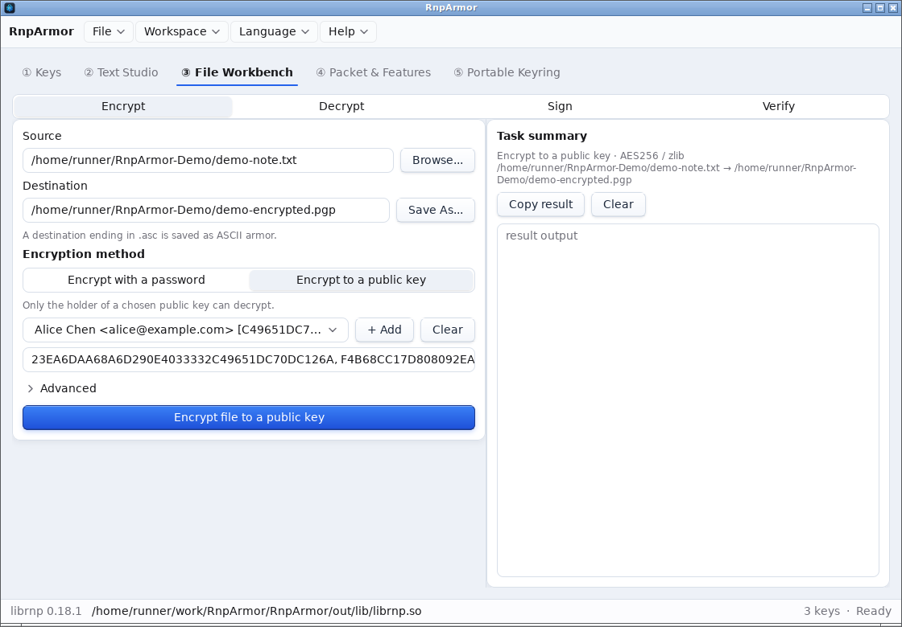
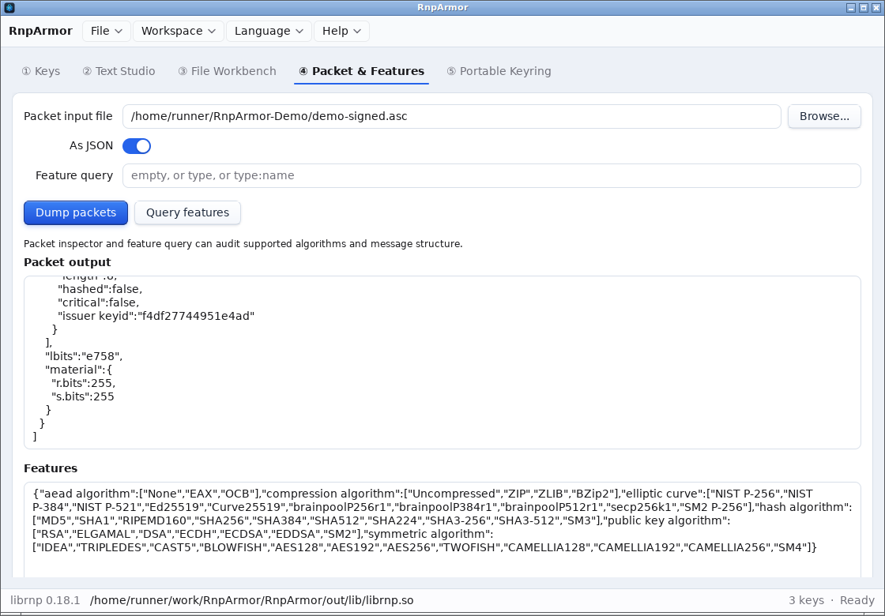

# RnpArmor User Guide

English | [简体中文](USER_GUIDE.zh-CN.md) | [README](../README.md)

<p></p>

## 1. Overview & Quick Start

RnpArmor is a native OpenPGP desktop GUI built with MyGo and `librnp v0.18.1`. It is designed for users who want explicit, portable keyring files (`pubring.gpg` and `secring.gpg`) in a chosen folder rather than modifying the system default GnuPG keyring.

Supported release targets:

- **Windows 10/11 (`amd64`)**: Per-user installer (`rnparmor-windows-amd64-setup.exe`) and portable archive (`rnparmor-windows-amd64.zip`).
- **macOS Apple Silicon (`arm64`, macOS 13.0+)**: Application disk image (`rnparmor-macos-arm64.dmg` containing `RnpArmor.app`).
- **Linux (`amd64`)**: Portable archive (`rnparmor-linux-amd64.tar.gz`).

> **Passphrase & Public-Only Keyrings:** RnpArmor starts with an empty in-memory passphrase (no pre-filled default passphrase). You can open a folder, browse, and import a public-only keyring (`pubring.gpg` without `secring.gpg`) without entering a passphrase. In **New Key**, leaving both passphrase fields blank generates an OpenPGP RFC 4880 unprotected secret key (no passphrase required later for signing, decrypting, or subkey operations), whereas entering a passphrase encrypts the secret key; signing, decrypting, or exporting/copying passphrase-protected secret keys uses the masked unlock **Passphrase** in **Portable Keyring** (or the passphrase adopted from **New Key**).

## 2. Download, Installation & First Launch

Release packages are published via `.github/workflows/release.yml` (`v0.0.1`–`v0.0.11` have been released: `v0.0.2` added Apache-2.0 licensing, Linux runtime screenshots, multi-platform icons, and the initial bilingual User Guide; `v0.0.3` fixed the GUI action deadlock and keyring persistence edge cases; `v0.0.4` shipped Phase 1 master-detail Key Manager / native folder picker and Phase 2 keyring pickers / native file browse and save dialogs; `v0.0.5` added PR #14 `+ New Key` algorithm presets/parameter linking/tri-lingual tips and PR #15 hierarchical collapsible subkey tree & full subkey lifecycle management; `v0.0.6` delivered PR #16 empty-passphrase RFC 4880 unprotected key generation and `No Passphrase` lifecycle support; `v0.0.7` shipped PR #17 pinned bottom status bar & graded notification feedback plus PR #18 light Fluent & frosted-glass UI refresh; `v0.0.8` shipped PR #19 refreshing all 11 Linux demo screenshots across the docs and PR #20 adding `+ New Key` passphrase visibility toggles, live mismatch blocking, and real `librnp` op-API key expiration; `v0.0.9` delivered PR #21 extending the show/hide passphrase eye toggle across all remaining password inputs, PR #22 switching Windows CI builds to package pinned prebuilt `r404r/rnp@v0.18.1-win.2` DLLs, and PR #23 refreshing the `v0.0.9` screenshots; `v0.0.10` delivered PR #24 adding the macOS Application menu with `Cmd+Q` and tri-lingual quit confirmation with active-operation warning across platforms; `v0.0.11` delivered PR #26, splitting Text Studio and File Workbench into Encrypt, Decrypt, Sign, and Verify, with mutually exclusive password or public-key encryption, a confirm-password field, in-page passphrases, and hybrid encryption left in Advanced and off by default).


### Verifying Release Checksums

Each release provides a combined checksum file `rnparmor-<TAG>-SHA256SUMS.txt` alongside the platform archives. Verify your download before extracting or installing:

```bash
# Linux / macOS
sha256sum -c rnparmor-<TAG>-SHA256SUMS.txt --ignore-missing
# or on macOS without GNU sha256sum:
shasum -a 256 rnparmor-macos-arm64.dmg
```

```powershell
# Windows (PowerShell)
Get-FileHash .\rnparmor-windows-amd64-setup.exe -Algorithm SHA256
Get-FileHash .\rnparmor-windows-amd64.zip -Algorithm SHA256
```

In addition, every bundle includes an internal `SHA256SUMS` file (covering `rnp.dll` and all bundled sibling runtime DLLs on Windows, or `librnp.so` / `librnp.dylib` on Linux/macOS). Every time RnpArmor starts, `internal/loadlib` verifies the shared library (`rnp.dll`, `librnp.so`, or `librnp.dylib`) against `SHA256SUMS` before loading it.

### Windows Installer (`rnparmor-windows-amd64-setup.exe`)

1. Download `rnparmor-windows-amd64-setup.exe`.
2. Double-click to run the Inno Setup installer:
   - Defaults to **per-user installation without administrator privileges** (`PrivilegesRequired=lowest`, overridable in the dialog).
   - Installs `rnparmor.exe`, `rnp.dll`, all required sibling runtime DLLs (`botan-3.dll`, `bz2.dll`, `libz.dll`, `MSVCP140.dll`, `VCRUNTIME140.dll`, `VCRUNTIME140_1.dll`), `SHA256SUMS`, `LICENSE`, and `licenses\` together so clean Windows systems do not need a separate Visual C++ Redistributable install.
   - Creates a **Start Menu** entry (`RnpArmor`), an optional **Desktop shortcut** (unchecked by default), and registers standard Windows uninstallation (`RnpArmor`).
3. Launch **RnpArmor** from the Start Menu or Desktop shortcut.

### Windows Portable (`rnparmor-windows-amd64.zip`)

1. Extract `rnparmor-windows-amd64.zip` into a dedicated folder (keep `rnparmor.exe`, `rnp.dll`, the bundled sibling runtime DLLs `botan-3.dll` / `bz2.dll` / `libz.dll` / `MSVCP140.dll` / `VCRUNTIME140.dll` / `VCRUNTIME140_1.dll`, `SHA256SUMS`, `LICENSE`, and `licenses\` together; no separate Visual C++ Redistributable install is needed).
2. Double-click `rnparmor.exe`:
   - Built with `-H=windowsgui` (Windows GUI subsystem) and an embedded `.ico` resource, so **no black console window pops up**.
   - Loads `rnp.dll` strictly from the same folder using `LoadLibraryEx` restricted search flags (never searches the current working directory or `PATH`).
3. **Windows SmartScreen note**: Because CI artifacts are not Authenticode-signed yet, Windows Defender SmartScreen may show *"Windows protected your PC"*. Verify the file SHA-256 against `rnparmor-<TAG>-SHA256SUMS.txt`, then click **More info** → **Run anyway** if you trust the download.

### macOS Apple Silicon (`rnparmor-macos-arm64.dmg`)

1. Open `rnparmor-macos-arm64.dmg`.
2. Drag `RnpArmor.app` into the `Applications` alias.
3. **First launch & Gatekeeper note**: `RnpArmor.app` is ad-hoc signed and **not Apple-notarized**. Double-clicking it the first time may trigger a Gatekeeper prompt:
   - Right-click (or **Control-click**) `RnpArmor.app` in Finder → choose **Open** → confirm **Open**, or allow it under **System Settings → Privacy & Security**.
4. Inside `RnpArmor.app`, `Contents/MacOS/rnparmor` verifies `Contents/MacOS/librnp.dylib` against `Contents/Resources/SHA256SUMS` automatically on launch.

### Linux Portable (`rnparmor-linux-amd64.tar.gz`)

1. Extract the archive and enter the extracted directory:

```bash
tar -xzf rnparmor-linux-amd64.tar.gz
cd rnparmor-linux-amd64
./rnparmor
```

The bundle contains `rnparmor`, `librnp.so`, `libbotan-3.so.10`, `libjson-c.so.5`, `SHA256SUMS`, `rnparmor.png`, `LICENSE`, and `licenses/`.

### CLI Flags & Environment Variables

| Option / Variable | Purpose | Details |
| --- | --- | --- |
| `--lang en\|zh\|ja` | Preset UI language | Precedence: `--lang` > `RNPARMOR_LANG` > `LANG` > `en` |
| `RNPARMOR_LANG` | Language environment variable | Supports `en`, `zh`, `ja` (and locale prefixes like `zh_CN.UTF-8`) |
| `--smoke-test` | Headless library & i18n check | Probes `librnp`, checks `SHA256SUMS` and translations, prints status, exits `0` without starting GUI |
| `--smoke-out <path>` | Write smoke output to file | Creates parent dirs if needed; useful on Windows `-H=windowsgui` where stdout has no console |
| `RNPARMOR_LIBRNP` | Override shared library path | Must be an **absolute path**; target directory (or `Contents/Resources` on macOS) must still provide a valid `SHA256SUMS` |

Example `--smoke-test` output:

```text
status=ok
app_version=v0.0.7
library=/path/to/librnp.so
version=0.18.1+git...
i18n=ok
```

## 3. Interface Overview & Menu Bar


The main window (`1120×780`) uses a **light Fluent & frosted-glass visual shell** paired with the 5 workspace tabs, a **pinned bottom status bar**, graded notification feedback (**Toasts** & in-app **AlertDialogs**), and a 4-group menu bar adapted per desktop platform:

**Light Fluent Theme, Two-Layer Depth & Frosted Overlays:**

- **Light-only theme with OS accessibility support**: RnpArmor stays in a light visual theme while still honoring system high-contrast mode, desktop text-scale factors, and OS accent preferences.
- **Two-layer depth layout**: all 5 workspaces (plus standalone child windows) sit inside pure-white (`#ffffff`) rounded cards with crisp borders and soft elevation shadows over a light cool-gray canvas (`#edf1f7`). On **Windows 11**, the main window enables native **Mica** translucency behind cards (automatically falling back to cool gray on Windows 10 and Linux).
- **Tactile raised buttons**: secondary, primary, and danger buttons use restrained vertical gradients, a top hairline highlight, a bottom fold line, hover lift shadows, and a subtle `1 DIP` downward press motion.
- **Frosted-glass menus & toasts (`mygo/plugins/glass`)**: in-app dropdown selects, context menus, popover menu panels, and bottom-bar notification toasts render with translucent frosted-glass material, rounded borders, and soft drop shadows.

**Pinned Bottom Status Bar & Notifications:**

- **Bottom Status Bar**: fixed at the very bottom of the main window (replacing the former stacked header lines to maximize workspace height). Shows the loaded `librnp` version, the single-line `librnp` / `rnp.dll` library path (hover to inspect the full path; click to copy it to the clipboard with a **`Library path copied`** toast), the loaded **primary-key count** (e.g., `2 keys` or `1 key`), and live state (**`Ready`** or **`busy · <action>`**).
- **Graded Notification Feedback**:
  - **Routine success (`Toast`)**: key generation, import/export, copying public/secret keys, fingerprints, or the library path, key deletion, encrypt/decrypt/sign actions, packet dumps, feature queries, keyring load/save, and subkey operations show a 4-second auto-dismissing frosted-glass toast centered just above the bottom status bar (hover pauses the timer; click **`×`** to dismiss early; never covers the status bar).
  - **Verification results & main-window errors (`AlertDialog`)**: **`Verify text`** and **`Verify file`** results, as well as failures occurring in the main window, open a rounded in-app alert dialog with details and an **`OK`** button.
  - **Child-window inline errors**: form validation or action failures triggered inside an open child window (**New Key**, **Import Key Text**, **Add Subkey**, **Change Subkey Expiry**, **Revoke Subkey**) remain as inline red error text inside that child window so your focus stays on the active field (falling back to a main-window alert if that window has already closed).
  - **Silent startup & redaction**: automatic keyring loading at launch stays silent without popup notices; alert/error messages automatically mask in-memory passphrases (`••••`) and redact secret/private key blocks.

**Menu Bar (Platform-Integrated 4-Group Bar on Windows/Linux, System Menu Bar + Application Menu on macOS):**

- **Windows**: hides the legacy title bar (`40 DIP` header band with Mica) and draws **`File` / `Workspace` / `Language` / `Help`** directly inside the top integrated bar (preserving the top-right native window buttons and supporting window dragging on the app title and empty spacer area).
- **Linux**: keeps the window manager's native title bar and window controls while rendering the same integrated glass-popover menu bar inside the window.
- **macOS**: uses the native macOS system menu bar at the top of the screen starting with the **`RnpArmor`** Application menu (**`About`**, **`Services`**, **`Hide`**, **`Hide Others`**, **`Show All`**, and **`Quit`** bound to **`Cmd+Q`**), followed by **`File`**, **`Workspace`**, **`Language`**, and **`Help`**, and displays the app title above the tabs inside the window.

1. **`File`**
   - **Choose Folder...**: opens the native system folder picker, sets **Workspace**, and automatically loads keys from that folder.
   - **Open session**: initializes an in-memory `librnp` session (and loads `pubring.gpg` / `secring.gpg` if present in **Workspace**).
   - **Load keyring**: loads `pubring.gpg` (and `secring.gpg`, if present) from the configured **Workspace** directory.
   - **Save keyring**: writes `pubring.gpg` (and `secring.gpg` when secret keys exist) to the **Workspace** directory.
   - **Quit**: on every platform, clicking **`File → Quit`**—and on macOS, pressing **`Cmd+Q`** or choosing **`Quit`** from the Application menu or Dock context menu—raises a tri-lingual confirmation dialog (**`Quit RnpArmor?`**) on the main window (with an extra warning if a `librnp` operation is currently running). Click **`Quit`** to exit, or click **`Cancel`** / press `Esc` to keep RnpArmor running. OS shutdown/logout (`SessionEnding`) and closing the main window directly via its window close button (`×`) exit without stalling on a second prompt.
2. **`Workspace`**
   - Radio items synchronized bi-directionally with the 5 tabs: **Keys**, **Text Studio**, **File Workbench**, **Packet & Features**, **Portable Keyring**.
3. **`Language`**
   - Live radio switch between **`English`**, **`中文`**, and **`日本語`**. Updates the menu bar, main window title/controls, and open child windows (**New Key**, **Import Key Text**, **About**) immediately without restarting.
4. **`Help`**
   - **About**: opens a standalone, menu-less, non-modal child window (`580×520`, fixed size, single-instance focused) with a **Close** button. Closing About keeps the main window open; closing the main window closes About, New Key, and Import Key Text automatically.
   - Read-only fields shown in About: **Application Version**, **Author**, **Repository URL**, **RNP Upstream & Version**, **Local RNP Library Path**, **Keyring Directory (portable workspace)**, **pubring.gpg exists**, **secring.gpg exists**, **UI Framework & Runtime** (`MyGo v0.10.0 | purego v0.11.1 | Botan 3.10.0`), plus a reminder that the system default keyring is not read.


## 4. Step-by-Step Guide for All 5 Workspaces

> All workspace operations run asynchronously in the background (with a 2-minute timeout). While an operation is running, the pinned bottom status bar shows **`busy · <action>`** and ignores duplicate clicks until the call returns, then reports the outcome via a **Toast**, an in-app **AlertDialog**, or a child-window inline error.

### Workspace 1: `① Keys`

Use this workspace as a master-detail key manager to browse your keyring folder, create or import keys, inspect primary/subkey metadata, export keys or revocation certificates, and delete keys.

**Toolbar & Filter Bar:**

- **Top Toolbar**:
  - **`+ New Key`**: opens the standalone **`New Key`** window (`560×640`).
  - **`Import File...`**: opens a native file picker filtered for `.asc`, `.pgp`, `.gpg`, and `.key`, imports keys into the active session, and updates disk keyring files if **Workspace** is non-empty.
  - **`Import Text...`**: opens the **`Import Key Text`** child window (`560×420`), where you can paste an ASCII-armored public/secret key or click **`Paste from Clipboard`**, then click **`Import`**.
  - **`Refresh`**: reloads and refreshes the keyring list from **Workspace**.
  - **Workspace chooser**: displays the current **Workspace** path (read-only; defaults to the startup working directory; if that directory is the filesystem root — `/` when macOS is opened from Finder or the Dock — it uses the current user's home, otherwise it stays the startup working directory; if `pubring.gpg` or `secring.gpg` exists there, including in home, it still auto-loads on launch). Preferences are stored in a config file: `RnpArmor/config.json` under the user config directory (on macOS, `~/Library/Application Support/RnpArmor/config.json`), or `config.json` beside the executable when `PORTABLE.txt` is beside it. The passphrase is not written. The chooser sits alongside **`Choose Folder...`**, which opens a native directory chooser and loads the selected folder automatically.
- **Filter, ID Switch & Search Bar**:
  - Ownership filter: **`All`** / **`My Keys`** (keys with a secret key) / **`Public`** (public-only keys).
  - Column ID toggle: **`Key ID (16)`** ↔ **`Fingerprint (40)`**.
  - Search box (**`Search UID, Key ID, fingerprint, algorithm`**): filters primary keys in real time.

**Master Tree Table & Detail Inspector:**

- **Left Pane (Hierarchical Collapsible Key Table)**: top-level rows remain sortable by **`Type`** (`Secret` / `Public`), **`Name / Email`**, **`Key ID`** or **`Fingerprint`**, **`Algorithm`**, and **`Status`** (`Valid` / `Expired` / `Revoked`). Primary keys that have subkeys show a `▾` / `▸` toggle (expanded by default) directly beside their ownership badge:
  - **Expanded Subkey Rows**: appear indented directly under their primary key (`└ Subkey` with usage `Encrypt`, `Sign`, or `Auth`, 16-char Key ID or 40-char Fingerprint synced with the ID toggle, algorithm, and status).
  - **Subkey Search & Selection**: search matches across both primary keys and their subkeys (UID, Key ID, fingerprint, and algorithm). Clicking a subkey row keeps its parent primary key selected in the right pane and highlights that subkey card. When loading or refreshing keys with no prior selection, RnpArmor automatically prefers a certifiable primary secret key.
- **Right Pane (Detail Inspector)**:
  - **Header & Badges**: primary UID, ownership badge (`Secret+Public` or `Public`), **`No Passphrase`** badge (shown when a secret key is stored without passphrase protection), status badge (`Valid`, `Expired`, or `Revoked`), and capability badges (`Certify`, `Sign`, `Encrypt`, and `Auth` when present).
  - **Metadata**: 40-character **Fingerprint** formatted in 4-character groups with **`Copy Fingerprint`**, 16-character **Key ID**, **Algorithm**, **Created**, and **Expires** (`YYYY-MM-DD` UTC or `Never`).
  - **Subkeys & Lifecycle Management**: lists each subkey card with capability badges (`Encrypt` / `Sign` / `Auth`), **`No Passphrase`** badge (when that subkey secret is unprotected), status badge (`Valid` / `Expired` / `Revoked`), algorithm, 16-char Key ID, **Created** / **Expires** dates, and grouped 40-char fingerprint (with **`Copy Fingerprint`** when highlighted). When the primary key includes secret material, you can manage subkeys individually without modifying other subkeys or revoking the primary key:
    - **`+ Add Subkey...`** (`560×680` modal): choose **Usage** (`Encrypt (recommended)`, `Sign`, or `Authenticate (Auth)`), valid usage-restricted **Algorithm** (`ECDH` / `RSA` / `ELGAMAL` for `Encrypt`; `EDDSA` / `RSA` / `ECDSA` for `Sign` and `Authenticate`), curve or bit size, hash/cipher, **Expires** (`Never expires`, `1 year from now`, `2 years from now`, `5 years from now`), and masked **Session passphrase** (paired with an eye show/hide toggle with localized `Show passphrase` / `Hide passphrase` tooltip that auto-resets to hidden on open, close, and submit). On a passphrase-protected primary key, leave blank to reuse the active session passphrase (or enter it if locked); on an unprotected primary key (`No Passphrase`), **Session passphrase** is optional—leaving it blank creates an unprotected subkey, while typing a passphrase still encrypts that new subkey individually.
    - **`Change Expiry...`** (`480×420` modal): updates only the selected subkey's expiration (`Never expires` or `+1` / `+2` / `+5` years from now, stored as seconds from that subkey's creation time) while keeping the primary key unchanged; **Session passphrase** also includes the auto-resetting eye toggle and can be left blank when the primary secret key has no passphrase.
    - **`Revoke...`** (`500×460` modal + native confirmation, hidden once revoked): permanently revokes only that subkey with an RFC reason (`Retired`, `Superseded`, `Compromised`, or `No reason`) and optional note; the primary key remains valid, and **Session passphrase** includes the auto-resetting eye toggle and is optional when the primary secret key is unprotected.
    - **`Delete...`** (native warning confirmation): permanently removes only that subkey from the keyring while keeping the primary key (the backend explicitly refuses deleting a primary key via subkey deletion). Note that deleting an encryption subkey may make historical messages encrypted to it undecryptable.
  - **Public Actions**: **`Copy Public Key`** (copies ASCII-armored public key to clipboard) and **`Export Public (.asc)...`** (native Save dialog).
  - **Secret Actions** *(shown only when the selected key includes a secret key)*:
    - **`Export Secret (.asc)...`**: displays a native warning confirmation prompt first, then opens a Save dialog and writes the file with `0600` permissions.
    - **`Copy Secret`**: copies the secret key to the clipboard using concealed clipboard mode (and wipes the temporary buffer).
    - **`Revocation Cert...`**: saves an ASCII-armored revocation certificate (`<last16fp>.rev.asc`) with `0600` permissions via a Save dialog.
  - **`Delete Key...`**: opens a native warning confirmation dialog showing the key fingerprint and whether only the public key or both public and secret keys will be removed; deleting the last remaining key cleans up empty `pubring.gpg` and `secring.gpg` files on disk.
  - **Collapsible `Raw Key JSON`**: click **`Load JSON`** to inspect raw structured key JSON.

**Creating a Key (`+ New Key` Window):**

1. Enter **`Name`** and/or **`Email`** (at least one is required; both combine as `Name <Email>`).
2. Optionally enter and confirm a masked **`Passphrase`** (*Leave blank for no passphrase*) and **`Confirm Passphrase`** (*Confirm passphrase, or leave both blank*):
   - **Show/hide toggle (eye button)**: each passphrase input has an eye icon button on its right (with localized **`Show passphrase`** / **`Hide passphrase`** tooltip) so you can inspect either field while typing. Both toggles automatically reset back to masked/hidden when opening or closing the `+ New Key` window and after submitting key generation.
   - **Live mismatch detection & submit blocking**: if **`Passphrase`** and **`Confirm Passphrase`** differ while typing (once **`Confirm Passphrase`** is non-empty, or immediately after clicking **`Generate Key`** including single-side blank mismatches), the **`Confirm Passphrase`** field turns into a red error state, clicking **`Generate Key`** displays an inline red alert box above the action buttons and blocks key generation without modifying your session passphrase, and correcting both fields to match automatically clears the error.
   - **Passphrase-protected key**: when both fields match and are non-empty, RnpArmor indicates that the secret key will be encrypted with the passphrase, adopts it into the active session upon generation, and clears the form inputs.
   - **Unprotected key (no passphrase)**: leaving **both** fields blank displays a clear live notice below **`Confirm Passphrase`** (*"Both fields are empty. An unprotected secret key will be generated and stored unencrypted."*) and generates an OpenPGP RFC 4880 unprotected secret key without altering any session passphrase held for other keys. Filling only one field is rejected as a passphrase mismatch.
   - **Security note**: unprotected secret keys are suited to isolated local environments, automated tests, or scenarios where plaintext-at-rest risk is explicitly accepted; anyone with access to the secret key file can use it directly without a passphrase, so a strong passphrase is still recommended for everyday primary keys.
3. Choose **`Expiration`**: `Never`, `1 Year`, `2 Years`, or `5 Years`. Under the hood, key generation passes the exact expiration seconds through `librnp`'s `rnp_op_generate_*` operation API (avoiding `librnp 0.18.1`'s `rnp_generate_key_json` quirk that defaulted keys to 2 years), so `Never` creates truly non-expiring primary keys and encryption subkeys while `1` / `2` / `5` years honor the selected validity window.
4. Choose **`Algorithm preset`** (`SHA256` + `AES256` defaults):
   - **`Modern (Ed25519 + Curve25519)`** *(default, recommended)*: `EDDSA` (`Ed25519`) **Primary Key** + `ECDH` (`Curve25519`) **Encryption Subkey**.
   - **`RSA 4096 + RSA 4096`**: `RSA 4096` **Primary Key** + `RSA 4096` **Encryption Subkey** (highest legacy compatibility).
   - **`RSA 3072 + RSA 3072`**: `RSA 3072` **Primary Key** + `RSA 3072` **Encryption Subkey**.
   - **`NIST P-256`**: `ECDSA` (`NIST P-256`) **Primary Key** + `ECDH` (`NIST P-256`) **Encryption Subkey**.
   - **`Custom`**: automatically expands **`Advanced algorithms`** (manually editing any algorithm option away from a named preset also switches the preset to **`Custom`** and expands the section).
5. Optionally expand **`Advanced algorithms`** (each field shows a dynamic inline description and hover tooltip in English, Chinese, and Japanese; parameters automatically link to valid curves or key sizes for the selected algorithm):
   - **Primary Key**: `EDDSA` (fixed `Ed25519`), `RSA` (`2048` / `3072` / `4096` bits), `ECDSA` (`NIST P-256` / `NIST P-384` / `NIST P-521`), or `DSA` (`2048` / `3072` bits; noted in UI tips as legacy/not recommended).
   - **Encryption Subkey**: `ECDH` (`Curve25519` / `NIST P-256` / `NIST P-384` / `NIST P-521`), `RSA` (`2048` / `3072` / `4096` bits), or `ELGAMAL` (`2048` / `3072` / `4096` bits; noted in UI tips as legacy/not recommended).
   - **Crypto**: hash (`SHA256`, `SHA384`, `SHA512`, `SHA3-256`; UI tips recommend `SHA256` or `SHA512`) and symmetric cipher (`AES256`, `AES192`, `AES128`, `Camellia256`; UI tips recommend `AES256`).
6. Click **`Generate Key`**.

**Non-clobbering Keyring Persistence:**

- Read-only actions (**Open session**, **Refresh**, **Load keyring**, **Open+Load**, **Query features**, **Load JSON**, **Copy Public Key** / **Export Public (.asc)...**, **Copy Secret** / **Export Secret (.asc)...**, **Revocation Cert...**, text/file crypto & signing/verification, and **Dump packets**) never rewrite or overwrite `pubring.gpg` / `secring.gpg` on disk.
- When **Workspace** is non-empty, **`Generate Key`**, **Import** (`Import File...` / `Import Text...`), and **`Delete Key...`** automatically persist changes to **Workspace**. Public-only keyrings write only `pubring.gpg` (no `secring.gpg`); keyrings with secret keys write both `pubring.gpg` and `0600` `secring.gpg`; deleting the last remaining key removes empty files.
- Explicit **`File → Save keyring`** / **`Portable Keyring → Save`** writes the active session keys; saving an empty session (`0` keys) returns an error and leaves existing files on disk intact.

### Workspace 2: `② Text Studio`

The four task tabs use a left input pane and a right result pane (initially 54% / 46%). The interface supports English, Simplified Chinese, and Japanese.


1. **Encrypt**: enter text under **Text to encrypt**. Choose **Encrypt with a password** and enter matching **Encryption password** and **Confirm encryption password**, or choose **Encrypt to a public key** and add recipient fingerprints. With no available public key, password mode is selected by default; otherwise public-key mode is selected. Your manual choice is retained. The app does not silently use the selected key as an encryption recipient. Password fields have eye toggles; a mismatch is shown while editing a nonempty confirmation and missing or mismatched passwords block submission.
2. Open **Advanced** if needed to choose cipher and compression, enable encryption with signing, or enable hybrid encryption. Hybrid is off by default and requires both recipients and a matching password; either method can decrypt the result, so it is not a double lock. Otherwise only the selected method's credentials are submitted. Encrypt to show ciphertext in the result pane; use **Copy result**, **Clear**, or **Send to decrypt test**.
3. **Decrypt**: paste the armored message into **PGP message to decrypt**, or send the encryption result to this task. Enter the optional decrypt password or key passphrase here and decrypt. A nonempty local value takes priority; when blank, the Portable Keyring session passphrase or an unprotected key is used.
4. **Sign**: enter text, select a signature mode and signer, and optionally enter the key passphrase on this page. The same local-first passphrase fallback applies. Copy the signature or use **Send to verify test**.
5. **Verify**: paste the signed block or text into the verification input; for a detached signature, also supply the separate signature block. The result reports signature validity and metadata; mathematical validity does not establish identity trust.

### Workspace 3: `③ File Workbench`

The file page has the same four tasks and initial 54% / 46% split. The left pane contains the task fields; the right shows a task summary and output or verification report.



1. **Encrypt**: select a source and new destination using **Browse...** and **Save As...**. Choose password or public-key encryption and complete its fields as described for Text Studio. Advanced options include cipher, compression, signing and optional hybrid encryption. A destination ending in `.asc` uses ASCII armor.
2. **Decrypt**: select the encrypted source and a new destination. Enter the optional decrypt password or key passphrase on this page; a blank field falls back to the Portable Keyring session passphrase or an unprotected key.
3. **Sign**: choose the source, signature output path, signing mode and signer; enter an optional local key passphrase. The local value takes priority over the session passphrase.
4. **Verify**: select the source; enable detached verification and select the signature path for a detached signature. For an inline signature, leave detached verification off.

Paths must be absolute. The source and destination must differ, and existing output files are not overwritten. Inputs must be regular, non-empty files up to 32 MiB; the in-memory output limit is 40 MiB.

### Workspace 4: `④ Packet & Features`

Use this workspace to inspect OpenPGP packet structures (JSON packet dump output below) and audit supported algorithms in `librnp`:



- **Dump packets**:
  1. Click **`Browse...`** next to **Packet input file** (native Open dialog defaulting to the **`OpenPGP`** filter `.asc`, `.pgp`, `.gpg`, `.key`, `.sig`) or enter an absolute path (up to 32 MiB).
  2. Toggle **JSON** on for JSON output (default) or off for text output.
  3. Click **Dump packets** to inspect the structure in **Packet output**.
- **Query features**:
  - Leave **Feature query** empty to dump all 6 categories (`symmetric algorithm`, `hash algorithm`, `public key algorithm`, `elliptic curve`, `compression algorithm`, `aead algorithm`).
  - Enter a category name (e.g. `elliptic curve`) or a `type:name` pair (e.g. `public key algorithm:EDDSA`) to check a specific feature, then click **Query features** to view the JSON output under **Features**.

### Workspace 5: `⑤ Portable Keyring`

Use this workspace to load, save, and migrate explicit portable keyrings, or to enter your masked unlock passphrase when using secret keys.

- **Workspace**: read-only path display with **`Choose Folder...`** (native folder picker).
- **Passphrase**: masked text input (`Password` mode, initially empty `""`) with placeholder `"Passphrase to unlock secret keys"` and an independent eye show/hide toggle. Leave empty to browse or import a public-only keyring (`pubring.gpg`) or to use keys generated without a passphrase (`No Passphrase`); enter your passphrase here whenever you need to decrypt, sign, or export/copy a passphrase-protected secret key (if not already adopted from creating a key in **New Key**).
- **Open+Load**: loads `pubring.gpg` (and `secring.gpg` if present) from **Workspace** into the session without rewriting the files on disk.
- **Save**: saves the current session keys inside **Workspace** (`pubring.gpg` only for public-only sessions, or `pubring.gpg` + `0600` `secring.gpg` when secret keys are present; creates the directory with `0700` permissions if needed). Saving an empty session (`0` keys) returns an error and leaves existing files untouched.
- **Reload keys**: refreshes the loaded key summaries.

**Backup & Migration:**

1. Close RnpArmor or ensure no operation is `busy`.
2. Copy `pubring.gpg` (and `secring.gpg` if your keyring includes secret keys) from your **Workspace** folder to an encrypted backup drive or another machine. Keep `secring.gpg` strictly private.
3. On the destination machine, open RnpArmor, click **`Choose Folder...`** (or go to **Portable Keyring**, select the folder via **`Choose Folder...`**, enter your masked **Passphrase** if needed for secret keys), then click **Open+Load**.

## 5. Security, Verification & Troubleshooting

### Security Reminders

- **Notification redaction & safe secret handling**: status toasts never embed passphrase or key contents, and **`AlertDialog`** error/result messages pass through `safeNotice` to mask in-memory passphrases (`••••`) and hide any `BEGIN PGP PRIVATE` / `BEGIN PGP SECRET` blocks (*"The details were hidden because they may contain key material."*).
- **Masked passphrases & concealed secret copies**: RnpArmor never pre-fills a default passphrase (`""` at startup). The passphrase and symmetric password inputs across **New Key**, **Text Studio**, **File Workbench**, **Portable Keyring**, and the three subkey lifecycle modals (**Add Subkey**, **Change Expiry**, **Revoke**) default to masked mode with a right-side eye show/hide toggle (auto-resetting to hidden whenever modal dialogs open, close, or finish submitting). **Copy Secret** marks clipboard content as concealed; exported secret key files and `.rev.asc` revocation certificates are written with `0600` permissions on Unix. If you intentionally leave both passphrase fields blank to create a **`No Passphrase`** secret key, its private key packets are stored unencrypted (`secring.gpg` and exports still keep `0600` file mode on Unix, but anyone obtaining the file can use the key without a passphrase); use a strong passphrase for everyday primary keys and reserve unprotected keys for isolated local testing or controlled automation.
- **No implicit system keyring**: RnpArmor never reads or modifies `~/.gnupg` or any default OS keyring.
- **Math validity vs. identity trust**: `[Math: VALID]` confirms the cryptographic signature matches the key and data; `[Identity: UNVERIFIED]` reminds you that RnpArmor does not evaluate Web-of-Trust or policy trust. Always verify key fingerprints out-of-band.
- **In-flight call cancellation**: An active `librnp` C call cannot be interrupted mid-flight; timeouts discard the result only after the C call finishes.

### Common Issues & Fixes

| Symptom | Cause | Resolution |
| --- | --- | --- |
| `librnp bundle checksum failed` on startup | Missing `SHA256SUMS`, modified library/sibling DLL, or mismatched `RNPARMOR_LIBRNP` | Re-extract the original release archive without modifying or removing `rnp.dll` (and its sibling DLLs on Windows), `librnp.so`/`librnp.dylib`, or `SHA256SUMS`; if using `RNPARMOR_LIBRNP`, use an absolute path alongside its valid `SHA256SUMS` |
| `path must be absolute` | Relative path entered in **File Workbench** or **Packet input file** | Use **`Browse...`** / **`Save As...`** (or enter a full absolute path, e.g., `C:\Users\name\docs\file.txt` on Windows or `/home/name/file.txt` on Linux/macOS), and **`Choose Folder...`** for **Workspace** |
| `refusing to overwrite an existing file` | Output path in **Destination** or **Signature path** already exists | Choose a new output filename that does not already exist |
| `input exceeds the memory limit` | Input file exceeds 32 MiB (`MaxInput`) | RnpArmor currently buffers files up to 32 MiB in memory |
| Operations fail with `passphrase unavailable` or key-not-found | Unlock **Passphrase** is empty, wrong for `secring.gpg`, or keyring folder not loaded | Enter the matching passphrase in **Portable Keyring**, click **`Choose Folder...`** to select the folder containing `pubring.gpg` (and `secring.gpg` for secret operations), and click **Refresh** / **Open+Load** |
| Windows SmartScreen / macOS Gatekeeper warning | Unsigned Windows binary or ad-hoc signed (unnotarized) macOS app | Verify release SHA-256 checksums first; on Windows click **More info → Run anyway**; on macOS **Control-click → Open** |
| Need CLI diagnostics without GUI | Diagnosing library loading or translations | Run `rnparmor --smoke-test --smoke-out smoke.txt` and inspect `status=ok`, `library=`, `version=`, and `i18n=ok` |

### Licenses & Notices

- RnpArmor project license: **Apache License, Version 2.0** ([`../LICENSE`](../LICENSE)).
- Third-party dependency pins and full license notices: [`../third_party/NOTICES.md`](../third_party/NOTICES.md).
- Distributed bundle locations:
  - Windows & Linux: `LICENSE` and `licenses/` at the bundle root.
  - macOS: `RnpArmor.app/Contents/Resources/LICENSE` and `RnpArmor.app/Contents/Resources/licenses/`.
