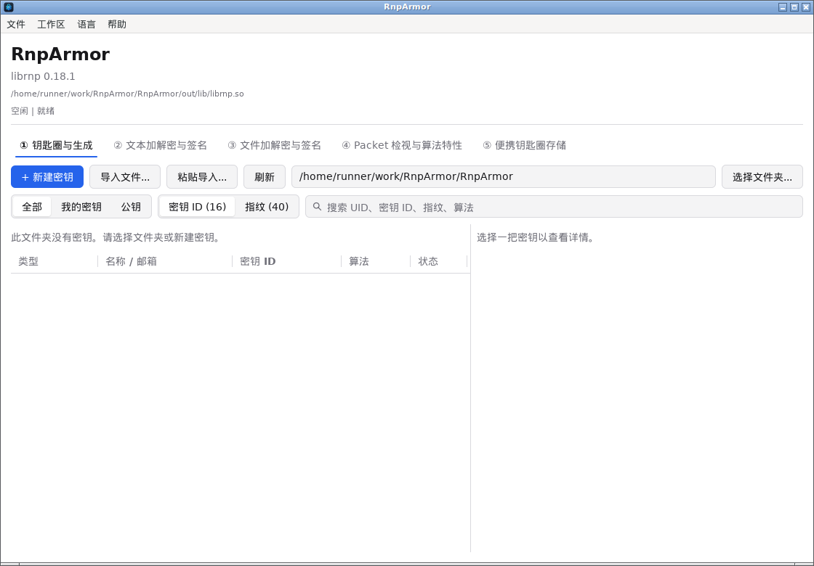
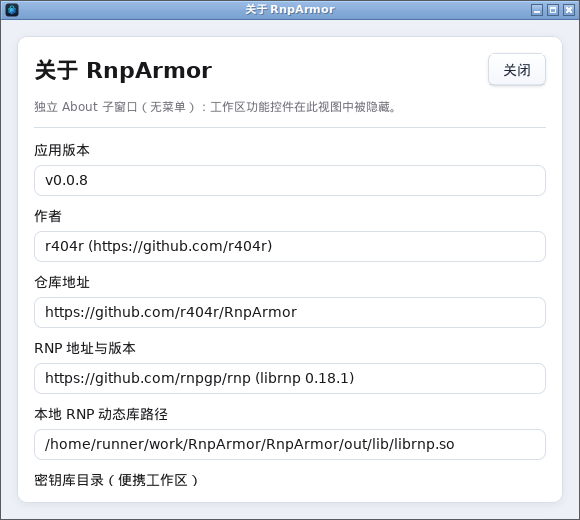
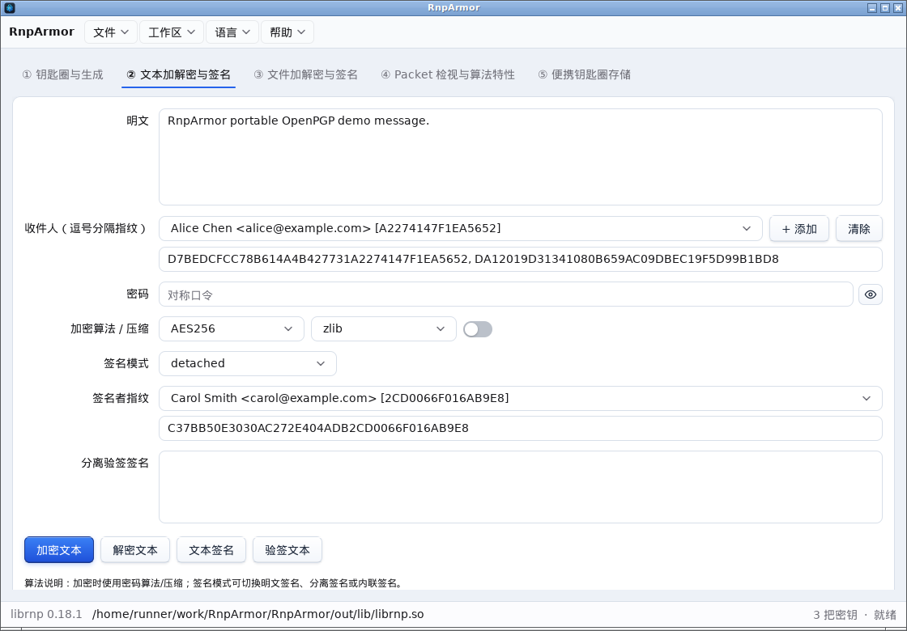
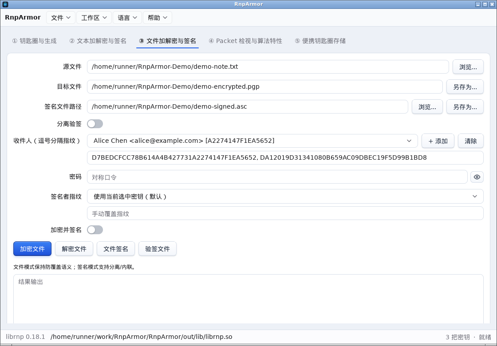
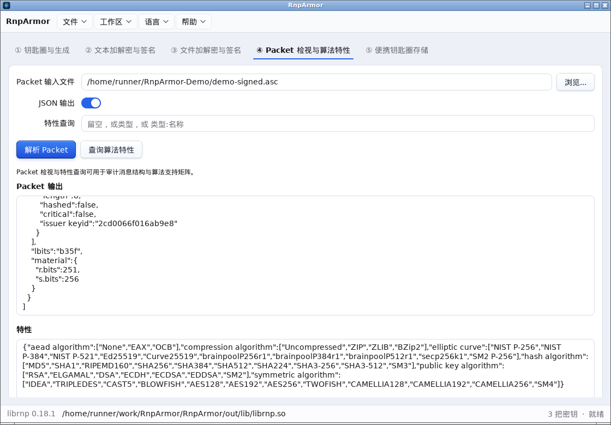

# RnpArmor 用户指南

[English](USER_GUIDE.md) | 简体中文 | [README](../README.zh-CN.md)

<p></p>

## 1. 概述与快速上手

RnpArmor 是基于 MyGo 原生界面与 `librnp v0.18.1` 构建的 OpenPGP 桌面图形工具，专注于在用户显式指定的目录中管理便携钥匙圈文件（`pubring.gpg` 与 `secring.gpg`），不会读写系统默认 GnuPG 钥匙圈。

当前支持的发布目标平台：

- **Windows 10/11（`amd64`）**：当前用户安装版（`rnparmor-windows-amd64-setup.exe`）与便携压缩包（`rnparmor-windows-amd64.zip`）。
- **macOS Apple Silicon（`arm64`，macOS 13.0 及以上）**：磁盘镜像（`rnparmor-macos-arm64.dmg`，内含 `RnpArmor.app`）。
- **Linux（`amd64`）**：便携压缩包（`rnparmor-linux-amd64.tar.gz`）。

> **口令与仅公钥钥匙圈说明：** RnpArmor 启动时内存口令默认为空（不再预填任何明文默认口令）。空口令状态下即可打开目录、浏览或导入仅含公钥的钥匙圈（仅 `pubring.gpg`、无 `secring.gpg`）；在**新建密钥**中，填写并确认口令可加密保护私钥，而两项均留空则生成符合 OpenPGP RFC 4880 的无口令保护私钥（后续加解密、签名验签及子密钥管理均可留空口令）；对设口令保护的私钥执行解密、签名或复制/导出时，可在**便携钥匙圈存储**填入解锁口令（新建设口令密钥后也会自动采纳到当前会话）。

## 2. 下载、安装与首次启动

发布产物由 `.github/workflows/release.yml` 构建与分发（`v0.0.1`–`v0.0.8` 均已发布：`v0.0.2` 合入 Apache-2.0 许可证、Linux 实机截图、三端应用图标与双语用户指南；`v0.0.3` 修复了 GUI 操作重入死锁与钥匙圈持久化边界问题；`v0.0.4` 合并发布 Phase 1 主从双栏 Keys 管理页与原生文件夹选择器，以及 Phase 2 收件人/签名者下拉选择器与原生文件浏览/另存为对话框；`v0.0.5` 合入 PR #14 的新建密钥 5 档算法预设/动态参数联动/三语提示与 PR #15 的左侧树形可折叠子密钥视图及子密钥全生命周期管理；`v0.0.6` 合入 PR #16 的空口令 RFC 4880 无口令保护私钥生成及配套全生命周期免口令支持；`v0.0.7` 合入 PR #17 主窗口底部固定状态栏/分级结果反馈与 PR #18 浅色 Fluent 及局部磨砂玻璃视觉升级；`v0.0.8` 合入 PR #19 的 11 张 Linux 演示截图刷新及图文同步与 PR #20 的 `+ 新建密钥` 口令显隐开关、口令不一致实时校验拦截与有效期真实生效修复；`feat/windows-prebuilt-rnp` 分支将 Windows 构建默认切换为复用钉扎预编译 `r404r/rnp@v0.18.1-win.2` 动态库及随包运行时 DLL，待合入后续版本）。

### 校验发布包 SHA-256

每次发布均提供统一校验文件 `rnparmor-<TAG>-SHA256SUMS.txt`，建议在解压或安装前先核对哈希：

```bash
# Linux / macOS
sha256sum -c rnparmor-<TAG>-SHA256SUMS.txt --ignore-missing
# 若 macOS 未安装 GNU sha256sum，可使用：
shasum -a 256 rnparmor-macos-arm64.dmg
```

```powershell
# Windows (PowerShell)
Get-FileHash .\rnparmor-windows-amd64-setup.exe -Algorithm SHA256
Get-FileHash .\rnparmor-windows-amd64.zip -Algorithm SHA256
```

此外，每个平台分发包内部均带有 `SHA256SUMS` 文件（Windows 版覆盖 `rnp.dll` 与全部随包同级运行时 DLL，Linux/macOS 覆盖 `librnp.so` / `librnp.dylib`）。RnpArmor 每次启动都会先通过 `internal/loadlib` 校验动态库（`rnp.dll`、`librnp.so` 或 `librnp.dylib`）的完整性，校验通过后才会加载。

### Windows 安装版（`rnparmor-windows-amd64-setup.exe`）

1. 下载 `rnparmor-windows-amd64-setup.exe`。
2. 双击运行 Inno Setup 安装向导：
   - 默认以**当前用户免管理员权限**安装（`PrivilegesRequired=lowest`，也可在向导对话框中按需切换）。
   - 将 `rnparmor.exe`、`rnp.dll`、必需同级运行时 DLL（`botan-3.dll`、`bz2.dll`、`libz.dll`、`MSVCP140.dll`、`VCRUNTIME140.dll`、`VCRUNTIME140_1.dll`）、`SHA256SUMS`、`LICENSE` 与 `licenses\` 一并安装到位，目标 Windows 裸机无需额外安装 Visual C++ 运行库。
   - 自动创建**开始菜单**快捷方式（`RnpArmor`）、提供可选**桌面快捷方式**（默认不勾选），并支持 Windows 标准卸载。
3. 安装完成后，从开始菜单或桌面快捷方式启动 **RnpArmor**。

### Windows 便携版（`rnparmor-windows-amd64.zip`）

1. 将 `rnparmor-windows-amd64.zip` 解压到独立文件夹（请保持 `rnparmor.exe`、`rnp.dll`、随包同级运行时 DLL `botan-3.dll` / `bz2.dll` / `libz.dll` / `MSVCP140.dll` / `VCRUNTIME140.dll` / `VCRUNTIME140_1.dll`、`SHA256SUMS`、`LICENSE` 与 `licenses\` 在同一目录下，无需额外安装 Visual C++ 运行库）。
2. 双击运行 `rnparmor.exe`：
   - 构建时使用 `-H=windowsgui`（Windows GUI 子系统）并嵌入了 `.ico` 图标资源，启动时**不会弹出黑色控制台窗口**。
   - 程序通过 `LoadLibraryEx` 限制搜索范围，仅从自身所在目录绝对路径加载 `rnp.dll`，不搜索当前工作目录或 `PATH`。
3. **Windows SmartScreen 提示说明**：由于 CI 产物尚未进行商业代码签名，首次运行时 Windows Defender SmartScreen 可能提示“Windows 已保护你的电脑”。请先核对 `rnparmor-<TAG>-SHA256SUMS.txt` 中的哈希值，确认无误后点击**详细信息** → **仍要运行**。

### macOS Apple Silicon（`rnparmor-macos-arm64.dmg`）

1. 打开 `rnparmor-macos-arm64.dmg`。
2. 将 `RnpArmor.app` 拖入右侧 `Applications`（应用程序）快捷方式。
3. **首次打开与 Gatekeeper 说明**：`RnpArmor.app` 仅作 ad-hoc 签名且**未经 Apple 公证**。首次直接双击可能触发 Gatekeeper 安全拦截提示：
   - 请在访达中右键（或按住 **Control 键点击**）`RnpArmor.app` → 选择**打开** → 再次确认**打开**，或在**系统设置 → 隐私与安全性**中允许打开。
4. 启动后，`Contents/MacOS/rnparmor` 会自动依据 `Contents/Resources/SHA256SUMS` 校验 `Contents/MacOS/librnp.dylib`。

### Linux 便携版（`rnparmor-linux-amd64.tar.gz`）

1. 解压压缩包并进入目录运行：

```bash
tar -xzf rnparmor-linux-amd64.tar.gz
cd rnparmor-linux-amd64
./rnparmor
```

包内包含 `rnparmor`、`librnp.so`、`libbotan-3.so.10`、`libjson-c.so.5`、`SHA256SUMS`、`rnparmor.png`、`LICENSE` 与 `licenses/`。

### 命令行参数与环境变量

| 参数 / 变量 | 用途 | 说明 |
| --- | --- | --- |
| `--lang en\|zh\|ja` | 预设界面语言 | 优先级：`--lang` > `RNPARMOR_LANG` > `LANG` > `en` |
| `RNPARMOR_LANG` | 语言环境变量 | 支持 `en`、`zh`、`ja`（及 `zh_CN.UTF-8` 等地区前缀） |
| `--smoke-test` | 无窗口冒烟自检 | 探测 `librnp`、校验 `SHA256SUMS` 与三语词典，输出结果后退出而不启动 GUI |
| `--smoke-out <path>` | 将冒烟输出写入文件 | 自动创建父目录；在 Windows `-H=windowsgui` 无控制台环境下尤为实用 |
| `RNPARMOR_LIBRNP` | 覆盖动态库路径 | 必须为**绝对路径**，且所在目录（或 macOS `Contents/Resources`）须包含有效的 `SHA256SUMS` |

`--smoke-test` 示例输出：

```text
status=ok
app_version=v0.0.7
library=/path/to/librnp.so
version=0.18.1+git...
i18n=ok
```

## 3. 界面概览与菜单栏



主窗口（`1120×780`）采用**浅色 Fluent 与局部磨砂玻璃视觉体系**，结合 5 个工作区选项卡、最底部固定的**状态栏**、分级结果反馈（轻提示 **Toast** 与应用内模态 **AlertDialog**）以及适配各桌面平台的 4 组菜单栏：

**浅色 Fluent 主题、双层景深与磨砂玻璃浮层：**

- **浅色外观与系统辅助偏好适配**：应用专注浅色主题，同时自动遵循操作系统的**高对比度**、**全局字号缩放**与**系统强调色**偏好。
- **双层景深卡片布局**：5 个工作区及各独立子窗口内容区均置于纯白（`#ffffff`）圆角阴影卡片内，由浅冷灰画布（`#edf1f7`）托底；在 **Windows 11** 下主窗口会开启原生 **Mica** 透底材质（Windows 10 与 Linux 自动降级为浅冷灰画布）。
- **克制立体质感按钮**：主要按钮、次要按钮与危险按钮统一采用细腻垂直渐变、顶部 1 像素高光与底部折边、悬停微浮阴影，以及按下时下沉 `1 DIP` 的微交互反馈。
- **磨砂玻璃浮层（`mygo/plugins/glass`）**：应用内下拉选择框、右键菜单、菜单栏弹出面板及轻提示统一接入局部磨砂玻璃材质、圆角边框与柔和投影。

**底部固定状态栏与分级反馈机制：**

- **底部固定状态栏**：固定在主窗口最下方（取代原先顶部堆叠的多行版本、库路径与状态文字，释放主工作区纵向空间），集中展示当前加载的 `librnp` 版本、单行自动省略的 `librnp` / `rnp.dll` 动态库路径（鼠标悬停可查看完整路径，点击一键复制并弹出 **`已复制库路径`** 轻提示）、当前主密钥数量（如 `2 把密钥`）以及实时状态（**`就绪`** 或 **`忙碌 · <操作>`**）。
- **分级反馈提示**：
  - **常规操作成功（轻提示 Toast）**：生成密钥、导入、导出、复制公钥/私钥/指纹/库路径、删除、文本/文件加解密与签名、解析 Packet、查询特性、加载/保存钥匙圈及子密钥管理等成功后，会在底部状态栏正上方弹出 4 秒自动收起的磨砂玻璃轻提示（鼠标悬停可暂停倒计时，可点击右上角 **`×`** 手动关闭，且位置避让状态栏本身，不遮挡状态信息）。
  - **验签结果与主窗口失败/错误（模态提示框 AlertDialog）**：**文本验签**、**文件验签**结果以及发生在主窗口的操作错误，会弹出圆角应用内提示框清晰展示详情（失败标题为 **`操作失败`**，点击 **`确定`** 关闭）。
  - **子窗口内联报错**：在**新建密钥**、**粘贴导入密钥**、**添加子密钥**、**修改子密钥有效期**、**吊销子密钥**等打开状态的子窗口内操作失败时，错误信息保留在该子窗口内联红字区域展示，避免主窗口弹窗抢夺焦点；若报错返回时子窗口已关闭，则自动兜底为主窗口提示框展示。
  - **启动静默与自动脱敏**：程序启动时自动加载默认工作目录钥匙圈保持静默，不弹出多余提示；所有弹窗/错误提示均自动对内存口令掩码（`••••`）并隐藏包含私钥/秘密密钥片段的内容（`详情已隐藏，因为其中可能包含密钥材料。`）。

**4 组菜单栏（Windows / Linux 自绘融合式菜单栏，macOS 保持原生系统菜单栏）：**

- **Windows**：隐藏传统标题栏（`40 DIP` 顶栏搭配原生 Mica 材质），在窗口顶部内嵌融合式 **`文件` / `工作区` / `语言` / `帮助`** 菜单栏（为右上角系统窗口控制按钮留出安全区，应用标题及菜单右侧空白区均支持直接拖动窗口）。
- **Linux**：保留窗口管理器原生标题栏与窗口按钮，同时在窗口内顶部渲染同款融合式磨砂下拉菜单栏。
- **macOS**：沿用屏幕顶部原生系统菜单栏，并在窗口内选项卡上方显示应用标题。

1. **文件**
   - **选择文件夹...**：调出原生系统文件夹选择器，更新**工作目录**并自动加载该目录中的钥匙圈。
   - **打开会话**：初始化内存 `librnp` 会话（若**工作目录**存在 `pubring.gpg` / `secring.gpg` 会自动加载）。
   - **加载钥匙圈**：从**工作目录**加载 `pubring.gpg`（若存在 `secring.gpg` 则一并加载）。
   - **保存钥匙圈**：将当前钥匙圈写入**工作目录**下的 `pubring.gpg`（含私钥时同时写入 `secring.gpg`）。
   - **退出**：关闭应用程序。
2. **工作区**
   - 5 个单选菜单项，与界面工作区 Tab 双向同步：**钥匙圈与生成**、**文本加解密与签名**、**文件加解密与签名**、**Packet 检视与算法特性**、**便携钥匙圈存储**。
3. **语言**
   - 实时单选切换 **`English`**、**`中文`**、**`日本語`**，切换后无需重启即可同步刷新菜单栏、主窗口与已打开的子窗口（**新建密钥**、**粘贴导入密钥**、**关于**）。
4. **帮助**
   - **关于**：打开独立的无菜单非模态 About 子窗口（`580×520`、固定尺寸、单实例聚焦），右上角带**关闭**按钮。关闭 About 窗口不影响主窗口；关闭主窗口会自动关闭 About、新建密钥与粘贴导入子窗口。
   - About 窗口展示只读信息：**应用版本**、**作者**、**仓库地址**、**RNP 地址与版本**、**本地 RNP 动态库路径**、**密钥库目录（便携工作区）**、**pubring.gpg 存在**、**secring.gpg 存在**、**GUI 框架与运行时**（`MyGo v0.10.0 | purego v0.11.1 | Botan 3.10.0`），并明确提示不会读取系统默认钥匙圈。



## 4. 五大工作区操作指南

> 所有工作区操作均在后台异步执行（超时上限 2 分钟）。操作执行期间底部固定状态栏会显示 **`忙碌 · <操作>`** 并忽略重复触发直到调用返回，随后按操作类型分别通过轻提示、应用内提示框或子窗口内联红字反馈结果。

### 工作区 1：`① 钥匙圈与生成`

采用主从双栏视图管理钥匙圈目录，支持创建或导入密钥、检视主/子密钥元数据、导出密钥与吊销证书，以及安全删除密钥。

**顶部工具栏与筛选搜索栏：**

- **顶部工具栏**：
  - **`+ 新建密钥`**：打开独立非模态的**新建密钥**窗口（`560×640`）。
  - **`导入文件...`**：调出原生文件选择器（过滤 `.asc`、`.pgp`、`.gpg`、`.key`），将密钥导入会话；若**工作目录**非空则同步更新磁盘文件。
  - **`粘贴导入...`**：打开**粘贴导入密钥**子窗口（`560×420`），支持直接粘贴装甲文本或点击**从剪贴板粘贴**后点击**导入**。
  - **`刷新`**：从**工作目录** / 当前会话重新加载并刷新密钥列表。
  - **工作目录选择器**：以只读框显示当前**工作目录**（默认启动工作目录；若存在 `pubring.gpg` 或 `secring.gpg`，启动即自动加载），右侧提供**选择文件夹...** 按钮，通过原生目录选择器切换目录并自动加载钥匙圈。
- **分段筛选、ID 切换与搜索栏**：
  - 所有权过滤：**`全部`** / **`我的密钥`**（包含私钥） / **`公钥`**（仅公钥）。
  - 列标识切换：**`密钥 ID (16)`** ↔ **`指纹 (40)`**。
  - 实时搜索框（**`搜索 UID、密钥 ID、指纹、算法`**）：按主用户 ID、Key ID、指纹或算法实时过滤主密钥列表。

**左侧树形主密钥表与右侧详情检视栏：**

- **左侧树形可折叠主密钥列表**：顶层主密钥支持按 **`类型`**（`私钥` / `公钥`）、**`名称 / 邮箱`**、**`密钥 ID`**（或 **`指纹`**）、**`算法`** 与 **`状态`**（`有效` / `已过期` / `已吊销`）排序；包含子密钥的主密钥行会在所有权徽章旁显示 `▾` / `▸` 折叠按钮（默认展开）：
  - **展开的子密钥行**：以缩进行形式紧随所属主密钥下方展示（`└ 子密钥`、用途 `加密` / `签名` / `认证`、随顶部切换联动展示的 16 位密钥 ID 或 40 位指纹、算法及状态）。
  - **检索与选中联动**：搜索同时匹配主密钥及其任意子密钥的 UID、密钥 ID、指纹与算法；点击任意子密钥行时，右侧仍锁定并展示其所属主密钥详情，并在`子密钥`区域高亮选中对应的子密钥卡片。若列表加载或刷新时尚未选中密钥，系统默认优先选中可认证的主私钥。
- **右侧详情检视栏**：
  - **标题与徽章**：主用户 ID、所有权徽章（`私钥+公钥` 或 `公钥`）、**`无口令保护`**徽章（当私钥以无口令保护方式存储时显示）、状态徽章（`有效` / `已过期` / `已吊销`）以及能力徽章（`认证` / `签名` / `加密`，主密钥具备认证能力时亦会显示对应`认证`徽章）。
  - **密钥信息**：4 字符分组展示的 40 位完整**指纹**与一键**复制指纹**按钮、16 位 **密钥 ID**、**算法**、**创建**日期与**过期**日期（UTC `YYYY-MM-DD` 或 `永不`）。
  - **子密钥列表（`子密钥`）与全生命周期管理**：逐卡展示每个子密钥的能力徽章（`加密` / `签名` / `认证`）、**`无口令保护`**徽章（当该子密钥私钥未设口令保护时显示）、状态徽章（`有效` / `已过期` / `已吊销`）、算法、16 位密钥 ID、**创建** / **过期**日期及完整分组指纹（高亮选中时带**复制指纹**按钮）。当所属主密钥包含私钥时，可针对子密钥独立执行以下操作（均不会影响主密钥或其他子密钥）：
    - **`+ 添加子密钥...`**（`560×680` 子窗口）：选择**用途**（`加密（推荐）` / `签名` / `认证（Auth）`），按用途自动筛选并校验**算法**（`加密`仅允许 `ECDH` / `RSA` / `ELGAMAL`；`签名`与`认证`仅允许 `EDDSA` / `RSA` / `ECDSA`），选择曲线/位宽、哈希与对称算法、**有效期**（`永不过期` / `自现在起 1 年` / `2 年` / `5 年`），并填写掩码**会话口令**。当主密钥受口令保护时，留空可沿用当前已解锁会话口令（未解锁时必填）；当主密钥为**`无口令保护`**状态时，**会话口令**可选（占位提示“可选。留空则不使用口令保护”）：留空将生成无口令保护的子密钥，若主动输入口令则会为该新建子密钥单独加密保护。
    - **`续期 / 改有效期...`**（`480×420` 子窗口）：按选定档位仅更新当前子密钥的有效期（按自该子密钥创建时刻起的秒数写入），主密钥有效期保持不变；主密钥无口令保护时可留空会话口令。
    - **`吊销...`**（`500×460` 子窗口，已吊销的子密钥自动隐藏该按钮）：选择吊销原因（`停止使用` / `已被替代` / `已泄露` / `未说明原因`）与可选说明并经二次警告确认后，仅吊销该子密钥，不影响主密钥有效性；主密钥无口令保护时同样允许留空口令。
    - **`删除...`**（高风险警告确认对话框）：永久删除该子密钥的公私钥数据并保留主密钥（底层 `DeleteSubkey` 亦显式拒绝通过此接口删除主密钥）。删除加密子密钥可能导致对应的历史密文无法解密，请谨慎操作。
  - **公钥操作**：**复制公钥**（复制 ASCII 封装公钥到剪贴板）与 **导出公钥 (.asc)...**（原生保存对话窗）。
  - **私钥专属操作**（仅当选中密钥包含私钥时显示）：
    - **导出私钥 (.asc)...**：先弹出原生风险二次确认框，再通过保存对话窗以 `0600` 权限写入磁盘。
    - **复制私钥**：以隐秘剪贴板模式（`Concealed`）复制私钥文本，并清零临时内存缓冲。
    - **吊销证书...**：通过保存对话窗将 ASCII 封装吊销证书（默认文件名 `<指纹后16位>.rev.asc`）以 `0600` 权限保存到磁盘。
  - **删除密钥...**：弹出原生警告二次确认框展示待删指纹与风险范围（仅删公钥 vs 同时删公私钥）；若删去最后一把密钥，会自动清理磁盘上已空的 `pubring.gpg` 与 `secring.gpg`。
  - **可折叠 `原始密钥 JSON`**：展开后点击**加载 JSON** 可查看结构化原始 JSON。

**新建密钥流程（`+ 新建密钥` 弹窗）：**

1. 填写**名称**与/或**邮箱**（两者至少填一项；同时填写时自动组合为 `名称 <邮箱>`）。
2. 在掩码输入框中按需填写**口令**（占位“留空即不设口令”）与**确认口令**（占位“再次输入口令，两项都留空则不设口令”）：
   - **显示/隐藏口令开关（眼睛图标）**：两个口令输入框右侧均配有眼睛图标切换按钮（带三语悬停提示`显示口令` / `隐藏口令`），方便输入时核对内容；在打开或关闭 `+ 新建密钥` 弹窗以及提交生成密钥后，开关会自动复位为隐藏掩码状态。
   - **口令不一致实时提示与拦截**：当两项输入不一致时（`确认口令` 非空时即时触发，或在点击 `生成密钥` 后连同单侧留空情形一并触发），**确认口令**字段会立即高亮显示红色报错提示，点击 `生成密钥` 会在操作按钮上方弹出红色内联错误框并阻止提交生成（不会改动当前会话口令）；将两项修改一致后，字段报错与错误横幅会自动清除。
   - **设置口令加密保护**：两项填写一致且非空后，界面下方提示“将使用该口令加密保护私钥。”；生成成功后会话会在内存中采纳该口令并清空表单输入框。
   - **生成无口令保护私钥**：当两项**均留空**时，界面下方实时提示“两项均为空。将生成无口令保护的私钥，并以未加密形式保存。”，并生成符合 OpenPGP RFC 4880 标准的无口令保护私钥（不会覆盖当前会话已为其他密钥保留的口令）。若仅填写其中一项，系统会拦截并提示口令不一致。
   - **安全提示**：无口令私钥适合本地隔离、自动化测试或明确可接受磁盘明文风险的场景；若私钥文件泄露即可直接使用，日常主力密钥仍建议设置高强度口令。
3. 选择**有效期**：`永不`、`1 年`、`2 年` 或 `5 年`。底层生成改为直接调用 `librnp` 的 `rnp_op_generate_*` 操作接口写入有效期秒数（绕开 `librnp 0.18.1` 中 `rnp_generate_key_json` 忽略 `expiration` 字段导致统一回落 2 年的问题），确保选择 `永不` 时主密钥与加密子密钥均真正永不过期，选择 `1 年` / `2 年` / `5 年` 时准确按对应年限生效。
4. 选择**算法预设**（默认搭配 `SHA256` 与 `AES256`）：
   - **`现代推荐（Ed25519 + Curve25519）`**（默认推荐）：`EDDSA`（`Ed25519`）主密钥 + `ECDH`（`Curve25519`）加密子密钥。
   - **`RSA 4096 + RSA 4096`**：主密钥与加密子密钥均为 `RSA 4096`（最高传统客户端兼容度）。
   - **`RSA 3072 + RSA 3072`**：主密钥与加密子密钥均为 `RSA 3072`。
   - **`NIST P-256（合规）`**：`ECDSA`（`NIST P-256`）主密钥 + `ECDH`（`NIST P-256`）加密子密钥。
   - **`自定义`**：自动展开**高级算法选项**（若在高级区把参数修改为偏离当前预设，界面也会自动切为**自定义**并展开高级区）。
5. 按需展开**高级算法选项**（**算法预设**、**主密钥**、**加密子密钥**与**密码参数**均带中/英/日三语动态字段说明与悬停 Tooltip 提示，且曲线/位数下拉随所选算法自动联动）：
   - **主密钥**：`EDDSA`（固定 `Ed25519`，隐藏位数）、`RSA`（可选 `2048` / `3072` / `4096` 位，隐藏曲线）、`ECDSA`（可选 `NIST P-256` / `NIST P-384` / `NIST P-521`）、`DSA`（可选 `2048` / `3072` 位，提示为历史兼容算法、不建议新密钥使用）。
   - **加密子密钥**：`ECDH`（可选 `Curve25519` / `NIST P-256` / `NIST P-384` / `NIST P-521`）、`RSA`（可选 `2048` / `3072` / `4096` 位）、`ELGAMAL`（可选 `2048` / `3072` / `4096` 位，提示为历史遗留算法、体积大且不建议新密钥使用）。
   - **密码参数**：私钥保护哈希（`SHA256`、`SHA384`、`SHA512`、`SHA3-256`，界面提示推荐 `SHA256` 或 `SHA512`）与对称加密算法（`AES256`、`AES192`、`AES128`、`Camellia256`，界面提示推荐 `AES256`）。
6. 点击**生成密钥**完成创建。

**只读不改写与钥匙圈持久化语义：**

- 只读操作（**打开会话**、**刷新**、**加载钥匙圈**、**打开并加载**、**查询算法特性**、**加载 JSON**、**复制公钥** / **导出公钥 (.asc)...**、**复制私钥** / **导出私钥 (.asc)...**、**吊销证书...**、文本/文件加解密与签名验签、**解析 Packet**）均不会重新写入或覆盖磁盘上的 `pubring.gpg` / `secring.gpg`。
- 当**工作目录**非空时，**生成密钥**、导入（**导入文件...** / **粘贴导入...**）与**删除密钥...** 会自动同步更新磁盘文件。仅含公钥的会话只写 `pubring.gpg`（不写空的 `secring.gpg`）；含私钥的会话写入 `pubring.gpg` 与 `0600` 权限的 `secring.gpg`；删除最后一把密钥会清理磁盘空文件。
- 显式点击**文件 → 保存钥匙圈**或**便携钥匙圈存储 → 保存**可手动写入磁盘；空会话（0 把密钥）显式保存会返回错误并保留磁盘已有文件。

### 工作区 2：`② 文本加解密与签名`

用于 ASCII 封装格式的文本加密、解密、签名与验签（图中展示预填演示明文、收件人选择与指纹列表、`AES256` / `zlib`、签名者下拉及 4 个文本操作按钮）：



**字段说明：**

- **明文**：默认 `"hello from RnpArmor"`。进行**解密文本**时，可直接将外部 ASCII 封装的 PGP 密文（`-----BEGIN PGP MESSAGE-----`）粘贴到此框；进行**验签文本**时，也可直接将外部 `cleartext` 或 `inline` 签名文本（`-----BEGIN PGP SIGNED MESSAGE-----` / `-----BEGIN PGP MESSAGE-----`）粘贴到此框。
- **收件人（逗号分隔指纹）**：
  - **钥匙圈下拉选择**：从已加载主密钥下拉列表（格式 `UID [16位 Key ID]`）选中收件人后点击**`+ 添加`**，自动追加到下方逗号分隔指纹框（忽略大小写与空格去重，同时保留手写条目）；点击**`清除`** 可一键清空列表。
  - **手动编辑与粘贴**：仍可在下方文本框（占位“逗号分隔的指纹，可粘贴”）直接粘贴或编辑外部指纹；尚未加载钥匙圈时也会显示提示并保留手动粘贴框。
  - **自动回退**：若**收件人**与**密码**均留空，程序会自动回退使用当前**已选择**密钥（默认优先选中可认证主私钥）。
- **密码**：可选掩码对称加密密码输入框（`Password` 模式，占位提示“对称口令”；可单独使用，也可与收件人公钥同时使用；填写密码且收件人留空时不会回退到**已选择**密钥）。
- **加密算法 / 压缩**：对称算法（`AES256`、`AES192`、`AES128`、`Camellia256`，默认 `AES256`）、压缩（`zlib`、`bzip2`、`zip`、`uncompressed`，默认 `zlib`）以及**加密并签名**开关。
- **签名模式**：`cleartext`（明文签名）、`detached`（分离签名，默认）或 `inline`（内联签名）。
- **签名者指纹**：
  - **签名者下拉选择**：仅列出包含私钥的主密钥，首项固定为**`使用当前选中密钥（默认）`**。切换下拉项即写入下方指纹覆盖框；切回默认项则会清空覆盖，使**加密并签名**与**文本签名**回退使用当前**已选择**密钥。
  - **手动覆盖输入**：可在下方文本框（占位“手动覆盖指纹”）直接粘贴或输入自定义指纹，且在下拉选中项未变化时完整保留手工输入内容。
- **分离验签签名**：进行分离验签时在此粘贴 ASCII 封装的分离签名文本，配合**明文**框中的原文一起验证。

**操作说明：**

- **加密文本**：加密**明文**并将结果输出到**结果输出**框（同时在会话内暂存密文供一键点击**解密文本**复用）。当**收件人**与**密码**均留空时，自动回退加密到当前**已选择**密钥。
- **解密文本**：优先直接解密粘贴在**明文**框中的外部 PGP 密文（`-----BEGIN PGP MESSAGE-----`）；若**明文**框不是密文，则自动回退解密刚由**加密文本** / **文本签名**暂存的消息（或**结果输出**框中的密文），并将解密明文写入**结果输出**框。
- **文本签名**：按所选**签名模式**（`cleartext`、`detached` 或 `inline`，哈希为 `SHA256`）对**明文**签名并输出到**结果输出**框（选择 `detached` 时还会自动将签名同步到**分离验签签名**框）。
- **验签文本**：
  - 当**分离验签签名**框非空时：以分离签名模式验证**明文**框内容（若**明文**为空则回退使用内部暂存文本）与**分离验签签名**。
  - 当**分离验签签名**框为空时：优先直接验证粘贴在**明文**框中的外部 `cleartext` / `inline` PGP 签名消息，其次回退验证刚由**文本签名**暂存或**结果输出**框中的签名消息。
  - 验签结果包含：
    - 数学有效徽章：`[数学有效: 是]` 或 `[数学有效: 否]`
    - 身份可信徽章：`[身份: 未验证]` 或 `[身份: 已信任]`（*当前版本仅报告密码学数学有效性，不自动断言信任策略，因此始终显示 `[身份: 未验证]`*）
    - 签名元数据：`状态`、`KeyID`、`指纹`、`哈希`、`创建时间`、`过期时间`。

### 工作区 3：`③ 文件加解密与签名`

通过原生文件选择对话窗与页内自洽的收件人/签名者选择器，安全地对磁盘文件进行加密、解密、签名与验签：



**字段与原生文件选择框：**

- **源文件**：路径输入框 + **`浏览...`** 原生文件打开对话窗（默认优先显示**`所有文件`**，可选切换 `OpenPGP` 过滤器）。
- **目标文件**：路径输入框 + **`另存为...`** 原生文件保存对话窗（默认优先显示**`所有文件`**；目标路径为空时默认定位到**源文件**所在目录，其次回退到**工作目录**）。
- **签名文件路径**：路径输入框并同时提供 **`浏览...`**（验签时打开已有 `.sig`/`.asc` 签名文件）与 **`另存为...`**（签名时指定输出路径，默认优先显示 **`OpenPGP`** 过滤器 `.asc` / `.pgp` / `.gpg` / `.key` / `.sig`，次选 **`所有文件`**）。
- **分离验签**：验证分离签名文件时打开**`分离`**开关。
- **收件人（逗号分隔指纹）**、掩码**密码**、**签名者指纹**与**加密并签名**开关：直接在当前页面内嵌，与**文本工作区**共享同一套状态，无需切回文本工作区再配置。

**重要路径与安全约束：**

- **源文件**、**目标文件**、**签名文件路径**均必须为**绝对路径**（使用**`浏览...`** / **`另存为...`** 选择会自动填入绝对路径）。
- **源文件**与**目标文件**不能为同一路径。
- **防覆盖语义**：RnpArmor 拒绝覆盖已存在的**目标文件**或**签名文件路径**（`refusing to overwrite an existing file`），每次输出请指定尚未存在的新文件路径。
- **体积上限**：仅支持普通非空文件，单文件输入上限为 **32 MiB**（`MaxInput`），内存输出上限为 **40 MiB**（`MaxOutput`）。

**操作说明：**

- **加密文件**：浏览或填写**源文件**与**目标文件**，在本页直接配置**收件人**、掩码**密码**与**加密并签名**（沿用**文本工作区**加密算法/压缩参数；若收件人与密码均留空，则自动回退使用当前**已选择**密钥）后点击**加密文件**。当**目标文件**以 `.asc` 结尾时自动输出 ASCII 封装格式，否则输出二进制 OpenPGP 格式。
- **解密文件**：在**源文件**选择加密文件路径，**目标文件**选择新输出路径，点击**解密文件**。
- **文件签名**：选择或填写**源文件**与**签名文件路径**，按需在本页选定**签名者**（**文本工作区**的**签名模式**可选 `detached` 或 `inline`，使用 ASCII 封装与 `SHA256`）后点击**文件签名**。
- **验签文件**：
  - 分离签名验签：打开**分离**开关，选择**源文件**（原始文件）与**签名文件路径**（通过**`浏览...`** 选择 `.asc`/`.sig` 签名文件），点击**验签文件**。
  - 内联签名验签：关闭**分离**开关，选择**源文件**（内联签名文件），点击**验签文件**。

### 工作区 4：`④ Packet 检视与算法特性`

用于解析 OpenPGP 消息包结构（下图展示演示签名文件的 JSON Packet 解析结果），并审计 `librnp` 支持的算法特性矩阵：



- **解析 Packet**：
  1. 点击 **Packet 输入文件**右侧的**`浏览...`** 打开原生文件对话窗（默认优先显示 `OpenPGP` 扩展名 `.asc` / `.pgp` / `.gpg` / `.key` / `.sig`），或直接输入文件绝对路径（最大 32 MiB）。
  2. 通过 **JSON** 开关选择 JSON 输出（默认开启）或文本输出。
  3. 点击**解析 Packet**，在 **Packet 输出**框查看结构明细。
- **查询算法特性**：
  - 将**特性查询**留空，点击**查询算法特性**，可一次性列出 6 类算法支持清单（`symmetric algorithm`、`hash algorithm`、`public key algorithm`、`elliptic curve`、`compression algorithm`、`aead algorithm`）。
  - 输入单个类别名（如 `elliptic curve`）或 `类型:名称`（如 `public key algorithm:EDDSA`），可精确查询支持状态。

### 工作区 5：`⑤ 便携钥匙圈存储`

用于显式加载、保存和迁移独立便携钥匙圈目录，或在需要使用私钥时输入掩码解锁口令。

- **工作目录**：以只读路径展示当前便携钥匙圈目录，并通过右侧**选择文件夹...** 原生选择器切换目录。
- **口令**：掩码密码输入框（`Password` 模式，初始为空 `""`，占位提示“用于解锁私钥的口令”）。浏览或导入仅公钥钥匙圈（仅 `pubring.gpg`），或使用**`无口令保护`**私钥执行加解密、签名等操作时均可留空；对受口令保护的私钥执行解密、签名、私钥复制/导出时需在此输入对应口令（若刚通过**新建密钥**设置了口令，则已自动采纳）。
- **打开并加载**：从**工作目录**读取 `pubring.gpg`（及存在的 `secring.gpg`）到当前会话，不改写磁盘文件。
- **保存**：将当前会话密钥保存到**工作目录**（仅含公钥时只保存 `pubring.gpg`，含私钥时同时保存 `pubring.gpg` 与 Unix `0600` 权限的 `secring.gpg`；目录不存在时按 `0700` 权限创建）。若会话为空（0 把密钥），保存会返回错误而不会删除磁盘已有文件。
- **刷新密钥**：重新读取会话中的密钥列表。

**备份与跨设备迁移：**

1. 确认 RnpArmor 没有正在执行的 `忙碌` 操作或先关闭程序。
2. 将**工作目录**中的 `pubring.gpg`（若包含私钥则连同 `secring.gpg` 一并）复制到加密备份盘或新设备，务必妥善保管 `secring.gpg`。
3. 在新设备启动 RnpArmor，点击**选择文件夹...** 选中目标目录（如使用私钥请在**便携钥匙圈存储**填入掩码**口令**），点击**打开并加载**即可恢复使用。

## 5. 安全提醒、验签语义与常见排查

### 安全提醒

- **通知自动脱敏与密钥材料保护**：成功轻提示绝不嵌入任何口令或密钥内容；应用内 `AlertDialog` 报错与提示文本均经过 `safeNotice` 脱敏处理，自动将内存中的口令替换为 `••••`，并在检测到 `BEGIN PGP PRIVATE` / `BEGIN PGP SECRET` 区块时隐去明细（`详情已隐藏，因为其中可能包含密钥材料。`）。
- **掩码口令、隐秘剪贴板与无口令私钥边界**：RnpArmor 不再预填明文默认口令（启动即为空）。**新建密钥**与**便携钥匙圈存储**的口令输入均做掩码遮蔽；**复制私钥**采用隐秘剪贴板标记并擦除临时内存；导出的私钥文件与 `.rev.asc` 吊销证书在 Unix 下均以 `0600` 权限落盘。若刻意将**新建密钥**双口令留空以生成**`无口令保护`**私钥，其私钥材料将以 OpenPGP 未加密形式保存（尽管 Unix 下 `secring.gpg` 与导出文件仍维持 `0600` 权限，文件一旦泄露即可直接使用）；日常主力密钥仍建议设置高强度口令，无口令私钥仅建议用于本地隔离或自动化测试场景。
- **不读取系统默认钥匙圈**：RnpArmor 不会读取或修改 `~/.gnupg` 或操作系统默认密钥环。
- **区分“数学有效”与“身份可信”**：`[数学有效: 是]` 仅证明签名在密码学上匹配对应密钥与数据；`[身份: 未验证]` 提示软件未做信任链或策略背书，请务必通过可信渠道核对签名者指纹。
- **长操作取消语义**：正在执行的 `librnp` C 调用无法在底层中途打断；超时或取消仅在 C 调用返回后丢弃结果。

### 常见问题排查

| 现象 | 原因 | 解决方法 |
| --- | --- | --- |
| 启动报 `librnp bundle checksum failed` | 缺少 `SHA256SUMS`、动态库或同级 DLL 被修改，或 `RNPARMOR_LIBRNP` 路径不匹配 | 保持原始解压目录完整（勿删改 `rnp.dll` 及其随包同级 DLL、`librnp.so`/`librnp.dylib` 与 `SHA256SUMS`）；使用 `RNPARMOR_LIBRNP` 时须提供绝对路径且同目录存在有效 `SHA256SUMS` |
| 提示 `path must be absolute` | **文件工作区**或 **Packet 输入文件**填入了相对路径 | 点击 **`浏览...`** / **`另存为...`**（或改为完整绝对路径，如 Windows `C:\Users\name\doc.txt` 或 Linux/macOS `/home/name/doc.txt`）；**工作目录**请使用**选择文件夹...** 选择 |
| 提示 `refusing to overwrite an existing file` | **目标文件**或**签名文件路径**已存在同名文件 | 更换一个尚未存在的新输出文件名 |
| 提示 `input exceeds the memory limit` | 输入文件超过 32 MiB（`MaxInput`） | 当前版本文件操作走内存缓冲，单文件上限为 32 MiB |
| 提示 `passphrase unavailable` 或找不到密钥 | 解锁**口令**为空、与 `secring.gpg` 不匹配或尚未加载钥匙圈 | 在**便携钥匙圈存储**输入匹配口令，点击**选择文件夹...** 确认目录下存在 `pubring.gpg`（执行私钥操作时需同时存在 `secring.gpg`），然后点击**刷新** / **打开并加载** |
| Windows SmartScreen / macOS Gatekeeper 拦截提示 | Windows 尚未商业签名 / macOS 仅 ad-hoc 签名未公证 | 先校验发布 SHA-256；Windows 点击**详细信息 → 仍要运行**；macOS 右键（Control+点击）→ **打开** |
| 需要脱离 GUI 排查动态库或词典问题 | 窗口未弹出或环境异常 | 运行 `rnparmor --smoke-test --smoke-out smoke.txt`，核查输出中的 `status=ok`、`library=`、`version=` 与 `i18n=ok` |

### 许可证与第三方声明

- RnpArmor 项目许可证：**Apache License, Version 2.0**（[`../LICENSE`](../LICENSE)）。
- 第三方依赖钉扎与完整许可声明见 [`../third_party/NOTICES.md`](../third_party/NOTICES.md)。
- 各平台包内许可证位置：
  - Windows 与 Linux：包根目录下的 `LICENSE` 与 `licenses/`。
  - macOS：`RnpArmor.app/Contents/Resources/LICENSE` 与 `RnpArmor.app/Contents/Resources/licenses/`。
