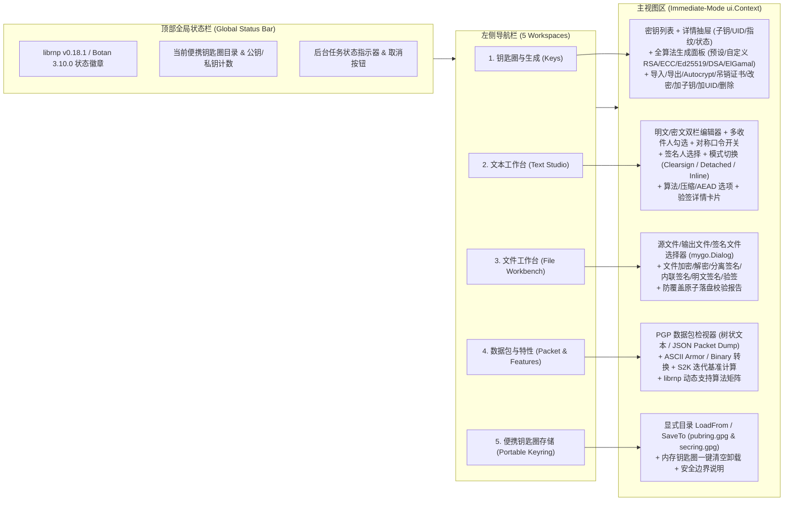

# RnpArmor 全功能架构审查、purego FFI 扩展设计与 Windows Portable 工程路线图

> **文档版本**：v2.0（首席架构与审查师终审定稿）
> **审查基准**：`/data/OpenBot/Shared/RnpArmor/worktrees/rnp-vertical-slice`（Commit `dd94fc4`，对应 PR #1 `cursor/rnp-vertical-slice-a1be`）
> **底层规范对齐**：`rnpgp/rnp v0.18.1` (`aad1892e4d8423398a0b973bd0a7e4544c359afc`, `include/rnp/rnp.h`)、`github.com/ebitengine/purego v0.11.1`、`github.com/egoist/mygo v0.10.0`

---

## 第一部分：现有半成品（PR #1 `cursor/rnp-vertical-slice-a1be`）代码质量与缺陷诊断

### 1.1 现有架构安全基座评估（必须保留的设计不变量）

对 `internal/loadlib/*` 与 `internal/rnp/*` 的逐行审计表明，现有垂直切片在**动态库防劫持、CGO 零依赖回调安全、敏感内存擦除**三个底层维度设计扎实，后续扩展必须严格继承以下不变量：

1. **零 CGO 绝对路径加载与全包哈希强校验 (`internal/loadlib/open*.go`)**：
   - `loadlib.Resolve()` 仅接受绝对路径环境变量 `RNPARMOR_LIBRNP` 或可执行文件同目录的 `rnp.dll` / `librnp.so` / `librnp.dylib`，绝不搜索当前工作目录（CWD）或 `PATH`。
   - `loadlib.Verify()` 在调用 `dlopen` / `LoadLibraryEx` 前强制读取同目录 `SHA256SUMS`，通过 `bundlePath` 拦截 `..`、盘符与绝对路径穿越，逐个核对清单内所有文件（含 `rnp.dll` 自身）的 SHA-256。
   - Windows 端 (`open_windows.go`) 使用 `windows.LoadLibraryEx(path, 0, LOAD_LIBRARY_SEARCH_DLL_LOAD_DIR | LOAD_LIBRARY_SEARCH_SYSTEM32)`，从操作系统加载器层面封死 CWD 与 `PATH` DLL 注入；Unix 端 (`open_unix.go`) 使用 `purego.Dlopen(path, RTLD_NOW | RTLD_LOCAL)` 配合 `$ORIGIN` RPATH。
2. **OS 线程绑定与无 Go 指针口令回调跳板 (`internal/rnp/session.go` & `callback.go`)**：
   - `Session.Do` 先检查 `inCallback.Load()` 防止回调重入死锁，再依次获取会话锁 `s.mu`、执行 `runtime.LockOSThread()`、记录 `enteredTID`、获取进程级 `apiMu`，保证同一时刻只有一个 OS 线程进入 `librnp`，且同步触发的 `rnp_password_cb` 在同一 OS 线程栈上执行。
   - `purego.NewCallback(passCallback)` 在整个进程生命周期内仅创建一次（规避 `purego` 跳板不可释放导致的句柄泄漏），`app_ctx` 仅传递单调递增的整数槽位 ID (`slot uintptr`)，彻底规避 Go GC 移动指针或 `cgocheck` 违规。
   - `passCallback` 内部校验 `uintptr(len(sl.pass))+1 <= bufLen`（`maxPass = 255` 对齐 `librnp` 256 字节缓冲上限），拷贝后对剩余字节全部写 `0`。
3. **敏感内存擦除与防覆盖文件落盘 (`internal/rnp/wipe.go` & `file.go`)**：
   - `wipe(b []byte)` 逐字节归零并调用 `runtime.KeepAlive(b)` 防止编译器死代码消除；C 侧返回缓冲均先 `rnp_buffer_clear(p, n)` 再 `rnp_buffer_destroy(p)`。
   - `commitNew` 先在目标目录创建 `.rnparmor-*` 临时文件写入并 `Sync()`，绝不原地截断或覆盖已有文件。

---

### 1.2 现有代码的 6 项核心架构缺陷与功能断层

| 编号 | 缺陷模块与代码位置 | 严重度 | 根因与技术细节诊断 |
| :--- | :--- | :---: | :--- |
| **D-01** | `internal/rnp/session.go:35-44`<br>`internal/rnp/ops.go:123,237` | **Blocker** | **`Session` 仅持有单对临时密钥指针且 `LoadFrom` 后无法加密/签名**：<br>`Session` 结构体仅维护 `primary uintptr` 与 `encKey uintptr`，只在 `Session.Generate()` 时赋值。当用户通过 `s.LoadFrom(ctx, dir)` 从磁盘加载已有 `pubring.gpg` / `secring.gpg` 时，`s.primary` 和 `s.encKey` 仍为 `0`！虽然 `DecryptFile` 直接调用 `rnp_decrypt(s.ffi, ...)` 可隐式检索钥匙圈，但 `EncryptFile`（第 123 行 `if s.encKey == 0 { return ErrNoKey }`）和 `SignFile`（第 237 行 `if s.primary == 0 { return ErrNoKey }`）直接报错返回 `ErrNoKey`。即：**加载已有钥匙圈的会话完全无法执行加密和签名**。 |
| **D-02** | `internal/rnp/ops.go:25-114` | **High** | **密钥生成算法、UserID 与 S2K 迭代硬编码**：<br>1. `s.generate()` 硬编码主钥 `"EDDSA"` + 子钥 `"ECDH"` (`"Curve25519"`)，UserID 硬编码为 `"rnp-armor-ephemeral"`，且 `if s.primary != 0` 限制单会话只能生成一次。<br>2. `s.protect(op)` 将 S2K 迭代次数硬编码为 `1024`（第 113 行 `bound.genIter(op, 1024)`）。`1024` 是 RFC 4880 S2K 编码的最低下限（仅适合单元测试提速），生产环境密钥保护必须支持 `rnp_calculate_iterations` 动态基线或标准高迭代参数。<br>3. 不支持 RSA (2048/3072/4096)、ECDSA/ECDH (NIST P-256/P-384/P-521、brainpool、secp256k1)、DSA、ElGamal、SM2、自定义过期时间与多子钥管理。 |
| **D-03** | `internal/rnp/api.go:22-77`<br>`internal/rnp/ops.go` | **High** | **缺少钥匙圈枚举、密钥定位与属性查询 FFI 绑定**：<br>`api.go` 仅绑定了 `rnp_get_public_key_count` 与 `rnp_get_secret_key_count`，未绑定 `rnp_identifier_iterator_create/next/destroy`、`rnp_locate_key`、`rnp_key_to_json`、`rnp_key_get_*`、`rnp_import_keys`、`rnp_key_export`、`rnp_key_remove`。上层 GUI 无法展示钥匙圈列表、无法按收件人/签名人选择密钥、无法导入导出单把公钥/私钥或生成吊销证书。 |
| **D-04** | `internal/rnp/ops.go:150-348` | **High** | **缺少文本内存级公开 API 与全模式加解密/签名/验签能力**：<br>1. `encrypt`、`decrypt`、`sign`、`verify` 均为私有方法且强绑定文件读写。<br>2. 签名仅绑定了 `rnp_op_sign_detached_create`（分离签名），缺少文本高频使用的 **`rnp_op_sign_cleartext_create`（Clearsign 明文签名）** 与 **`rnp_op_sign_create`（Inline 内联签名）**。<br>3. 验签仅绑定了 `rnp_op_verify_detached_create`，缺少 `rnp_op_verify_create`（无法验证 Clearsign / Inline 签名并提取原文，也无法在解密同时自动验签）；且 `ops.go:329` 仅检查第 `0` 个签名（`verAt(op, 0, &handle)`），未提取签名者 KeyID、Fingerprint、UserID、签名时间戳与哈希算法。<br>4. 加密不支持多收件人公钥、不支持纯对称口令加密 (`rnp_op_encrypt_add_password`)、不支持加密同时签名 (`rnp_op_encrypt_add_signature`)、不支持压缩算法 (`rnp_op_encrypt_set_compression`) 与 AEAD (`rnp_op_encrypt_set_aead`)。 |
| **D-05** | `internal/rnp/file_other.go:9-36` | **Medium** | **Windows 文件发布 (`publish`) 非原子且双倍内存/IO 开销**：<br>Linux 下 `file_linux.go` 使用 `unix.Renameat2(..., RENAME_NOREPLACE)` 实现零拷贝原子重命名；而 Windows 下 `file_other.go` 先将已写好的临时文件 `os.ReadFile(tmp)` 重新整块读入内存，再用 `O_WRONLY|O_CREATE|O_EXCL` 打开 `dst` 重新写入一遍并删除 `tmp`。处理 32 MiB 文件时会产生额外 32 MiB 内存分配与双倍磁盘写入，且进程中途崩溃会留下半截文件。Windows 端应改用 `windows.MoveFileEx(tmpPtr, dstPtr, 0)`（不传 `MOVEFILE_REPLACE_EXISTING` 即天然具备防覆盖同卷原子重命名语义）。 |
| **D-06** | `internal/loadlib/open.go:51-96`<br>`scripts/package-portable.ps1:34`<br>`scripts/build-windows.ps1:315` | **Medium** | **`SHA256SUMS` 校验范围过宽与打包脚本路径规则冲突**：<br>1. `build-windows.ps1` 将 `PORTABLE.txt`、`DEPENDENCIES.txt`、`licenses/*` 全部写入 `SHA256SUMS`，而 `loadlib.Verify` 在每次启动时校验 `SHA256SUMS` 中的**所有行**。用户若在解压目录改动说明文档即导致 `rnp.dll` 拒绝加载。<br>2. `package-portable.ps1` 第 34 行规定 `if ($name.Contains("\") -or $name.Contains("/")) { throw "checksum name must be a single file name" }`，与 `build-windows.ps1` 第 320 行写入 `licenses/rnp-LICENSE.md` 子目录相对路径直接冲突。 |

---

### 1.3 Windows CI 90 分钟超时被取消（Run `#44782528749`）根因剖析与精确修复补丁

#### 1.3.1 超时与挂起的三重根因
1. **根因一：`scripts/build-windows.ps1` 第 344–365 行无头环境启动 GUI 进程并重定向标准输出/错误导致管道/句柄阻塞**
   ```powershell
   # scripts/build-windows.ps1:344-345
   $proc = Start-Process -FilePath (Join-Path $dist "rnparmor.exe") -WorkingDirectory $dist -PassThru -WindowStyle Hidden -RedirectStandardOutput $smokeOut -RedirectStandardError $smokeErr
   $running = -not $proc.WaitForExit(12000)
   ```
   - 在 GitHub Actions `windows-2022` Runner（无交互式桌面的 Headless Session 0 服务会话）中，`Start-Process ... -RedirectStandardOutput -RedirectStandardError` 会由 PowerShell 创建文件/管道重定向句柄并由子进程树继承。
   - `rnparmor.exe` 启动后直接进入 `mygo.App.Run()`（Win32 消息循环 + D3D11/GDI 表面初始化）。在无头 Windows Runner 上，一则 GUI 线程或图形驱动子线程可能卡在设备枚举/消息等待，二则 `$proc.WaitForExit(12000)` 与 PowerShell `Start-Process` 的重定向流生命周期配合时，若子进程派生了持有标准句柄的图形/系统辅助句柄或卡在同步 I/O，脚本极易在进程等待与清理阶段挂起。
   - 同理，第 335–337 行使用 `Start-Process -FilePath $go ... -Wait -NoNewWindow -RedirectStandardOutput $testLog -RedirectStandardError $testErr` 跑 `go test`，在 PowerShell 中使用 `Start-Process -Wait` 配合文件重定向在大输出或子进程句柄未关闭时也有已知的 `.WaitForExit()` 流刷写死锁风险（直接使用 `& $go test ... 2>&1 | Tee-Object -FilePath $testLog` 并检查 `$LASTEXITCODE` 更安全且实时输出日志）。
2. **根因二：Botan 3.10.0 Amalgamation 在无缓存 CI 上的极长编译耗时**
   - `build-windows.ps1` 第 142 行启用了 `--amalgamation`，将整个 Botan 3.10.0 合并为巨型单编译单元 `botan_all.cpp`（逾百万行代码）。在 2 核 7GB RAM 的 `windows-2022` 虚拟机上，MSVC `cl.exe /O2 /MT` 编译该单文件无法利用多核并行，且占用数 GB 内存触发页面交换，仅此一步即消耗 35–55 分钟；加上 `.github/workflows/smoke.yml` 未配置任何 `actions/cache`，每次 PR 触发均从零重编 Botan、json-c、zlib、bzip2、librnp。
3. **根因三：`scripts/build-librnp.ps1` 与 `scripts/build-windows.ps1` 职责重叠且前者为半截废弃脚本**
   - `scripts/build-librnp.ps1`（共 44 行）仅下载并校验了 `Botan-3.10.0.tar.xz`，随后在第 44 行直接 `exit 2` 退出，既未编译 Botan 也未编译 `librnp`；而 `scripts/build-windows.ps1` 把依赖下载、编译、Go 构建、DLL 导入表审计、测试、冒烟、打包全部塞进同一个 389 行脚本中，`scripts/package-portable.ps1` 也被架空。

#### 1.3.2 精确修复补丁方案

**补丁 1：`cmd/rnparmor/main.go` 增加 `--smoke-test` 无头自检模式（支持 CI 确定性秒级验证）**
```go
// 在 cmd/rnparmor/main.go 中支持 --smoke-test 标志：
// 1. 校验 DefaultLibrary() 与 SHA256SUMS 完整性；
// 2. 调用 rnp.Probe(path) 验证 librnp 0.18.1 动态加载与符号绑定；
// 3. 创建内存临时 Session，跑通密钥生成 + 文本加密解密 + Clearsign 验签全链路；
// 4. 打印 JSON/文本自检报告并以 os.Exit(0) 正常退出，不在无头 CI 中卡死 Win32 消息循环。
```

**补丁 2：`scripts/build-windows.ps1` 第 332–366 行替换 `Start-Process` 管道重定向与冒烟逻辑**
```powershell
# 替换原 332-340 行 go test 调用（避免 Start-Process -Wait 重定向挂起，实时向 CI 控制台输出进度）：
Write-Host "go test with RNPARMOR_LIBRNP=$env:RNPARMOR_LIBRNP"
Push-Location $root
try {
    & $go test -v -count=1 -timeout 10m ./internal/loadlib/ ./internal/rnp/ 2>&1 | Tee-Object -FilePath $testLog
    if ($LASTEXITCODE -ne 0) { throw "go test failed with exit code $LASTEXITCODE" }
} finally {
    Pop-Location
}

# 替换原 341-366 行 GUI 冒烟测试（先执行确定性 --smoke-test，再做带硬超时的无重定向窗口探针）：
Remove-Item Env:RNPARMOR_LIBRNP -ErrorAction SilentlyContinue
$exePath = Join-Path $dist "rnparmor.exe"

# Step A: 确定性 FFI + 打包完整性自检（秒级退出，验证独立目录 rnp.dll 加载与密码学全链路）
$smokeOutput = & $exePath --smoke-test 2>&1
if ($LASTEXITCODE -ne 0) {
    throw "rnparmor.exe --smoke-test failed ($LASTEXITCODE): $smokeOutput"
}

# Step B: 窗口进程启动探针（不挂载 RedirectStandardOutput/Error 管道，防止句柄继承死锁）
$proc = Start-Process -FilePath $exePath -WorkingDirectory $dist -PassThru -WindowStyle Hidden
try {
    $exited = $proc.WaitForExit(5000)
    if (-not $exited) {
        $smokeState = "smoke-test passed; GUI process alive after 5s; stopped cleanly"
    } elseif ($proc.ExitCode -eq 0) {
        $smokeState = "smoke-test passed; GUI process exited 0"
    } else {
        throw "rnparmor.exe crashed with exit code $($proc.ExitCode)"
    }
} finally {
    if (-not $proc.HasExited) {
        Stop-Process -Id $proc.Id -Force -ErrorAction SilentlyContinue
    }
    $env:PATH = $savedPath
}
```

**补丁 3：优化 Botan 编译并行度并在 `.github/workflows/smoke.yml` 中缓存 `out/deps`**
1. 在 `scripts/build-windows.ps1` 第 142 行移除 `--amalgamation`（当 `$ninja` 可用时，Ninja 多核并行编译独立 `.cpp` 比单核编译巨型 `botan_all.cpp` 快 3~4 倍且不爆内存）。
2. 在 `.github/workflows/smoke.yml` 的 `windows-portable` 与 `linux` 作业中加入 `actions/cache@v4` 缓存 `out/deps`（Key 绑定 `hashFiles('deps/pins.json', 'scripts/windows/**')`）。
3. 清理职责重叠：让 `scripts/build-librnp.ps1` 专职构建 Windows `out/deps` 与 `rnp.dll`（或由 `build-windows.ps1` 调用），并修正 `scripts/package-portable.ps1` 使其支持 `licenses/...` 相对路径。

---

## 第二部分：`internal/rnp` 全功能 purego FFI 扩展设计（对齐 `librnp v0.18.1` C API）

以下设计严格对齐 `rnpgp/rnp v0.18.1` 的 `include/rnp/rnp.h` 头文件原型。所有新增绑定均通过 `purego.RegisterLibFunc` 注册在 `internal/rnp/api.go` 的 `api` 结构体中，不引入任何 `import "C"`。

### 2.1 `rnp.h` 核心标志位常量映射（`internal/rnp/consts.go`）

```go
package rnp

// RNP_KEY_EXPORT_* 密钥导出标志 (rnp.h:43-49)
const (
	FlagKeyExportArmored uint32 = 1 << 0 // RNP_KEY_EXPORT_ARMORED
	FlagKeyExportPublic  uint32 = 1 << 1 // RNP_KEY_EXPORT_PUBLIC
	FlagKeyExportSecret  uint32 = 1 << 2 // RNP_KEY_EXPORT_SECRET
	FlagKeyExportSubkeys uint32 = 1 << 3 // RNP_KEY_EXPORT_SUBKEYS
	FlagKeyExportBase64  uint32 = 1 << 9 // RNP_KEY_EXPORT_BASE64 (Autocrypt)
)

// RNP_KEY_REMOVE_* 密钥删除标志 (rnp.h:51-53)
const (
	FlagKeyRemovePublic  uint32 = 1 << 0 // RNP_KEY_REMOVE_PUBLIC
	FlagKeyRemoveSecret  uint32 = 1 << 1 // RNP_KEY_REMOVE_SECRET
	FlagKeyRemoveSubkeys uint32 = 1 << 2 // RNP_KEY_REMOVE_SUBKEYS
)

// RNP_KEY_UNLOAD_* 钥匙圈卸载标志 (rnp.h:55-56)
const (
	FlagKeyUnloadPublic uint32 = 1 << 0 // RNP_KEY_UNLOAD_PUBLIC
	FlagKeyUnloadSecret uint32 = 1 << 1 // RNP_KEY_UNLOAD_SECRET
)

// RNP_LOAD_SAVE_* 钥匙圈加载/导入/保存标志 (rnp.h:80-84)
const (
	FlagLoadSavePublicKeys uint32 = 1 << 0  // RNP_LOAD_SAVE_PUBLIC_KEYS
	FlagLoadSaveSecretKeys uint32 = 1 << 1  // RNP_LOAD_SAVE_SECRET_KEYS
	FlagLoadSavePermissive uint32 = 1 << 8  // RNP_LOAD_SAVE_PERMISSIVE
	FlagLoadSaveSingle     uint32 = 1 << 9  // RNP_LOAD_SAVE_SINGLE
	FlagLoadSaveBase64     uint32 = 1 << 10 // RNP_LOAD_SAVE_BASE64
)

// RNP_JSON_* 密钥转 JSON 标志 (rnp.h:61-64)
const (
	FlagJSONPublicMPIs    uint32 = 1 << 0 // RNP_JSON_PUBLIC_MPIS
	FlagJSONSecretMPIs    uint32 = 1 << 1 // RNP_JSON_SECRET_MPIS
	FlagJSONSignatures    uint32 = 1 << 2 // RNP_JSON_SIGNATURES
	FlagJSONSignatureMPIs uint32 = 1 << 3 // RNP_JSON_SIGNATURE_MPIS
)

// RNP_JSON_DUMP_* 与 RNP_DUMP_* 数据包检视标志 (rnp.h:69-75)
const (
	FlagJSONDumpMPI  uint32 = 1 << 0 // RNP_JSON_DUMP_MPI
	FlagJSONDumpRaw  uint32 = 1 << 1 // RNP_JSON_DUMP_RAW
	FlagJSONDumpGrip uint32 = 1 << 2 // RNP_JSON_DUMP_GRIP

	FlagDumpMPI  uint32 = 1 << 0 // RNP_DUMP_MPI
	FlagDumpRaw  uint32 = 1 << 1 // RNP_DUMP_RAW
	FlagDumpGrip uint32 = 1 << 2 // RNP_DUMP_GRIP
)

// RNP_VERIFY_* 解密/验签行为标志 (rnp.h:140-142)
const (
	FlagVerifyIgnoreSigsOnDecrypt  uint32 = 1 << 0 // RNP_VERIFY_IGNORE_SIGS_ON_DECRYPT
	FlagVerifyRequireAllSigs       uint32 = 1 << 1 // RNP_VERIFY_REQUIRE_ALL_SIGS
	FlagVerifyAllowHiddenRecipient uint32 = 1 << 2 // RNP_VERIFY_ALLOW_HIDDEN_RECIPIENT
)

// RNP_ENCRYPT_* 加密标志 (rnp.h:135)
const (
	FlagEncryptNoWrap uint32 = 1 << 0 // RNP_ENCRYPT_NOWRAP
)
```

---

### 2.2 完整 FFI 函数绑定清单（按四大功能域划分）

#### (1) 密钥管理、枚举、元数据读取、全算法生成、导入导出、吊销与删除

| librnp C 函数名 (`rnp.h` 行号) | C 原型摘录 | Go `purego` 绑定签名 (`internal/rnp/api.go`) | 内存释放与边界契约 |
| :--- | :--- | :--- | :--- |
| `rnp_identifier_iterator_create` (4024) | `rnp_result_t (rnp_ffi_t ffi, rnp_identifier_iterator_t *it, const char *identifier_type)` | `iterCreate func(ffi uintptr, it *uintptr, typ string) uint32` | `typ`: `"fingerprint"`, `"keyid"`, `"userid"`, `"grip"`。用毕必须调用 `iterDestroy`。 |
| `rnp_identifier_iterator_next` (4037) | `rnp_result_t (rnp_identifier_iterator_t it, const char **identifier)` | `iterNext func(it uintptr, id *uintptr) uint32` | **严禁对 `*id` 调用 `rnp_buffer_destroy`**！该字符串缓冲归迭代器所有；遍历结束时返回 `RNP_SUCCESS` 且 `*id == 0`。 |
| `rnp_identifier_iterator_destroy` (4045) | `rnp_result_t (rnp_identifier_iterator_t it)` | `iterDestroy func(it uintptr) uint32` | 销毁迭代器并释放其内部缓冲。 |
| `rnp_locate_key` (801) | `rnp_result_t (rnp_ffi_t ffi, const char *identifier_type, const char *identifier, rnp_key_handle_t *key)` | `locateKey func(ffi uintptr, typ, id string, key *uintptr) uint32` | 未找到密钥时仍返回 `0 (RNP_SUCCESS)`，但 `*key == 0`；找到后必须调用 `rnp_key_handle_destroy(*key)`。 |
| `rnp_key_to_json` (4015) | `rnp_result_t (rnp_key_handle_t handle, uint32_t flags, char **result)` | `keyToJSON func(key uintptr, flags uint32, res *uintptr) uint32` | `*res` 必须通过 `readCString` 读取并用 `rnp_buffer_destroy` 释放。 |
| `rnp_key_get_fprint` (2518) | `rnp_result_t (rnp_key_handle_t key, char **fprint)` | `keyGetFprint func(key uintptr, out *uintptr) uint32` | `*out` 需 `rnp_buffer_destroy`。 |
| `rnp_key_get_keyid` (2528) | `rnp_result_t (rnp_key_handle_t key, char **keyid)` | `keyGetKeyID func(key uintptr, out *uintptr) uint32` | `*out` 需 `rnp_buffer_destroy`。 |
| `rnp_key_get_grip` (2538) | `rnp_result_t (rnp_key_handle_t key, char **grip)` | `keyGetGrip func(key uintptr, out *uintptr) uint32` | `*out` 需 `rnp_buffer_destroy`。 |
| `rnp_key_get_primary_grip` (2549) | `rnp_result_t (rnp_key_handle_t key, char **grip)` | `keyGetPrimaryGrip func(key uintptr, out *uintptr) uint32` | 用于判断或关联子钥所属主钥；`*out` 需 `rnp_buffer_destroy`。 |
| `rnp_key_get_primary_fprint` (2561) | `rnp_result_t (rnp_key_handle_t key, char **fprint)` | `keyGetPrimaryFprint func(key uintptr, out *uintptr) uint32` | 仅对子钥调用有效；`*out` 需 `rnp_buffer_destroy`。 |
| `rnp_key_get_primary_uid` (1460) | `rnp_result_t (rnp_key_handle_t key, char **uid)` | `keyGetPrimaryUID func(key uintptr, out *uintptr) uint32` | 无 UserID 时可能返回错误码；`*out` 需 `rnp_buffer_destroy`。 |
| `rnp_key_get_uid_count` (1468) | `rnp_result_t (rnp_key_handle_t key, size_t *count)` | `keyGetUIDCount func(key uintptr, n *uintptr) uint32` | 获取主钥上的 UserID 数量。 |
| `rnp_key_get_uid_at` (1478) | `rnp_result_t (rnp_key_handle_t key, size_t idx, char **uid)` | `keyGetUIDAt func(key, idx uintptr, out *uintptr) uint32` | `*out` 需 `rnp_buffer_destroy`。 |
| `rnp_key_get_uid_handle_at` (1489) | `rnp_result_t (rnp_key_handle_t key, size_t idx, rnp_uid_handle_t *uid)` | `keyGetUIDHandleAt func(key, idx uintptr, uid *uintptr) uint32` | 返回的 `*uid` 用毕须调用 `rnp_uid_handle_destroy`。 |
| `rnp_uid_is_primary` (1520) / `rnp_uid_is_valid` (1532) / `rnp_uid_is_revoked` (2357) | `rnp_result_t (rnp_uid_handle_t uid, bool *result)` | `uidIsPrimary`, `uidIsValid`, `uidIsRevoked func(uid uintptr, res *bool) uint32` | 读取单个 UserID 的主标识、有效性与吊销状态。 |
| `rnp_uid_remove` (2378) / `rnp_uid_handle_destroy` (2385) | `rnp_result_t (rnp_key_handle_t key, rnp_uid_handle_t uid)` | `uidRemove func(key, uid uintptr) uint32`<br>`uidDestroy func(uid uintptr) uint32` | 删除非唯一 UserID 并释放句柄。 |
| `rnp_key_get_alg` (2447) | `rnp_result_t (rnp_key_handle_t key, char **alg)` | `keyGetAlg func(key uintptr, out *uintptr) uint32` | 返回 `"RSA"`, `"EDDSA"`, `"ECDH"`, `"ECDSA"`, `"DSA"`, `"ELGAMAL"`, `"SM2"`；`*out` 需 `rnp_buffer_destroy`。 |
| `rnp_key_get_bits` (2468) / `rnp_key_get_dsa_qbits` (2476) | `rnp_result_t (rnp_key_handle_t key, uint32_t *bits)` | `keyGetBits`, `keyGetDSAQBits func(key uintptr, bits *uint32) uint32` | 获取 RSA/DSA/ElGamal 位数或 ECC 曲线位数。 |
| `rnp_key_get_curve` (2485) | `rnp_result_t (rnp_key_handle_t key, char **curve)` | `keyGetCurve func(key uintptr, out *uintptr) uint32` | 仅 ECC 算法有效；`*out` 需 `rnp_buffer_destroy`。 |
| `rnp_key_allows_usage` (2572) | `rnp_result_t (rnp_key_handle_t key, const char *usage, bool *result)` | `keyAllowsUsage func(key uintptr, usage string, res *bool) uint32` | `usage`: `"encrypt"`, `"sign"`, `"certify"`, `"authenticate"`。 |
| `rnp_key_get_creation` (2583) / `rnp_key_get_expiration` (2593) | `rnp_result_t (rnp_key_handle_t key, uint32_t *result)` | `keyGetCreation`, `keyGetExpiration func(key uintptr, sec *uint32) uint32` | `expiration` 为相对 `creation` 的有效秒数（`0` 为永不过期）。 |
| `rnp_key_valid_till64` (2633) | `rnp_result_t (rnp_key_handle_t key, uint64_t *result)` | `keyValidTill64 func(key uintptr, ts *uint64) uint32` | 综合吊销与过期的最终有效截止 Unix 秒（防止 32 位时间戳溢出）。 |
| `rnp_key_is_primary` (2869) / `rnp_key_is_sub` (2878) | `rnp_result_t (rnp_key_handle_t key, bool *result)` | `keyIsPrimary`, `keyIsSub func(key uintptr, res *bool) uint32` | 区分主钥与子钥句柄。 |
| `rnp_key_have_secret` (2887) / `rnp_key_have_public` (2896) | `rnp_result_t (rnp_key_handle_t key, bool *result)` | `keyHaveSecret`, `keyHavePublic func(key uintptr, res *bool) uint32` | 检查是否包含私钥/公钥材料。 |
| `rnp_key_is_locked` (2700) / `rnp_key_is_protected` (2821) | `rnp_result_t (rnp_key_handle_t key, bool *result)` | `keyIsLocked`, `keyIsProtected func(key uintptr, res *bool) uint32` | 检查私钥锁定与 S2K 加密保护状态。 |
| `rnp_key_is_valid` (2617) / `rnp_key_is_expired` (2691) / `rnp_key_is_revoked` (2642) | `rnp_result_t (rnp_key_handle_t key, bool *result)` | `keyIsValid`, `keyIsExpired`, `keyIsRevoked func(key uintptr, res *bool) uint32` | 检查密钥自签名有效性、过期与吊销状态。 |
| `rnp_key_get_revocation_reason` (2652) | `rnp_result_t (rnp_key_handle_t key, char **result)` | `keyGetRevReason func(key uintptr, out *uintptr) uint32` | `*out` 需 `rnp_buffer_destroy`。 |
| `rnp_key_get_subkey_count` (2401) / `rnp_key_get_subkey_at` (2411) | `rnp_result_t (rnp_key_handle_t key, size_t idx, rnp_key_handle_t *subkey)` | `keyGetSubkeyCount func(key uintptr, n *uintptr) uint32`<br>`keyGetSubkeyAt func(key, idx uintptr, sub *uintptr) uint32` | 返回的 `*sub` 用毕必须调用 `rnp_key_handle_destroy`。 |
| `rnp_key_get_default_key` (2435) | `rnp_result_t (rnp_key_handle_t primary_key, const char *usage, uint32_t flags, rnp_key_handle_t *default_key)` | `keyGetDefaultKey func(primary uintptr, usage string, flags uint32, out *uintptr) uint32` | 自动从主钥及其子钥中挑选最匹配 `usage`（如 `"encrypt"` 或 `"sign"`）的可用密钥句柄！ |
| `rnp_generate_key_json` (899) | `rnp_result_t (rnp_ffi_t ffi, const char *json, char **results)` | `generateKeyJSON func(ffi uintptr, jsonDesc string, results *uintptr) uint32` | **全算法生成主入口**：支持一次生成任意主钥+子钥组合；`*results` 返回 `{"primary":{"grip":"..."},"sub":{"grip":"..."}}`，必须 `rnp_buffer_destroy`。 |
| `rnp_op_generate_set_bits` (1019) / `rnp_op_generate_set_dsa_qbits` (1037) / `rnp_op_generate_set_expiration` (1148) | `rnp_result_t (rnp_op_generate_t op, uint32_t val)` | `genBits`, `genDSAQBits`, `genExpiration func(op uintptr, v uint32) uint32` | 供向现有主钥单独追加子钥 (`rnp_op_generate_subkey_create`) 时设置位数与过期秒数。 |
| `rnp_import_keys` (722) / `rnp_import_signatures` (766) | `rnp_result_t (rnp_ffi_t ffi, rnp_input_t input, uint32_t flags, char **results)` | `importKeys`, `importSigs func(ffi, in uintptr, flags uint32, res *uintptr) uint32` | 导入 Armored/Binary 公私钥或独立吊销/认证签名，返回导入状态 JSON（`*res` 需 `rnp_buffer_destroy`）。 |
| `rnp_key_export` (1279) | `rnp_result_t (rnp_key_handle_t key, rnp_output_t output, uint32_t flags)` | `keyExport func(key, out uintptr, flags uint32) uint32` | 单把公钥或私钥导出（配合 `FlagKeyExportArmored \| FlagKeyExportPublic \| FlagKeyExportSubkeys`）。 |
| `rnp_key_export_autocrypt` (1293) | `rnp_result_t (rnp_key_handle_t key, rnp_key_handle_t sub, const char *uid, rnp_output_t out, uint32_t flags)` | `keyExportAutocrypt func(key, sub uintptr, uid string, out uintptr, flags uint32) uint32` | 导出 5-packet Autocrypt 精简公钥（`FlagKeyExportBase64`）。 |
| `rnp_key_export_revocation` (1316) / `rnp_key_revoke` (1338) | `rnp_result_t (rnp_key_handle_t key, rnp_output_t out, uint32_t flags, const char *hash, const char *code, const char *reason)` | `keyExportRevocation func(key, out uintptr, flags uint32, hash, code, reason string) uint32`<br>`keyRevoke func(key uintptr, flags uint32, hash, code, reason string) uint32` | 导出独立吊销证书或直接吊销主钥/子钥（`code`: `"no"`, `"superseded"`, `"compromised"`, `"retired"`）。 |
| `rnp_key_remove` (1383) / `rnp_unload_keys` (679) | `rnp_result_t (rnp_key_handle_t key, uint32_t flags)` | `keyRemove func(key uintptr, flags uint32) uint32`<br>`unloadKeys func(ffi uintptr, flags uint32) uint32` | 删除指定密钥（`FlagKeyRemovePublic \| FlagKeyRemoveSecret \| FlagKeyRemoveSubkeys`）或清空内存钥匙圈。 |

#### (2) 文本内容与文件加解密、签名（Clearsign / Detached / Inline）及验签扩展

| librnp C 函数名 (`rnp.h` 行号) | C 原型摘录 | Go `purego` 绑定签名 (`internal/rnp/api.go`) | 业务场景与契约说明 |
| :--- | :--- | :--- | :--- |
| `rnp_op_encrypt_add_password` (3772) | `rnp_result_t (rnp_op_encrypt_t op, const char *password, const char *s2k_hash, size_t iterations, const char *s2k_cipher)` | `encAddPass func(op uintptr, pass uintptr, s2kHash string, iter uintptr, s2kCipher string) uint32` | **对称口令加密**：`pass` 传 `0 (NULL)` 时自动通过 `passCallback` 请求口令（避免明文 string 常驻 Go 堆），或传入临时清零字节指针。 |
| `rnp_op_encrypt_add_signature` (3716) | `rnp_result_t (rnp_op_encrypt_t op, rnp_key_handle_t key, rnp_op_sign_signature_t *sig)` | `encAddSig func(op, key uintptr, sig *uintptr) uint32` | **加密并同时签名（Encrypt & Sign）**。 |
| `rnp_op_encrypt_set_hash` (3732) | `rnp_result_t (rnp_op_encrypt_t op, const char *hash)` | `encSetHash func(op uintptr, hash string) uint32` | 设置加密并签名时的签名哈希算法。 |
| `rnp_op_encrypt_set_compression` (3829) | `rnp_result_t (rnp_op_encrypt_t op, const char *compression, int level)` | `encCompress func(op uintptr, alg string, level int32) uint32` | 设置 `"Uncompressed"`, `"ZLib"`, `"BZip2"`, `"ZIP"` 及压缩等级 `0..9`。 |
| `rnp_op_encrypt_set_aead` (3807) / `rnp_op_encrypt_set_aead_bits` (3817) | `rnp_result_t (rnp_op_encrypt_t op, const char *alg)` | `encSetAEAD func(op uintptr, alg string) uint32`<br>`encSetAEADBits func(op uintptr, bits int32) uint32` | 设置 `"None"` 或 `"OCB"` AEAD 认证加密模式。 |
| `rnp_op_encrypt_set_flags` (3844) / `rnp_op_encrypt_set_file_mtime` (3866) | `rnp_result_t (rnp_op_encrypt_t op, uint32_t val)` | `encSetFlags`, `encFileMtime func(op uintptr, v uint32) uint32` | 支持 `RNP_ENCRYPT_NOWRAP` 及保留文件修改时间戳。 |
| `rnp_op_sign_create` (2976) | `rnp_result_t (rnp_op_sign_t *op, rnp_ffi_t ffi, rnp_input_t input, rnp_output_t output)` | `signCreate func(op *uintptr, ffi, in, out uintptr) uint32` | **Inline（内联/封装）签名**：支持文本与二进制文件。 |
| `rnp_op_sign_cleartext_create` (2989) | `rnp_result_t (rnp_op_sign_t *op, rnp_ffi_t ffi, rnp_input_t input, rnp_output_t output)` | `signCleartext func(op *uintptr, ffi, in, out uintptr) uint32` | **Clearsign（ASCII 明文签名）**：输出 `-----BEGIN PGP SIGNED MESSAGE-----`。注：Clearsign 下不可调用 `rnp_op_sign_set_armor`。 |
| `rnp_op_sign_set_compression` (3054) | `rnp_result_t (rnp_op_sign_t op, const char *compression, int level)` | `signCompress func(op uintptr, alg string, level int32) uint32` | 仅对 `rnp_op_sign_create`（内联签名）有效。 |
| `rnp_op_sign_set_file_name` (3102) / `rnp_op_sign_set_file_mtime` (3111) | `rnp_result_t (rnp_op_sign_t op, ...)` | `signFileName func(op uintptr, name string) uint32`<br>`signFileMtime func(op uintptr, mtime uint32) uint32` | 为内联签名设置内部文件名与修改时间。 |
| `rnp_op_ sign_set_creation_time` (3084) / `rnp_op_sign_set_expiration_time` (3093) | `rnp_result_t (rnp_op_sign_t op, uint32_t sec)` | `signCreationTime`, `signExpirationTime func(op uintptr, sec uint32) uint32` | 自定义签名创建时间与过期时长。 |
| `rnp_op_verify_create` (3142) | `rnp_result_t (rnp_op_verify_t *op, rnp_ffi_t ffi, rnp_input_t input, rnp_output_t output)` | `verCreate func(op *uintptr, ffi, in, out uintptr) uint32` | **一体化解密+验签 / Clearsign 验签 / Inline 验签**：提取还原明文至 `out`，并记录所有签名及加密保护信息。 |
| `rnp_op_verify_set_flags` (3179) | `rnp_result_t (rnp_op_verify_t op, uint32_t flags)` | `verSetFlags func(op uintptr, flags uint32) uint32` | 解密含签名的密文时设置 `FlagVerifyIgnoreSigsOnDecrypt` 可在签名公钥未知时仍提取出明文并报告签名状态。 |
| `rnp_op_verify_get_protection_info` (3255) | `rnp_result_t (rnp_op_verify_t op, char **mode, char **cipher, bool *valid)` | `verProtInfo func(op uintptr, mode, cipher *uintptr, valid *bool) uint32` | 获取密文使用的加密模式（`"cfb-mdc"`, `"aead-ocb"` 等）、对称算法（`"AES256"`）及完整性校验结果；`*mode`、`*cipher` 需 `rnp_buffer_destroy`。 |
| `rnp_op_verify_get_file_info` (3221) | `rnp_result_t (rnp_op_verify_t op, char **filename, uint32_t *mtime)` | `verFileInfo func(op uintptr, name *uintptr, mtime *uint32) uint32` | 获取内联签名或密文内部封装的原始文件名与时间戳。 |
| `rnp_op_verify_get_recipient_count` (3267) / `rnp_op_verify_get_recipient_at` (3290) / `rnp_op_verify_get_used_recipient` (3278) | `rnp_result_t (rnp_op_verify_t op, ...)` | `verRecipCount func(op uintptr, n *uintptr) uint32`<br>`verRecipAt func(op, idx uintptr, r *uintptr) uint32`<br>`verUsedRecip func(op uintptr, r *uintptr) uint32` | 查询密文的目标收件人列表及实际用于解密的收件人句柄。 |
| `rnp_recipient_get_keyid` (3303) / `rnp_recipient_get_alg` (3314) | `rnp_result_t (rnp_recipient_handle_t r, char **out)` | `recipGetKeyID`, `recipGetAlg func(r uintptr, out *uintptr) uint32` | 获取收件人 KeyID 与算法；`*out` 需 `rnp_buffer_destroy`。 |
| `rnp_op_verify_get_symenc_count` (3323) / `rnp_op_verify_get_used_symenc` (3334) | `rnp_result_t (rnp_op_verify_t op, ...)` | `verSymCount func(op uintptr, n *uintptr) uint32`<br>`verUsedSym func(op uintptr, s *uintptr) uint32` | 判断密文是否包含对称口令槽（SKESK）以及是否通过口令完成解密。 |
| `rnp_op_verify_signature_get_hash` (3440) | `rnp_result_t (rnp_op_verify_signature_t sig, char **hash)` | `verSigGetHash func(sig uintptr, out *uintptr) uint32` | 获取该签名使用的哈希算法；`*out` 需 `rnp_buffer_destroy`。 |
| `rnp_op_verify_signature_get_key` (3448) | `rnp_result_t (rnp_op_verify_signature_t sig, rnp_key_handle_t *key)` | `verSigGetKey func(sig uintptr, key *uintptr) uint32` | 获取签名者密钥句柄（若钥匙圈中存在），**用毕必须调用 `rnp_key_handle_destroy(*key)`**！ |
| `rnp_op_verify_signature_get_handle` (3431) | `rnp_result_t (rnp_op_verify_signature_t sig, rnp_signature_handle_t *handle)` | `verSigGetHandle func(sig uintptr, h *uintptr) uint32` | 即使钥匙圈中无签名者公钥，也能通过该句柄调用 `rnp_signature_get_keyid` / `rnp_signature_get_key_fprint` 提取签名包内的 Issuer KeyID/Fingerprint！用毕调用 `rnp_signature_handle_destroy`。 |
| `rnp_op_verify_signature_get_times` (3459) | `rnp_result_t (rnp_op_verify_signature_t sig, uint32_t *create, uint32_t *expires)` | `verSigGetTimes func(sig uintptr, created, expires *uint32) uint32` | 获取签名时间戳与过期秒数。 |
| `rnp_signature_get_keyid` (2157) / `rnp_signature_get_key_fprint` (2167) / `rnp_signature_handle_destroy` (2349) | `rnp_result_t (rnp_signature_handle_t sig, ...)` | `sigGetKeyID`, `sigGetFprint func(sig uintptr, out *uintptr) uint32`<br>`sigDestroy func(sig uintptr) uint32` | 提取签名包中的签名者 KeyID 与指纹（`*out` 需 `rnp_buffer_destroy`），并销毁签名句柄。 |

#### (3) RNP 特色功能（数据包检视 Dump、Armor 转换、算法探测、密钥属性与口令修改）

| librnp C 函数名 (`rnp.h` 行号) | C 原型摘录 | Go `purego` 绑定签名 (`internal/rnp/api.go`) | 用途说明 |
| :--- | :--- | :--- | :--- |
| `rnp_dump_packets_to_json` (2951) | `rnp_result_t (rnp_input_t input, uint32_t flags, char **result)` | `dumpPacketsJSON func(in uintptr, flags uint32, out *uintptr) uint32` | 将任意 OpenPGP 消息、签名或密钥流解析为结构化 Packet JSON 数组；`*out` 需 `rnp_buffer_destroy`。 |
| `rnp_dump_packets_to_output` (2961) | `rnp_result_t (rnp_input_t input, rnp_output_t output, uint32_t flags)` | `dumpPacketsOut func(in, out uintptr, flags uint32) uint32` | 将 OpenPGP 数据包转储为人类可读的 Packet 树文本。 |
| `rnp_key_packets_to_json` (2910) | `rnp_result_t (rnp_key_handle_t key, bool secret, uint32_t flags, char **result)` | `keyPacketsJSON func(key uintptr, secret bool, flags uint32, out *uintptr) uint32` | 检视钥匙圈中指定密钥的底层 OpenPGP Packet JSON。 |
| `rnp_guess_contents` (1429) / `rnp_detect_key_format` (469) | `rnp_result_t (rnp_input_t input, char **contents)` | `guessContents func(in uintptr, out *uintptr) uint32`<br>`detectKeyFormat func(buf *byte, n uintptr, out *uintptr) uint32` | 自动嗅探输入流类型（`"message"`, `"public key"`, `"secret key"`, `"signature"`, `"unknown"`）。 |
| `rnp_enarmor` (1440) / `rnp_dearmor` (1448) | `rnp_result_t (rnp_input_t in, rnp_output_t out, ...)` | `enarmor func(in, out uintptr, typ string) uint32`<br>`dearmor func(in, out uintptr) uint32` | 二进制 PGP 包与 ASCII Armor 双向无损转换。 |
| `rnp_supports_feature` (493) / `rnp_supported_features` (516) | `rnp_result_t (const char *type, char **result)` | `supportsFeature func(typ, name string, ok *bool) uint32`<br>`supportedFeatures func(typ string, out *uintptr) uint32` | 动态查询当前 `librnp` + `Botan 3.10.0` 编译开启的全部算法与曲线列表。 |
| `rnp_backend_string` (4069) / `rnp_backend_version` (4076) | `const char *()` | `backendString func() string`<br>`backendVersion func() string` | 返回密码学后端名称与版本（如 `"Botan"` / `"3.10.0"`）。 |
| `rnp_key_set_expiration` (2606) | `rnp_result_t (rnp_key_handle_t key, uint32_t expiry)` | `keySetExpiration func(key uintptr, expiry uint32) uint32` | 修改已有主钥或子钥的有效期（自动触发私钥重签名）。 |
| `rnp_key_add_uid` (2501) | `rnp_result_t (rnp_key_handle_t key, const char *uid, const char *hash, uint32_t exp, uint8_t flags, bool primary)` | `keyAddUID func(key uintptr, uid, hash string, exp uint32, flags uint8, primary bool) uint32` | 为已有主钥添加新 UserID 并绑定自签名。 |
| `rnp_key_lock` (2795) / `rnp_key_unlock` (2809) | `rnp_result_t (rnp_key_handle_t key, const char *password)` | `keyLock func(key uintptr) uint32`<br>`keyUnlock func(key, pass uintptr) uint32` | 锁定或解锁私钥（`pass` 传 `0` 时走 `passCallback`）。 |
| `rnp_key_protect` (2844) / `rnp_key_unprotect` (2860) | `rnp_result_t (rnp_key_handle_t handle, const char *password, const char *cipher, const char *cipher_mode, const char *hash, size_t iterations)` | `keyProtect func(key, pass uintptr, cipher, mode, hash string, iter uintptr) uint32`<br>`keyUnprotect func(key, pass uintptr) uint32` | **修改私钥保护口令**：先用旧口令 `rnp_key_unprotect(key, 0)`，再用新口令 `rnp_key_protect` 重新加密并 `rnp_key_lock`。 |
| `rnp_key_get_protection_type` (2723) / `cipher` (2756) / `hash` (2768) / `mode` (2743) / `iterations` (2780) | `rnp_result_t (rnp_key_handle_t key, ...)` | `keyProtType`, `keyProtCipher`, `keyProtHash`, `keyProtMode func(key uintptr, out *uintptr) uint32`<br>`keyProtIter func(key uintptr, iter *uintptr) uint32` | 查询私钥当前的 S2K 保护参数（加密算法、哈希、模式、迭代次数）。 |
| `rnp_key_25519_bits_tweaked` (1362) / `rnp_key_25519_bits_tweak` (1373) | `rnp_result_t (rnp_key_handle_t key, ...)` | `key25519Tweaked func(key uintptr, ok *bool) uint32`<br>`key25519Tweak func(key uintptr) uint32` | RFC 7748 Curve25519 私钥比特位兼容性检查与修正。 |

---

### 2.3 `internal/rnp` 高层公开领域模型与 Go 方法签名

为了彻底解决 `D-01`~`D-04`，将 `Session` 从“仅保存 `primary`/`encKey` 两个指针”升级为**基于 Fingerprint / KeyID 动态寻址的全功能会话管理器**（同时保留原有 `Generate`、`EncryptFile`、`DecryptFile`、`SignFile`、`VerifyFile` 签名以 100% 兼容现有单元测试）：

```go
// KeySummary 是主钥或子钥的完整只读视图，供 MyGo UI 直接渲染列表、详情抽屉与收件人/签名人选择器
type KeySummary struct {
	Fingerprint      string       `json:"fingerprint"`
	KeyID            string       `json:"key_id"`
	Grip             string       `json:"grip"`
	PrimaryUID       string       `json:"primary_uid"`
	UserIDs          []UIDInfo    `json:"user_ids"`
	Algorithm        string       `json:"algorithm"`          // "EDDSA", "RSA", "ECDSA", "ECDH", "DSA", "ELGAMAL", "SM2"
	Bits             uint32       `json:"bits"`               // 255, 256, 2048, 3072, 4096...
	Curve            string       `json:"curve,omitempty"`    // "Ed25519", "Curve25519", "NIST P-256", ...
	CreatedUnix      uint32       `json:"created_unix"`
	ExpirationSec    uint32       `json:"expiration_sec"`     // 0 = 永不过期
	ValidTillUnix    uint64       `json:"valid_till_unix"`
	HasSecret        bool         `json:"has_secret"`
	IsLocked         bool         `json:"is_locked"`
	IsProtected      bool         `json:"is_protected"`
	IsValid          bool         `json:"is_valid"`
	IsExpired        bool         `json:"is_expired"`
	IsRevoked        bool         `json:"is_revoked"`
	RevocationReason string       `json:"revocation_reason,omitempty"`
	CanSign          bool         `json:"can_sign"`
	CanEncrypt       bool         `json:"can_encrypt"`
	CanCertify       bool         `json:"can_certify"`
	CanAuthenticate  bool         `json:"can_authenticate"`
	ProtectionCipher string       `json:"protection_cipher,omitempty"`
	ProtectionHash   string       `json:"protection_hash,omitempty"`
	ProtectionIter   uint64       `json:"protection_iterations,omitempty"`
	Subkeys          []SubkeyInfo `json:"subkeys,omitempty"`
}

// SignMode 定义三种签名模式
type SignMode string
const (
	SignModeCleartext SignMode = "cleartext" // rnp_op_sign_cleartext_create (ASCII 明文签名)
	SignModeDetached  SignMode = "detached"  // rnp_op_sign_detached_create  (分离签名)
	SignModeInline    SignMode = "inline"    // rnp_op_sign_create           (内联封装签名)
)

// EncryptOptions 统一控制文本与文件加密参数
type EncryptOptions struct {
	Recipients       []string // 收件人 Fingerprint / KeyID / UserID 列表（可通过 rnp_locate_key + rnp_key_get_default_key("encrypt") 解析）
	Signer           string   // 可选：同时签名的私钥 Fingerprint / KeyID（非空时调用 rnp_op_encrypt_add_signature）
	SymmetricPass    []byte   // 可选：对称加密口令（非空时调用 rnp_op_encrypt_add_password，调用后立即 wipe）
	Cipher           string   // "AES256" (默认), "AES192", "AES128", "CAMELLIA256", "TWOFISH", "SM4"...
	AEAD             string   // "None" (默认), "OCB"
	CompressionAlg   string   // "Uncompressed" (默认), "ZLib", "BZip2", "ZIP"
	CompressionLevel int      // 0..9
	HashAlg          string   // 签名与 S2K 哈希算法，默认 "SHA256"
	Armored          bool     // 文本加密恒为 true，文件加密可选 true (.asc) 或 false (.gpg)
	FileName         string   // 可选内部文件名
}

// SignatureDetail 表示验签后单条签名的完整诊断信息
type SignatureDetail struct {
	Status          uint32 `json:"status"`
	StatusText      string `json:"status_text"`
	MathValid       bool   `json:"math_valid"`
	IdentityTrusted bool   `json:"identity_trusted"` // 恒为 false，明确区分数学验签与身份信任
	SignerKeyID     string `json:"signer_key_id"`
	SignerFprint    string `json:"signer_fingerprint"`
	SignerUID       string `json:"signer_uid"`
	HashAlg         string `json:"hash_alg"`
	CreatedUnix     uint32 `json:"created_unix"`
	ExpiresSec      uint32 `json:"expires_sec"`
}

// VerifyDecryptReport 统一承载 DecryptText / VerifyText / DecryptFileWithOpts / VerifyFileWithOpts 的返回结果
type VerifyDecryptReport struct {
	Plaintext       []byte            `json:"-"`                 // 提取或解密出的原文（文件模式下已原子落盘，此字段为空）
	ProtectionMode  string            `json:"protection_mode"`   // "none", "cfb-mdc", "aead-ocb"
	SymmetricCipher string            `json:"symmetric_cipher"`  // "AES256" 等
	IntegrityValid  bool              `json:"integrity_valid"`   // MDC 或 AEAD 完整性校验是否通过
	UsedSymmetric   bool              `json:"used_symmetric"`    // 是否通过对称口令解密
	UsedRecipientID string            `json:"used_recipient_id"` // 实际匹配解密的收件人 KeyID
	RecipientKeyIDs []string          `json:"recipient_key_ids"` // 密文包含的全部收件人 KeyID
	EmbeddedFile    string            `json:"embedded_file"`
	EmbeddedMtime   uint32            `json:"embedded_mtime"`
	Signatures      []SignatureDetail `json:"signatures"`
	AllSigsValid    bool              `json:"all_sigs_valid"`
}
```

---

## 第三部分：MyGo (`github.com/egoist/mygo v0.10.0`) GUI 与 `Session.Go` 异步状态绑定架构

### 3.1 `mygo v0.10.0` 线程模型与渲染机制核查

根据对 `github.com/egoist/mygo@v0.10.0` 源码（`mygo.go`、`content.go`、`window.go`、`dialog.go`、`ui/*`）的核查：
1. **主线程锁定**：`mygo` 在 `init()` 中执行 `runtime.LockOSThread()` 将主协程绑定在进程主线程（Win32 / GTK / Cocoa UI 线程），`mygo.App.Run()` 必须在 `main()` 中调用。
2. **即时模式原生视图 (`ui.View`)**：`mygo.NewWindow(mygo.WindowOptions{..., Content: ui.View(app.view)})` 在主线程每一帧调用 `app.view(c *ui.Context)` 构建 UI 节点树。**`app.view` 内部严禁执行任何阻塞 I/O、耗时密码学计算或原生文件弹窗 (`mygo.Dialog.Open/Save`)**。
3. **跨协程主线程状态提交 (`win.Update` 与 `win.Invalidate`)**：
   - `win.Update(fn func())`（定义于 `mygo@v0.10.0/content.go:190`）通过 `postMain` 将状态修改闭包 `fn()` 投递到主线程执行，并在执行完毕后自动调用 `w.contentChanged()` 请求下一帧重绘。因此，**所有被 `app.view(c *ui.Context)` 读取的 UI 状态字段，只要在后台协程中通过 `win.Update(func() { ... })` 修改，即天然在主线程串行无锁访问，彻底消除 UI 数据竞态**！
   - `mygo.Dialog.Open`、`mygo.Dialog.Save`、`mygo.Clipboard.WriteText`、`mygo.Clipboard.ReadText` 内部会调用 `postMain` 并 `await(ch)` 等待主线程完成，因此在 UI 点击回调中必须通过 `go func() { ... }()` 启动后台协程调用，拿到路径或剪贴板文本后再用 `win.Update(...)` 回写 UI 状态。

### 3.2 `MyGo UI 线程` ↔ `Session.Go 工作线程` ↔ `passCallback` 交互时序架构

```mermaid
sequenceDiagram
    autonumber
    participant UI as MyGo Main Thread<br/>(ui.View / win.Update)
    participant Modal as Passphrase Modal<br/>(In-App UI Overlay)
    participant Worker as Session.Go Goroutine<br/>(runtime.LockOSThread)
    participant RNP as librnp v0.18.1 (C FFI)<br/>(s.mu + apiMu)
    participant CB as passCallback Trampoline<br/>(purego.NewCallback)

    UI->>UI: 用户点击「生成密钥 / 解密 / 签名 / 修改口令」
    alt 操作需要私钥口令或对称口令且尚未输入
        UI->>Modal: 打开应用内口令输入弹窗 (记录 pendingAction 闭包)
        Modal->>UI: 用户输入口令并点击确认
        UI->>UI: 将口令拷贝至临时 []byte，清空输入框 string
    end
    UI->>UI: 设置 app.busy = true, app.cancelFn = cancel
    UI->>Worker: 启动 s.Go(ctx, func(ctx) error { ... })
    Note over UI: 主线程立即返回，窗口保持 60fps 流畅响应与 Spinner 动画
    Worker->>Worker: 获取 s.mu -> runtime.LockOSThread() -> 获取 apiMu
    Worker->>Worker: s.SetPassphrase(tempPass) 并 defer s.ClearPassphrase() + wipe(tempPass)
    Worker->>RNP: 调用 librnp C API (如 rnp_generate_key_json / rnp_op_verify_execute)
    opt librnp 需要解锁私钥或对称加解密口令
        RNP->>CB: 同一 OS 线程同步回调 passCallback(ffi, slotID, key, pgp_context, buf, buf_len)
        CB->>CB: inCallback.Swap(true) 防重入 -> slotByID(slotID) -> 写入 buf 并填 0 -> 返回 true
        CB-->>RNP: 口令校验通过，继续 C 运算
    end
    RNP-->>Worker: 返回 rnp_result_t 及输出缓冲
    Worker->>Worker: takeOutput 拷贝结果 -> rnp_buffer_clear + rnp_buffer_destroy -> 释放锁
    Worker->>UI: 调用 win.Update(func() { 更新密钥列表/输出文本/状态横幅; app.busy = false })
    UI->>UI: contentChanged() 触发下一帧重绘展示结果
```

### 3.3 五大功能工作区（Workspace Tabs）与状态绑定设计



#### 关键安全交互约束（口令即时擦除与防驻留）：
- **会话不在后台长期驻留明文主口令**：改进 `Session.Open(libPath, optionalInitialPass)`，允许以空口令槽初始化 `Session`（此时 `slot.cancel = true`，任何意外触发的口令回调均安全返回 `false`）。
- 当用户在 GUI 触发需要口令的操作（生成受保护密钥、签名、私钥解密、对称加解密、修改保护口令、添加子钥/UserID、吊销密钥）时：
  1. 仅在本次 `Session.Go` 任务闭包内调用 `s.withScopedPass(pass, func() error { ... })` 将口令写入 `slot`；
  2. 操作返回前在 `defer` 中调用 `wipe(sl.pass)`、将 `sl.cancel` 置回 `true`，并对所有私钥句柄执行 `rnp_key_lock(key)`，确保私钥解锁材料与口令字节不会在操作结束后滞留内存。

---

## 第四部分：分阶段落地路线图（Worktree 拆分建议与模块接口契约）

遵循 `AGENTS.md` 红线（严禁直接修改 `main` 分支与已提交历史，所有并行开发在 `/data/OpenBot/Shared/RnpArmor/worktrees/<branch>` 独立推进），建议拆分为以下 3 个阶段递进交付：

### 4.1 阶段与 Worktree 拓扑规划

| 阶段 | 分支 / Worktree 路径 | 负责角色 | 核心交付物与文件边界 | 准出验收标准（Gate） |
| :---: | :--- | :--- | :--- | :--- |
| **Phase 1**<br>FFI 全量扩展层 | 分支：`feat/full-rnp-gui`（或独立 `feat/rnp-ffi-full`）<br>路径：`worktrees/feat-full-rnp-gui` | 主力全栈工程师 | `internal/rnp/api.go`<br>`internal/rnp/consts.go`<br>`internal/rnp/keys.go`<br>`internal/rnp/text_ops.go`<br>`internal/rnp/inspect.go`<br>`internal/rnp/file_windows.go`<br>`internal/rnp/session_ext_test.go` | 1. 绑定全部 90+ 个 `librnp v0.18.1` C API。<br>2. 原有 7 个单测 100% 保持通过。<br>3. 新增全算法密钥生成（RSA/Ed25519/ECDSA/ECDH/DSA/ElGamal）、枚举/导入/导出/吊销/删除、文本加解密（多收件人+对称口令+签名）、三种签名模式（Clearsign/Detached/Inline）及验签、Packet Dump 单元测试，且 `CGO_ENABLED=1 go test -race -gcflags=all=-d=checkptr=0 ./internal/...` 零告警通过。 |
| **Phase 2**<br>MyGo 原生 GUI 视图层 | 分支：`feat/full-rnp-gui`<br>路径：`worktrees/feat-full-rnp-gui` | 主力全栈工程师 / 前端与交互工程师 | `cmd/rnparmor/main.go`<br>`cmd/rnparmor/state.go`<br>`cmd/rnparmor/views_*.go` | 1. 实现 5 大功能工作区（钥匙圈与全算法生成、文本工作台、文件工作台、数据包检视与 RNP 特性、便携钥匙圈存储）。<br>2. 所有 `librnp` 调用 100% 走 `Session.Go` + `win.Update`，UI 主线程零阻塞。<br>3. 实现 `--smoke-test` 命令行无头全链路自检标志。<br>4. `CGO_ENABLED=0 go build ./cmd/rnparmor` 编译通过并完成桌面窗口实测。 |
| **Phase 3**<br>Windows Portable CI 闭环 | 分支：`feat/full-rnp-gui`<br>路径：`worktrees/feat-full-rnp-gui` | 测试与快速执行手 / 主力全栈工程师 | `scripts/build-windows.ps1`<br>`scripts/build-librnp.ps1`<br>`scripts/package-portable.ps1`<br>`.github/workflows/smoke.yml` | 1. 修复 `build-windows.ps1` 第 335–366 行 `Start-Process` 重定向阻塞，接入 `--smoke-test`。<br>2. 移除 Botan `--amalgamation` 单文件瓶颈并配置 `.github/workflows/smoke.yml` `out/deps` 缓存。<br>3. 统一 `SHA256SUMS` 校验契约，确保 `go test ./...` 与 `./cmd/rnparmor --smoke-test` 全部绿灯，GitHub `status` 干净无遗留临时文件。 |

---

### 4.2 模块间接口契约（FFI 层 ↔ GUI 层 ↔ CI 打包层）

1. **FFI 层 (`internal/rnp`) 对 GUI 层 (`cmd/rnparmor`) 的契约**：
   - `internal/rnp` 不依赖任何 `mygo` 包，所有公开方法第一参数均为 `context.Context`，内部统一经由 `s.Do(ctx, ...)` 串行化。
   - 任何返回给 GUI 的结构体（`KeySummary`、`VerifyDecryptReport`、`PacketDump`、`ImportReport`）均为纯 Go 值类型/切片拷贝，**绝不向 `internal/rnp` 包外暴露任何 `uintptr` C 句柄**（防止 GUI 线程在锁外误用或漏调 `rnp_key_handle_destroy`）。
   - 错误类型统一使用 `*CodeError`（含 `Op`、`Code`、`Text`）与哨兵错误（`ErrClosed`、`ErrReenter`、`ErrPass`、`ErrNoKey`、`ErrExists`、`ErrTooLarge`、`ErrEmpty`、`ErrRelative`），错误信息绝不包含任何明文、私钥材料或口令内容。
2. **GUI 层 (`cmd/rnparmor`) 对 CI 打包层 (`scripts/*`) 的契约**：
   - `rnparmor` 默认启动图形界面；当传入 `--smoke-test` 时，不启动 GUI 窗口，而是对同目录 `rnp.dll` / `librnp.so`（或 `RNPARMOR_LIBRNP`）执行 `loadlib.Verify` -> `rnp.Probe` -> 内存 `Session` 全功能冒烟自检，成功输出一行状态摘要并以退出码 `0` 退出，失败输出错误详情并以非 `0` 退出码退出。
3. **CI 打包层 (`scripts/*`) 对 `internal/loadlib` 的契约**：
   - 便携目录根下的 `SHA256SUMS` 必须列出 `rnp.dll`（Windows）或 `librnp.so` 及所有随包分发的非系统动态库（如 Linux 下的 `libbotan-3.so.10`、`libjson-c.so.5`），格式严格为 `<64位小写hex>  <相对路径>`，由 `loadlib.Verify` 在加载动态库前完成强校验。

---

## 第五部分：多语言（中 / 日 / 英 i18n）实时切换与 README 双语必检规范

### 5.1 零依赖编译期中 / 日 / 英（`en` / `zh` / `ja`）三语实时切换架构
1. **强类型三语字典 (`cmd/rnparmor/i18n.go`)**：
   - 定义语言枚举 `type Lang int`（`LangEN` = English、`LangZH` = 简体中文、`LangJA` = 日本語），支持在窗口顶部全局状态栏或侧边栏通过 `ui.Segmented(c, &app.langIdx, "English", "中文", "日本語")` 一键即时切换。
   - 所有界面词条（5 大工作区导航、模式切换器、密钥生成向导、算法参数说明、验签双徽章“数学有效 vs 身份未验证”、文件防覆盖提示、Packet 检视器、错误与状态栏文本）统一收敛到强类型 `TextCatalog` 结构体中，编译期确保中/日/英三语 100% 同步覆盖，绝不遗漏半截单语硬编码。
2. **无损状态切换与 CJK 字体兼容**：
   - 切换语言仅改变 `app.langIdx` 并触发当前帧重绘，用户在工作台中已输入的明文/密文、已勾选收件人、已选文件路径及已加载的内存/目录钥匙圈状态完全保留。
   - 依托 `egoist/mygo` 底层 `go-text/typesetting` 的系统字体回退链（Windows 下 `Segoe UI` -> `Yu Gothic UI` / `Meiryo` -> `Microsoft YaHei UI`，Linux 下 `Noto Sans CJK`），原生支持英文、简体中文与日文假名/汉字同屏混排；PGP 指纹、KeyID 与 ASCII Armor 块固定采用等宽字体。

### 5.2 `README.md` 英文为主 + 中英双语同步必检机制
1. **文档结构契约**：
   - 仓库根目录 `README.md` 必须**以英文为主（English-first），同时包含完整的英文与中文双语章节**（顶部提供 `[English](#rnparmor) | [简体中文](#rnparmor-中文说明)` 语言跳转锚点，前半部分为完整英文版，后半部分为完整中文版）。
2. **Feature 完成必检红线（Definition of Done）**：
   - 每当新增或修改任何 Feature（包括中/日/英三语界面切换、全算法密钥生成与管理、文本加解密与 Clearsign/Detached/Inline 签名验签、文件加解密与防覆盖签名验签、RNP Packet 检视器、Windows Portable 构建流程），**必须在提交前检查并同步更新 `README.md` 的英文与中文两套说明**，并在 QA 验收时核查 `README.md` 与实际功能的一致性。
