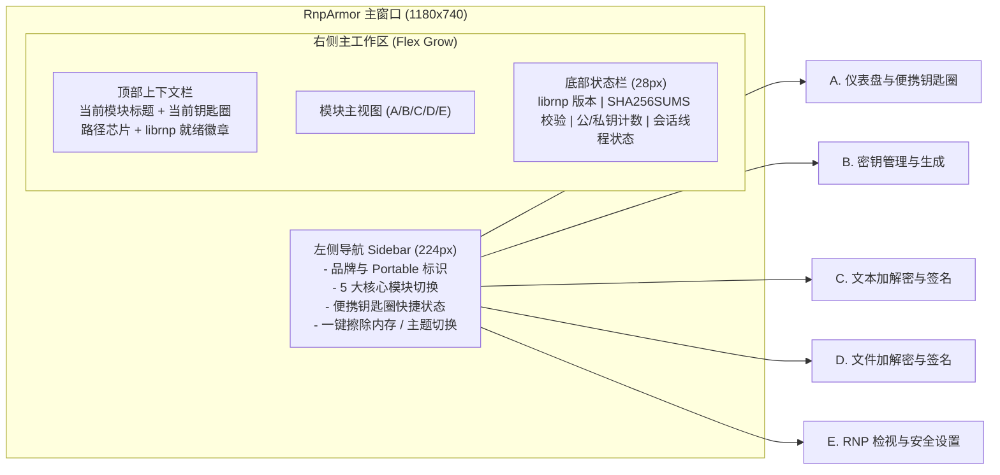
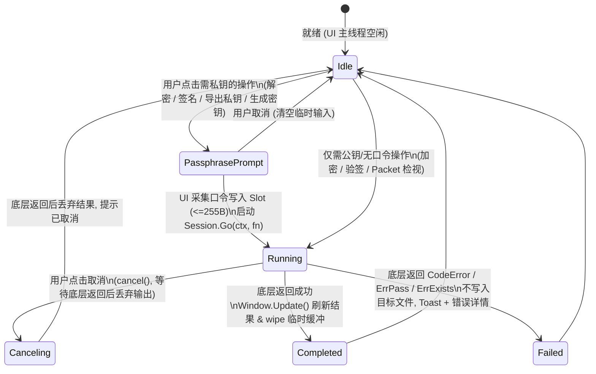

# RnpArmor 易用性 UI/UX 设计规范与 MyGo 组件映射方案

> **适用版本**：RnpArmor Windows Portable（单目录绿色版，基于 `github.com/egoist/mygo v0.10.0` + `librnp v0.18.1` + `Botan 3.10.0`）  
> **参考代码基线**：`origin/cursor/rnp-vertical-slice-a1be`（`internal/rnp/`、`cmd/rnparmor/main.go`）  
> **配套高保真交互原型**：`docs/ui-prototype/index.html`（支持中/日/英三语实时切换及无菜单独立 About 页；对比截图见 `preview-zh.png`、`preview-ja.png`、`preview-en.png`、`preview-about.png` 及 `preview.png`）

---

## 1. 设计目标与易用性核心原则

RnpArmor 的核心定位是**面向 Windows 10/11 的便携式、免安装、零外部依赖 OpenPGP 桌面图形界面**。传统 PGP 工具（如 Kleopatra / GPG4Win）常因术语密集、隐式信任模型复杂、系统钥匙圈路径黑盒而造成高门槛与误操作风险。本方案围绕以下 4 项易用性原则展开设计：

### 1.1 双层复杂度（Progressive Disclosure / 渐进式披露）
- **默认安全层（普通用户 80% 场景）**：主路径隐藏低频密码学参数，默认锁定 RNP 推荐安全基线（`EdDSA` 主钥 + `ECDH Curve25519` 子钥、`AES256`、`SHA256`、ASCII Armor），通过清晰中文动词引导“选钥匙 → 选内容 → 一键执行”。
- **专家完整层（高级用户 20% 场景）**：通过 MyGo 原生 `ui.Collapsible` / `ui.Accordion` 按需展开完整 RNP 能力（全套非对称/对称/哈希/压缩算法、子钥独立用途与到期时间、S2K 迭代基准调优、OpenPGP Packet 二进制结构树检视）。

### 1.2 安全语义前置化（Security-by-UI）
严格将 `AGENTS.md` 与 `internal/rnp` 的安全不变量显性化为界面状态：
1. **显式便携钥匙圈**：顶部/侧栏常驻显示当前显式加载的钥匙圈目录，明示“**不读取系统默认 GPG / `%APPDATA%` 钥匙圈**”；未加载目录时明确标示“内存临时会话”。
2. **数学验签与身份信任强制解耦**：对应 `rnp.VerifyResult{MathValid, IdentityTrusted}`，验签结果卡片**拆分为两个独立徽章**——“数学验签：有效 / 无效”与“身份信任：未验证（RnpArmor 不内置信任网/WoT）”，杜绝误导用户将数学通过当成身份可信。
3. **默认防覆盖保护**：文件输出与钥匙圈保存路径在 UI 层前置检测文件存在性，若目标文件已存在即标红阻止并建议新文件名，与底层 `O_EXCL` / `renameat2(RENAME_NOREPLACE)` 双重兜底一致。
4. **口令与内存边界透明**：输入框约束口令 ≤ 255 字节，输入文件上限提示 32 MiB（输出缓冲上限 40 MiB），提供随时可触发的“清空并擦除会话内存（`wipe`）”操作。

### 1.3 非阻塞交互与线程安全体验
- 所有 `librnp` 耗时操作（密钥生成、大文件加解密、S2K 基准测算）必须经由 `Session.Go` 在锁定 OS 线程上串行执行，UI 层展示明确的运行态徽章与不可重入保护（同会话内禁用冲突提交按钮）。
- **取消语义诚实告知**：由于底层 C 调用无法在执行中途强行中断，运行态明确提示“点击取消将在当前底层调用返回后丢弃未发布的输出，不会写入目标文件”。
- **口令采集不重入**：严格遵守“口令回调在持有 `librnp` 锁的线程上同步执行、禁止在回调中弹窗重入会话”的约束——所有需要私钥口令的操作，均在**发起 `Session.Go` 前**由 UI 层先通过 `ui.Modal` 收集口令字节并写入 slot（`Session.SetPassphrase`），操作结束后立即 `wipe` 临时字节切片。

### 1.4 视觉与人机工效规范
- **窗口规格**：默认 `1180 × 740` DIP（最小 `960 × 640` DIP），严格适配 Windows 10/11 高 DPI 缩放。
- **色彩与主题**：直接沿用 `egoist/mygo/ui` 内置 `LightTheme()` / `DarkTheme()` 语义令牌（主色 `#2563eb`、成功 `#16a34a`、警示 `#d97706`、危险 `#dc2626`、基距 `Spacing = 4`、圆角 `Radius = 6`、Windows 正文字号 `14px`），零自定义侵入式样式，确保与原生 GPU 渲染质感一致。
- **信息排版**：指纹、KeyID、ASCII Armored PGP 块与 Packet 十六进制偏移一律采用等宽字体（`Consolas` / `Cascadia Mono` / `monospace`），指纹按 4 字符分组展示以降低人工核对错误率。

---

## 2. 全局信息架构（Information Architecture）

采用桌面工具效率最高的 **左侧导航栏（`224px`）+ 右侧自适应工作区 + 底部单行状态栏** 架构：



### 2.1 核心异步操作与口令交互状态机



---

## 3. 五大核心模块详细交互规范

### 模块 A：仪表盘与便携钥匙圈状态（Portable Keyring & Workspace）
- **定位**：打开应用后的首屏“安全驾驶舱”，3 秒内看清运行库校验、当前钥匙圈位置与最常用任务入口。
- **核心分区**：
  1. **便携钥匙圈工作区卡片**：
     - 展示当前显式加载目录绝对路径（例如 `D:\Tools\RnpArmor\keyrings\work-2026`），若未加载则明确提示“当前为纯内存临时会话（不会自动读写 `%APPDATA%` 或 `~/.gnupg`）”。
     - 展示 `pubring.gpg` / `secring.gpg` 加载状态、公/私钥数量（对应 `Session.Counts`）及未保存变更提示（Dirty 标记）。
     - 操作按钮：`加载钥匙圈目录…`（`mygo.Dialog.Open{Directory: true}`）、`保存至新目录…`（防覆盖校验）、`新建空白临时会话`。
  2. **运行时与完整性校验卡片**：
     - 展示 `librnp` 版本字符串（`rnp_version_string`）、DLL 绝对路径、`SHA256SUMS` 校验状态（绿色“已通过”）以及底层静态依赖概要（Botan 3.10.0 / json-c 0.19 / 静态 zlib & bzip2）。
  3. **快捷任务入口（2×2 卡片网格）**：
     - `生成推荐安全密钥` → 直接跳转模块 B 并打开密钥生成向导。
     - `加密 / 解密文本` → 跳转模块 C。
     - `文件加密与签名` → 跳转模块 D。
     - `检视 PGP 数据包` → 跳转模块 E。
  4. **安全边界提示条（只读常驻）**：清晰告知三项核心约束——“不读取系统默认钥匙圈”、“数学验签成功 ≠ 身份可信”、“单文件上限 32 MiB，绝不覆盖已有输出文件”。

---

### 模块 B：密钥全生命周期管理与生成（Key Management & Generation）
- **定位**：主从式（Master-Detail）双栏管理视图，兼顾大钥匙圈检索与细粒度子钥/吊销操作。
- **顶部工具栏**：
  - 筛选分段器（`ui.Segmented`）：`全部` | `含私钥` | `仅公钥` | `已吊销/过期`。
  - 实时搜索框：支持按 UserID、邮箱、40 位指纹、16 位 KeyID 即时过滤。
  - 操作按钮：`+ 生成新密钥`（主按钮）、`导入密钥 (.asc/.gpg)`、`保存钥匙圈至目录`。
- **主体双栏布局（`ui.Split`，左侧列表自适应，右侧抽屉默认 `390px`）**：
  - **左侧密钥表（`ui.Table`）**：列包括 `UserID / 邮箱`、`类型（私钥+公钥 / 公钥）`、`算法`、`KeyID / 指纹末 8 位`、`到期时间`、`状态徽章（有效 / 即将过期 / 已吊销）`，支持点击表头排序与列宽拖拽。
  - **右侧密钥详情抽屉**：
    - 摘要头：UserID、完整 40 位指纹（4 位分组 + 一键复制）、保护状态（如 `AES256-CFB · S2K 131,072 次迭代`）与吊销状态。
    - **主钥与子钥结构树（`ui.Tree`）**：清晰呈现 Primary Key 与每个 Subkey 的 KeyID、算法/曲线（如 `EdDSA (Ed25519)`、`ECDH (Curve25519)`）、用途标签（`Certify` / `Sign` / `Encrypt` / `Auth`）、有效期与保护状态。
    - **生命周期操作区**：
      - 导出公钥（支持 `.asc` ASCII Armor 与 `.gpg` 二进制格式选择）。
      - 导出私钥（醒目警示色，执行前弹出二次确认 + 口令校验）。
      - 子钥管理（添加加密/签名/认证子钥）。
      - 吊销管理（生成吊销证书 `.rev.asc` 供离线备份，或导入吊销证书吊销密钥）。
- **易用型密钥生成向导（`ui.Modal`）**：
  - **模式切换（`ui.Segmented`）**：`推荐安全预设（适合绝大多数用户）` | `高级自定义模式（RNP 全算法）`。
  - **推荐模式（3 项必填，极简降噪）**：
    1. 身份标识：姓名 + 邮箱 + 可选备注（实时预览标准 `Name (Comment) <email>` 格式 UserID）。
    2. 保护口令 + 确认口令（实时校验非空、一致、≤ 255 字节，提供口令强度提示条）。
    3. 有效期：`2 年（推荐）` / `1 年` / `5 年` / `永不过期`。
    - 底部只读摘要条显示锁定参数：`主钥 EdDSA (Ed25519) [Sign, Certify] + 子钥 ECDH (Curve25519) [Encrypt] · AES256 / SHA256`。
  - **高级自定义模式（完整覆盖 RNP 参数）**：
    - **主钥配置**：算法（`EdDSA`、`RSA` [2048/3072/4096]、`ECDSA` [NIST P-256 / P-384 / P-521 / secp256k1]、`DSA` [2048/3072]）、哈希算法（`SHA256` / `SHA384` / `SHA512` / `SHA3-256` / `SHA3-512`）、主钥用途多选（`certify` / `sign` / `encrypt` / `auth`）。
    - **子钥独立配置**：开关“同时生成独立子钥”、子钥算法（`ECDH` [Curve25519 / NIST P-256 / P-384 / P-521 / secp256k1]、`RSA` [2048/3072/4096]、`ElGamal` [2048/3072]、`EdDSA`、`ECDSA`）、子钥用途多选（`encrypt` / `sign` / `auth`）、独立有效期。
    - **私钥保护（S2K）配置**：对称加密算法（`AES256` / `AES192` / `AES128`）、保护哈希（`SHA256` / `SHA384` / `SHA512`）、S2K 迭代次数（支持自动按目标毫秒如 `150ms` 调用 `rnp_calculate_iterations` 或手动指定）。

---

### 模块 C：文本内容加解密与签名验签工作台（Text Crypto & Sign Studio）
- **定位**：高频剪贴板/邮件/即时通信内容处理的单屏双栏工作台。
- **顶部操作模式分段器（`ui.Segmented`）**：
  - `加密` | `解密` | `签名` | `验签` | `加密并签名`。
- **上下文参数条（随模式动态收敛，只显示当前模式需要的选项）**：
  - **加密 / 加密并签名**：
    - 加密方式切换：`公钥加密（多收件人）` vs `纯口令对称加密（无需对方公钥）`。
    - 收件人多选列表（可勾选多位收件人，显示已选芯片计数）+ 高级折叠区（对称加密算法 `AES256/192/128`、压缩开关）。
  - **签名 / 加密并签名**：
    - 签名私钥下拉选择（仅列出包含可用 `sign` 能力私钥的条目）。
    - 签名格式单选（仅“签名”模式）：`Clearsign 明文签名`（人类可读原文 + 签名尾块）、`Detached 分离签名`（仅输出签名块）、`Inline 内联签名`（整体封装）。
    - 摘要哈希算法（默认 `SHA256`，折叠区可选 `SHA384/512/SHA3`）。
  - **解密**：自动检测密文类型（公钥加密或口令加密），执行时提示输入对应私钥或对称口令。
  - **验签**：自动识别 Clearsign / Inline 签名文本；若为分离签名，可切换显示“分离签名块”附加输入框。
- **左右分栏编辑与输出区（`ui.SplitPercent` 50/50）**：
  - 左栏：输入明文/密文 `ui.TextArea`（含字符/字节计数、一键“从剪贴板粘贴”、一键“清空”）。
  - 右栏：ASCII Armored / 明文结果 `ui.TextArea`（只读可选中，等宽字体）+ 顶部操作栏（`复制结果`、`清空并擦除内存`）+ **状态徽章区**。
  - 验签专属双徽章反馈：
    - 徽章 1：`数学验签：有效（RNP_SUCCESS）` 或 `数学验签：失败（内容被篡改或缺少公钥）`。
    - 徽章 2：`身份信任：未验证（仅证明与当前钥匙圈内 KeyID 数学匹配）`（醒目琥珀色信息提示）。

---

### 模块 D：文件加解密与签名验签工作台（File Crypto & Sign Workbench）
- **定位**：面向本地文档、压缩包与发布物的零覆写安全批处理/单文件工作台。
- **顶部操作模式分段器（`ui.Segmented`）**：
  - `加密` | `解密` | `分离签名` | `内联签名` | `验签`。
- **表单流式卡片**：
  1. **源文件选择**：只读路径框 + `浏览文件…` 按钮（`mygo.Dialog.Open`），选中后实时显示文件大小与 **32 MiB 上限校验状态**（超限时立即阻断并给出明确原因）。
  2. **签名文件选择（仅“验签”分离签名模式显示）**：选择 `.sig` / `.asc` 分离签名文件。
  3. **目标输出路径（非验签模式显示）**：
     - 路径输入框 + `另存为…` 按钮（`mygo.Dialog.Save`）。
     - **智能后缀建议**：加密 + Armor ON → 自动建议 `<原文件>.asc`；加密 + Armor OFF → `<原文件>.gpg`；分离签名 → `<原文件>.sig`（或 `.asc`）；解密 → 自动剥离 `.asc`/`.gpg` 并附加防冲突序号。
     - **防覆盖实时校验条**：若目标路径已存在同名文件，明确弹出红色防覆盖提示（“目标文件已存在，RnpArmor 禁止覆盖已有文件，请修改文件名”）并禁用执行按钮；提供一键“自动生成不冲突文件名（如 `_1`）”快捷按钮。
  4. **密钥与参数配置**：
     - 依据当前模式显示收件人多选 / 签名私钥选择 / 对称口令开关。
     - 高级参数折叠面板（`ui.Collapsible`）：`ASCII Armor` 开关、压缩算法（`ZLIB` / `BZIP2` / `ZIP` / `Uncompressed`）、对称加密算法（`AES256` / `AES192` / `AES128`）、哈希算法（`SHA256` / `SHA384` / `SHA512`）。
  5. **执行栏与详细结果反馈卡片**：
     - 主按钮（如 `开始加密文件`）+ 运行中出现的 `取消（返回后丢弃输出）` 按钮。
     - 结果反馈卡片展示：操作状态、输入/输出路径（支持“打开所在目录”）、文件字节数、耗时、防覆盖新建写入确认（`O_EXCL / NOREPLACE`）、验签双态徽章与签名者 KeyID / 创建时间戳。

---

### 模块 E：RNP 高级功能与数据包检视器（RNP Inspector & Settings）
- **定位**：将 RNP 强大的底层诊断能力以清晰直观的图形界面释放给进阶用户，同时集中管理便携模式安全策略。
- **三大子功能（通过顶部 `ui.Tabs` 切换或分区卡片呈现）**：
  1. **OpenPGP 数据包检视器（`rnp_dump_packets`）**：
     - 输入来源：粘贴任意 ASCII Armored PGP 文本，或点击 `加载本地文件…` 读取 `.asc`/`.gpg`/`.sig`。
     - 视图切换：`可视化 Packet 结构树（ui.Tree）` | `原始 JSON / 文本转储`。
     - 结构树左栏展示 Packet 列表（Tag 编号、类型名如 `Public-Key Encrypted Session Key (Tag 1)`、`Symmetrically Encrypted and Integrity Protected Data (Tag 18)`、`Signature (Tag 2)`、`Public-Key (Tag 6)`、字节偏移与长度）；右栏展示选中 Packet 的关键字段（版本、算法、KeyID、MDC/AEAD 状态、子包列表），零命令行门槛排查 PGP 兼容性问题。
  2. **S2K 耗时基准测试（`rnp_calculate_iterations`）**：
     - 选择哈希算法（`SHA256` / `SHA384` / `SHA512`）与目标派生耗时（`100 ms` / `250 ms` / `500 ms` / 自定义毫秒）。
     - 点击 `运行本机基准测算` 在工作线程执行，展示测算得出的推荐迭代次数（如 `163,840 iterations @ 150ms`）与安全强度评级，支持一键“设为密钥生成默认 S2K 迭代值”。
  3. **便携模式与安全策略设置**：
     - **内存擦除策略**：操作完成后自动擦除临时明文/口令缓冲（强制开启，只读展示以明示保障）、窗口最小化或空闲超时后自动清空工作台输入/输出区（可配置 `关闭` / `5 分钟` / `15 分钟`）。
     - **口令缓存策略**：默认 `每次操作重新输入（最安全）`，可选 `仅本次会话内存暂存（5 / 15 分钟后自动 wipe，严禁写入磁盘或 Windows 凭据库）`。
     - **紧急操作**：`立即锁定并擦除全部内存敏感数据`（清空口令 slot、工作台缓冲与剪贴板），以及当前便携目录运行环境核对清单。

---

## 4. `egoist/mygo/ui` (`v0.10.0`) 原生组件精确映射方案

基于 `github.com/egoist/mygo` (`ebde9399baf2734b3361856a53f4036859973d1d`, `v0.10.0`) 实际导出 API 的逐项映射（注：`mygo/ui` 不内置名为 `ui.Card` 的函数，卡片通过封装 `ui.Column` 样式辅助函数实现）：

| UI 元素 / 交互场景 | `egoist/mygo` 精确组件 / API | 关键属性与工程用法说明 |
| --- | --- | --- |
| 主窗口与根视图 | `mygo.NewWindow(mygo.WindowOptions{Width: 1180, Height: 740, Content: ui.View(app.view)})` | `app.view(c *ui.Context)` 纯声明式每帧构建，后台完成后通过 `win.Update()` / `Invalidate()` 触发重绘 |
| 左侧模块导航栏 | `ui.Sidebar(c, &app.navID, fn)` + `ui.SidebarSection` + `ui.SidebarItem` + `ui.Badge` | 固定 `.Width(224)`，自带键盘上下/首字母导航与 `RoleTree` 无障碍语义；`ui.Badge` 显示密钥数量 |
| 通用卡片容器（Card） | 自定义 helper `card(c, fn)` 基于 `ui.Column(c)` | `.Padding(t.Space(4)).Gap(t.Space(3)).Radius(t.Radius+2).Background(t.Surface).Border(1, t.Border)` |
| 模式切换（加密/解密/签名等） | `ui.Segmented(c, &modeIdx, "加密", "解密", "签名", "验签", "加密并签名")` | `.FillEqually().Label("操作模式")`，单 Tab 焦点站 + 方向键切换 |
| 子视图标签页（检视器/设置） | `ui.Tabs(c, &tabIdx, "数据包检视器", "S2K 基准测试", "安全策略")` | 内置下划线高亮与键盘左右切换 |
| 左右双栏工作台 / 主从抽屉 | `ui.Split(c, &drawerW, left, right)` / `ui.SplitPercent(c, &ratio, left, right)` | 支持拖拽分隔条与双击 `.SplitReset(...)` 复位 |
| 密钥列表表格 | `ui.Table(c, len(rows), cols, &app.keyTableState, cellFn)` | 虚拟化渲染，支持 `TableColumn{Sortable: true}` 排序与拖拽调宽，`ListState.Selected` 驱动右侧详情抽屉 |
| 密钥主钥-子钥树 & Packet 树 | `ui.Tree(c, fn)` + `ui.TreeItem(c, label, &node.Open, childrenFn)` | 完整支持方向键展开/收起；非常适合主钥/子钥层级及 `rnp_dump_packets` 数据包结构树 |
| 高级参数折叠面板 | `ui.Collapsible(c, "高级密码学参数", &app.advOpen, fn)` / `ui.Accordion` | 实现“渐进式披露”，自带展开平滑动画并响应系统减少动态偏好 |
| 表单与标签对齐 | `ui.Form(c, fn)` + `ui.Field(c, label, fn).Description(...).Error(...)` | 自动右对齐标签列、关联无障碍标签与红色行内校验错误 |
| 单行文本 / 搜索 / 口令输入 | `ui.TextInput(c, &val).Placeholder(...).MaxLength(255)` | 口令输入启用隐藏掩码，只读路径框使用 `.ReadOnly(true)`（保留可选中复制能力） |
| 文本明文/密文大编辑区 | `ui.TextArea(c, &val)` | 内置分段虚拟排版与垂直滚动，大段 ASCII Armor 块流畅编辑不卡顿 |
| 算法/曲线/密钥下拉选择 | `ui.Select(c, &selected, options)` | 自带滚动弹出面板与键盘高亮选择 |
| 多选用途/收件人/开关 | `ui.Checkbox(c, &checked, label)` / `ui.Toggle(c, &on, label)` | 支持 `ui.ToggleGroup` 组合开关 |
| 主操作与次级操作按钮 | `ui.PrimaryButton(c, label)` / `ui.Button(c, label)` / `ui.MenuButton` | 耗时操作运行期间设置 `.Disabled(app.busy)` 防止重入 |
| 密钥生成向导 & 口令弹窗 | `ui.Modal(c, &app.modalOpen, fn)` | 模态遮罩层，支持 Esc 关闭与焦点回退 |
| 原生文件/目录选择器 | `mygo.Dialog.Open(mygo.OpenDialogOptions{Directory: true/false, Filters: ...})` / `mygo.Dialog.Save(...)` | 在独立 goroutine 调用防止阻塞 UI 帧循环，返回绝对路径 |
| 轻提示与剪贴板反馈 | `c.Toast(msg)` / `c.AddToast(ui.Toast{Title: ..., Description: ..., Type: ...})` | 底部自动堆叠、悬停暂停计时、读屏播报 |

### 4.1 线程安全与口令采集编排模式（Go 伪代码示意）

```go
// 1. UI 线程：用户点击「执行解密」，打开 ui.Modal 采集口令（不直接调用 librnp）
// 2. 用户在 Modal 点击确认后：
passBytes := []byte(app.passInput) // 立即复制进临时 byte slice
app.passInput = ""                 // 清空 UI 字符串字段

app.busy = true
ctx, cancel := context.WithCancel(context.Background())
app.cancelOp = cancel

go func() {
    defer wipeBytes(passBytes) // 用毕立刻清零
    defer cancel()

    if err := app.session.SetPassphrase(passBytes); err != nil {
        app.postResult(opResult{Err: err})
        return
    }
    // Session.Do 内部已执行 runtime.LockOSThread() + 串行锁
    err := app.session.DecryptFile(ctx, srcPath, dstPath)
    _ = app.session.ClearPassphrase() // 若策略为“不缓存口令”，立即清零 slot
    app.postResult(opResult{Err: err, OutputPath: dstPath})
}()
// postResult 在持有轻量状态锁更新 app 状态后调用 win.Update() 触发 UI 重绘
```

---

## 5. 与现有 `internal/rnp` 的能力缺口对齐（供后端迭代参考）

当前 `worktrees/rnp-vertical-slice/internal/rnp/api.go` 已绑定基础密钥生成、文件加解密、分离签名/验签、显式 `SaveTo`/`LoadFrom` 与 `rnp_calculate_iterations`。为完整支撑本设计方案的 5 大模块，后续开发分支需按优先级补齐以下 `librnp v0.18.1` FFI 绑定：

| 所属模块 | 需新增 `librnp` C API 绑定 | 用途 |
| --- | --- | --- |
| 模块 B（密钥列表与详情） | `rnp_identifier_iterator_create/next/destroy`、`rnp_locate_key`、`rnp_key_get_fprint`、`rnp_key_get_keyid`、`rnp_key_get_alg`、`rnp_key_get_bits`、`rnp_key_get_curve`、`rnp_key_get_creation`、`rnp_key_get_expiration`、`rnp_key_is_primary/sub/protected/revoked`、`rnp_key_allows_usage`、`rnp_key_get_uid_count/at`、`rnp_key_get_subkey_count/at` | 渲染密钥表与主钥-子钥结构树 |
| 模块 B（全算法生成与导入导出） | `rnp_op_generate_set_bits`、`rnp_op_generate_set_expiration`、`rnp_key_export`、`rnp_key_export_revocation`、`rnp_key_revoke`、`rnp_import_keys` | 支持 RSA/ECDSA/ECDH/DSA/ElGamal、独立子钥、`.asc`/`.gpg` 导出与吊销 |
| 模块 C（文本工作台） | `rnp_op_sign_cleartext_create`、`rnp_op_sign_create`（inline）、`rnp_op_verify_create`、`rnp_op_encrypt_add_password`、`rnp_op_encrypt_add_signature`、`rnp_op_verify_signature_get_key` | 支持 Clearsign / Inline 签名、对称口令加密、加密并签名、显示签名者 KeyID |
| 模块 D（文件高级参数） | `rnp_op_encrypt_set_compression`、`rnp_op_sign_set_compression` | 支持 ZLIB / BZIP2 / ZIP / Uncompressed 压缩配置 |
| 模块 E（数据包检视器） | `rnp_dump_packets_to_json` / `rnp_dump_packets_to_output` | 可视化 Packet 结构树与原始转储 |


---

## 6. 多语言国际化（中 / 日 / 英 i18n）设计与 MyGo 组件绑定规范

为满足跨区域用户与多语言 Windows 桌面环境需求，RnpArmor 界面原生支持 **简体中文（`zh-Hans`）**、**日本語（`ja`）**、**English（`en`）** 三语实时无损切换。

### 6.1 三语切换器布局与无损切换原则
- **双入口布局（全局一致）**：
  1. **窗口顶部全局栏（Topbar 右侧）**：常驻紧凑型三语分段器 `中文 | 日本語 | English`，任意模块下可一键切换。
  2. **左侧导航栏底部便携状态区**：提供同步联动的紧凑三语分段器，方便用户与深色/浅色主题、一键内存擦除一同集中操作。
- **实时无损切换（State-Preserving Live Switch）**：
  - 切换语言时仅替换展示层文本目录，**绝不重置**当前选中的模块 Tab、子视图、已打开的密钥生成弹窗、用户输入中的明文/密文/文件路径、已勾选收件人集合或已生成的验签/文件执行结果卡片。
  - 动态结果（如验签状态徽章、文件写入反馈、S2K 基准结果、Packet 节点属性）以结构化数据保存在应用状态中，渲染时按当前语言实时格式化，确保切换语言后已展示的结果也同步变为目标语言。

### 6.2 CJK 字体回退与等宽排版规范
- **正文字体回退链（Windows 10/11 Portable 优先）**：
  - 简体中文：`"Segoe UI", "Microsoft YaHei UI", "PingFang SC", sans-serif`
  - 日语：`"Segoe UI", "Yu Gothic UI", "Meiryo", "Hiragino Sans", sans-serif`
  - 英文：`"Segoe UI", -apple-system, BlinkMacSystemFont, sans-serif`
  - 在 `egoist/mygo` 中遵循系统默认字体并结合 `App.SetLocale` 通知文本引擎选择对应地区字形（防止中日异体汉字混排失真）。
- **指纹 / KeyID / ASCII Armor 等宽排版**：
  - 统一使用 `"Cascadia Mono", "Consolas", monospace`，40 位十六进制指纹保持 4 字符分组（每 20 位双空格分隔），不受三语切换影响。
- **文本膨胀冗余（Expansion Budget）**：
  - 英文与日语操作标签通常较中文长 25%～45%；侧边栏宽度预留 `240 DIP`，键值属性列左栏预留 `138 DIP`，按钮与状态徽章采用 `SingleLine` + 合理弹性容器（`FlexWrap` / `Grow`），确保三语下均保持 `overflowCount == 0` 且无截断。

### 6.3 核心安全术语三语标准对照表

所有涉及密码学安全语义的文案在三语间严格保持语义对等，禁止使用误导性措辞（尤其是“数学验签”与“身份信任”的边界）：

| 术语概念 | 简体中文（`zh`） | 日本語（`ja`） | English（`en`） |
| --- | --- | --- | --- |
| 便携钥匙圈 | 便携钥匙圈 | ポータブル鍵束 | Portable Keyring |
| 显式加载目录 | 显式加载 | 明示読込 | Explicit Directory |
| 内存临时会话 | 内存临时会话 | メモリ一時セッション | Ephemeral Session |
| 数学验签有效 | 数学验签：有效（RNP_SUCCESS） | 署名検証（数学的）：有効（RNP_SUCCESS） | Math Signature: Valid (RNP_SUCCESS) |
| 身份信任未验证 | 身份信任：未验证（IdentityTrusted = false） | 身元信頼：未検証（IdentityTrusted = false） | Identity Trust: Unverified (IdentityTrusted = false) |
| 防覆盖保护 | 防覆盖保护（禁止覆盖已有文件） | 上書き防止保護（既存ファイル上書き禁止） | No-Overwrite Guard (Refuses Existing Files) |
| 清空并擦除内存 | 清空并擦除内存 | 消去してメモリをワイプ | Clear & Wipe Memory |
| 推荐安全预设 | 推荐安全预设（EdDSA + Curve25519） | 推奨セキュリティプリセット（EdDSA + Curve25519） | Recommended Preset (EdDSA + Curve25519) |
| 高级自定义模式 | 高级自定义模式（RNP 全算法） | 高度なカスタムモード（RNP 全アルゴリズム） | Advanced Custom Mode (Full RNP) |
| 分离签名 / 明文签名 / 内联签名 | 分离签名 / 明文签名 / 内联签名 | 分離署名 / クリアテキスト署名 / インライン署名 | Detached / Clearsign / Inline Signature |
| OpenPGP 数据包检视器 | OpenPGP 数据包检视器 | OpenPGP パケット検査 | OpenPGP Packet Inspector |
| S2K 耗时基准测试 | S2K 耗时基准测试 | S2K 反復回数ベンチマーク | S2K Iteration Benchmark |

### 6.4 `egoist/mygo` (`v0.10.0`) 三语组件与 `TextCatalog` 映射方案

`github.com/egoist/mygo v0.10.0` 原生提供 `App.SetLanguages`、`App.Locale`、`App.SetLocale`（见 `locale.go`）与声明式 `ui.Segmented` 控件。RnpArmor 推荐采用**显式静态 `TextCatalog` + `ui.Segmented` 驱动**方案，保证 Windows Portable 模式下零外部语言包文件依赖且不向 `%APPDATA%` 写入系统级偏好：

```go
type Lang int

const (
    LangEN Lang = iota // 0: "en"
    LangZH             // 1: "zh-Hans"
    LangJA             // 2: "ja"
)

type TextCatalog struct {
    NavDashboard       string
    NavKeys            string
    NavText            string
    NavFiles           string
    NavInspector       string
    VerifyMathValid    string
    VerifyTrustUnknown string
    BtnWipeMemory      string
    // ... 按模块分组定义全部字段，编译期零缺失校验
}

var catalogs = [...]TextCatalog{
    LangEN: {
        NavDashboard:       "Dashboard & Keyring",
        NavKeys:            "Keys & Generation",
        NavText:            "Text Crypto & Sign",
        NavFiles:           "File Crypto & Sign",
        NavInspector:       "RNP Inspector & Settings",
        VerifyMathValid:    "Math Signature: Valid (RNP_SUCCESS)",
        VerifyTrustUnknown: "Identity Trust: Unverified (IdentityTrusted = false)",
        BtnWipeMemory:      "Clear & Wipe Memory",
    },
    LangZH: {
        NavDashboard:       "仪表盘与钥匙圈",
        NavKeys:            "密钥管理与生成",
        NavText:            "文本加解密与签名",
        NavFiles:           "文件加解密与签名",
        NavInspector:       "RNP 检视与设置",
        VerifyMathValid:    "数学验签：有效（RNP_SUCCESS）",
        VerifyTrustUnknown: "身份信任：未验证（IdentityTrusted = false）",
        BtnWipeMemory:      "清空并擦除内存",
    },
    LangJA: {
        NavDashboard:       "ダッシュボードと鍵束",
        NavKeys:            "鍵管理・鍵生成",
        NavText:            "テキスト暗号化・署名",
        NavFiles:           "ファイル暗号化・署名",
        NavInspector:       "RNP 検査・設定",
        VerifyMathValid:    "署名検証（数学的）：有効（RNP_SUCCESS）",
        VerifyTrustUnknown: "身元信頼：未検証（IdentityTrusted = false）",
        BtnWipeMemory:      "消去してメモリをワイプ",
    },
}

// 启动初始化：注册受支持语言，根据系统语言自动选择初始 langIdx
func initLocale(app *AppState) {
    mygo.App.SetLanguages("en", "zh-Hans", "ja")
    switch mygo.App.Locale() {
    case "zh-Hans":
        app.langIdx = int(LangZH)
    case "ja":
        app.langIdx = int(LangJA)
    default:
        app.langIdx = int(LangEN)
    }
}

// 在 Topbar 或 Sidebar 中绑定三语切换器
func (app *AppState) renderLangSwitcher(c *ui.Context) {
    if ui.Segmented(c, &app.langIdx, "English", "中文", "日本語").Label("Language").Changed() {
        tags := [...]string{"en", "zh-Hans", "ja"}
        mygo.App.SetLocale(tags[app.langIdx]) // 同步更新原生控件、字体字形与系统菜单语言
    }
}

// 任意视图帧内直接读取当前语言目录（O(1) 无锁只读）
func (app *AppState) T() *TextCatalog { return &catalogs[app.langIdx] }
```

> **便携模式提示**：`mygo.App.SetLocale` 默认在未设置 `MYGO_LOCALE` 时会尝试持久化语言偏好；若要求严格零外部配置写入，可在便携启动配置中仅维护进程/便携目录内 `langIdx` 并配合静态 `catalogs[app.langIdx]` 驱动视图重绘。


---

## 7. 独立 About 页面（无菜单纯净视图）设计规范

为确保用户在核对软件出处、底层 `librnp` 引擎来源及当前便携密钥库绝对路径时不受功能菜单干扰，RnpArmor 提供**无菜单独立 About 页面（No-Menu Standalone View）**。

### 7.1 “无菜单”纯净布局与入口约束
- **进入入口**：主工作区顶部全局栏右侧与底部状态栏均提供 `关于 / 概要 / About` 轻量按钮。
- **核心布局红线（No Menu Layout）**：
  - 当 `app.showAbout == true` 时，**完全隐藏左侧导航菜单（`ui.Sidebar`）、顶部模块栏（Topbar）与工作区功能 Tab（`ui.Tabs`）**，避免将 About 混入左侧业务菜单树。
  - 视口切换为居中单列滚动卡片视图（最大宽度 `780 DIP`），顶部仅保留两项极简控制：
    1. 左侧：`← 返回工作区 / ← ワークスペースに戻る / ← Back to Workspace`（点击后无损恢复进入前的模块 Tab 与输入状态）。
    2. 右侧：紧凑三语切换器 `中文 | 日本語 | English`（支持在 About 页面直接实时切换三语）。

### 7.2 About 页面信息字段清单（三语与动态数据源）

所有路径与链接均采用等宽字体并配备一键复制按钮（调用 MyGo 剪贴板服务 + Toast 反馈）：

| 展示区块 | 中文 / 日文 / 英文标签 | 内容示例 / 动态来源 |
| --- | --- | --- |
| 应用标识 | RnpArmor | `Windows Portable OpenPGP Desktop GUI · Powered by MyGo & librnp` + `Windows x64 Portable` 版本徽章 |
| 作者 | 作者 / 作成者 / Author | `r404r`（`https://github.com/r404r`） |
| 项目仓库地址 | 项目仓库地址 / リポジトリ URL / Repository URL | `https://github.com/r404r/RnpArmor` |
| RNP 官方地址 | RNP 官方地址 / RNP 公式アドレス / RNP Upstream URL | `https://github.com/rnpgp/rnp`（`librnp v0.18.1` · Commit `aad1892e4d8423398a0b973bd0a7e4544c359afc`） |
| RNP 本地库路径 | RNP 本地库路径 / RNP ライブラリパス / RNP Library Path | 运行时 `rnp.DefaultLibrary()` 返回的绝对路径（如 `D:\RnpArmor\rnp.dll` / Linux `librnp.so`）+ `SHA256SUMS 已校验` 徽章 |
| 当前密钥库地址 | 当前密钥库地址 / 鍵束ディレクトリ / Keyring Directory | 动态读取当前显式加载目录（如 `D:\RnpArmor\keyrings\work`，附 `pubring.gpg`/`secring.gpg` 与公/私钥统计）；若为临时会话则显示内存临时状态，并常驻提示“绝不读写 `%APPDATA%\gnupg`” |
| GUI 与密码学依赖 | GUI 框架与底层密码学依赖 / GUI フレームワーク・暗号基盤 / UI Framework & Crypto Stack | `MyGo v0.10.0`（`https://github.com/egoist/mygo`）、`purego v0.11.1`、`Botan 3.10.0`、`json-c 0.19` + 静态 `zlib 1.4` / `bzip2 1.0.8` |

### 7.3 `egoist/mygo/ui` 条件渲染实现模式

在根视图 `app.view(c *ui.Context)` 最顶部通过早返回（early return）切换视图，从根源上保证进入 About 时**不构建 `ui.Sidebar` 与任何功能菜单节点**：

```go
func (app *AppState) view(c *ui.Context) {
    if app.showAbout {
        app.viewAbout(c) // 无 Sidebar、无 Tabs、无功能菜单栏
        return
    }
    app.viewWorkspace(c) // 常规主工作区（含 ui.Sidebar + Topbar + 5 模块）
}

func (app *AppState) viewAbout(c *ui.Context) {
    t, T := c.Theme(), app.T()
    ui.Scroll(c).Fill().Background(t.Surface).Children(func() {
        ui.Column(c).AlignItems(ui.Center).Padding(24).Children(func() {
            ui.Column(c).MaxWidth(780).FillWidth().Gap(14).Children(func() {
                ui.Row(c).Justify(ui.SpaceBetween).AlignItems(ui.Center).Children(func() {
                    if ui.Button(c, T.BtnBackToWorkspace).Clicked() {
                        app.showAbout = false
                    }
                    app.renderLangSwitcher(c) // 紧凑三语切换器
                })
                app.renderAboutHeroCard(c)
                app.renderAboutCoreInfoCard(c) // 作者、仓库、RNP 地址/路径、当前密钥库路径
                app.renderAboutDepsCard(c)     // MyGo / purego / Botan / json-c
            })
        })
    })
}
```
